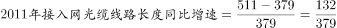
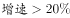
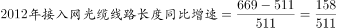
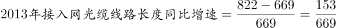
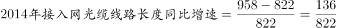
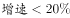
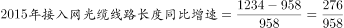
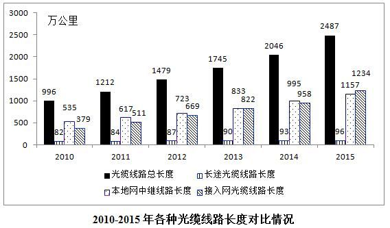

# 同比增长率比较（超阈值年份计数）

考点：[[20-考点/资料分析/增长/同比增长率比较（超阈值年份计数）|增长 / 同比增长率比较（超阈值年份计数）]]
材料：[[15-材料/资料分析/184986 2010-2015年全国各种光缆线路|184986 2010-2015年全国各种光缆线路]]

**问法模型**：题干问'2011-2015年接入网光缆线路长度同比增速超过（20%）的年份有几个'→逐年套用r=(当年值-上年值)/上年值计算增速并与阈值比较，数出满足条件的年份个数

## 推理链
1. 第1步：按图例（斜纹柱）从图中读出接入网光缆线路长度（万公里）：2010年379、2011年511、2012年669、2013年822、2014年958、2015年1234。
2. 第2步：同比增速模型r=(当年-上年)/上年，逐年对2011-2015五个年份计算，分母均为上一年数值。
3. 第3步：2011年(511-379)/379=132/379≈34.8%（首位商3）、2012年(669-511)/511=158/511≈30.9%（首位商3），均超过20%。
4. 第4步：2013年(822-669)/669=153/669≈22.9%（首位商2），超过20%。
5. 第5步：2014年(958-822)/822=136/822≈16.5%（首位商1），未超过20%。
6. 第6步：2015年(1234-958)/958=276/958≈28.8%（首位商2），超过20%。
7. 第7步：超过20%的年份为2011、2012、2013、2015共4个，与选项C(4)对照，故选C。

**最快解法**：⚡ 首位商法（截位直除）：逐年只算'增长量÷上年值'的首位商——132/379、158/511、153/669、136/822、276/958，首商依次为3、3、2、1、2，首位≥2即增速超20%，仅2014年商1不满足，直接得4年选C；更省力的口诀是'增速>20%⇔增长量>现期/6'，只需比大小（如136<958/6≈160即2014年不超），免算百分数。

## 易错点
- ⚠ 基期逐年前移：每年增速的分母是上一年数值（如2011年分母是2010年的379），若全用2011年或现年作分母则全盘皆错。
- ⚠ 数据读柱：接入网是斜纹柱（379→511→669→822→958→1234），勿与本地网中继柱（617→723→833…）混淆；单位'万公里'分子分母一致不影响增速，但读错柱则全错。
- ⚠ 末年陷阱：接入网逐年都在增长，易凭'年年增长'误选D(5)个；须逐项比较阈值，2014年16.5%明显不足20%，2013年22.9%虽接近但确实超过，恰为4个。

## 母题抽象
> 🧩 当题干出现'某指标2011-2015年同比增速超过X%的年份有几个'时，先按图例逐年读数，用首位商法或'增长量>现期/6⇔增速>20%'逐项判定，再数出满足年份个数对照选项。

**同类特征**：2011-2015年、同比增速超过、接入网光缆线路长度、年份有几个、逐年增长率与阈值比较、分组柱状图逐年读数

## 相关题
- [[10-真题/资料分析/增长/13504272 一般增长率计算与计数比较（同比增速-5%年份计数）|13504272]]（云南 2025，相关度1）
- [[10-真题/资料分析/增长/16070145 同比增长率比较（逐年增速计算并计数年份）|16070145]]（贵州 2026，相关度1）
- [[10-真题/资料分析/比重/2024186 增量比重（新建量中分项占比，分母为总长度增量）|2024186]]（重庆 2016，相关度1）
- [[10-真题/资料分析/增长/2188348 两期数值比较（逐期增减判断计数）|2188348]]（江西 2018，相关度1）
- [[10-真题/资料分析/比重/2662229 现期比重比较（占比过半判断）|2662229]]（新疆 2020，相关度1）

---

### 题干

2011-2015年接入网光缆线路长度同比增速超过的年份有几个：

### 选项
- A. 2
- B. 3
- C. 4　✅
- D. 5

### 官方解析

由“…同比增速超过…”，判断题型为一般增长率问题。

，首位商3，故；

，首位商3，故；

，首位商2，故；

，首位商1，故；

，首位商2，故。

共有4个年份增速大于。

故正确答案为C。

### 给定材料

> [!warning] 疑点（官方解析可能有误，待人工复核）
> 题干显示中阈值数字缺失，官方解析亦以省略形式呈现；由解析首位商（3、3、2、1、2）与答案C(4个)可反推阈值为20%，与各年增速34.8%/30.9%/22.9%/16.5%/28.8%的对照自洽，官方解析本身无错误。

<!-- CODEX-ANSWER-REVIEW:BEGIN -->
### 本次独立复核

**复核状态：** `resolved`（答案与解析已核定）

**计分答案：** C（可计分）

**复核解析：**

阈值图公式可读为20%。图中接入网光缆线路长度2010—2015依次为379、511、669、822、958、1234。逐年增速：2011=(511−379)/379≈34.83%；2012=(669−511)/511≈30.92%；2013=(822−669)/669≈22.87%；2014=(958−822)/822≈16.55%；2015=(1234−958)/958≈28.81%。超过20%的年份为2011、2012、2013、2015，共4年，选C。

**相关信息：**

题干图像缺失的阈值确为20%，不是由答案反推；逐年基数与现期来自图中接入网光缆系列。

**题源依据：** [固定版本原题](https://github.com/Mentat-Uran/kaogongzhentizhengliu/blob/84ab93d4b64b61d897bece8a1c0a5bab06b4feb2/10-%E7%9C%9F%E9%A2%98/%E8%B5%84%E6%96%99%E5%88%86%E6%9E%90/%E5%A2%9E%E9%95%BF/2024184%20%E5%90%8C%E6%AF%94%E5%A2%9E%E9%95%BF%E7%8E%87%E6%AF%94%E8%BE%83%EF%BC%88%E8%B6%85%E9%98%88%E5%80%BC%E5%B9%B4%E4%BB%BD%E8%AE%A1%E6%95%B0%EF%BC%89.md)；固定内容 commit `84ab93d4b64b61d897bece8a1c0a5bab06b4feb2`，Markdown blob `14a8945c1c30dd96593ab8ac5649426cb7787f6c`。
<!-- CODEX-ANSWER-REVIEW:END -->
