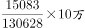
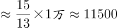
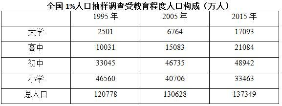

# 增长量计算（基期需跨口径换算：万人→每10万人）

考点：[[20-考点/资料分析/增长/增长量计算（基期需跨口径换算：万人→每10万人）|增长 / 增长量计算（基期需跨口径换算：万人→每10万人）]]
材料：[[15-材料/资料分析/184988 全国1%人口抽样调查下1995—20|184988 全国1%人口抽样调查下1995—20]]

**问法模型**：题干问'相比2005年，2010年每10万人中高中人口上升/减少多少人' → 先把表格2005年万人绝对数按'÷总人口×10^5'折算为每10万人口径，再与文字段2的2010年率作差定升降

## 推理链
1. 第1步：从文字段2提取2010年基期值：'高中由14032人上升为15350人'，即2010年每10万人中高中人口=14032人（15350是2015年，勿误用）
2. 第2步：2005年数据只能由表格取：高中15083万人、总人口130628万人，单位为万人，必须换算成'每10万人中人数'口径
3. 第3步：换算公式：每10万人高中人数=高中人口/总人口×100000=15083/130628×10^5
4. 第4步：代入计算：15083/130628≈0.11547，×10^5≈11547人，即2005年每10万人中高中人口约11547人
5. 第5步：作差：14032−11547=2485人，差为正即'上升'
6. 第6步：与选项对照：上升2485人与C项完全吻合（排除B、D的'减少'方向及A的1318人），故选C

**最快解法**：⚡ 截位直除+口径统一：15083/130628≈1508/13063≈11.55%，故2005年每10万高中≈11550人；14032−11550≈2480，最接近2485且方向为上升，秒选C

## 易错点
- ⚠ 口径混排陷阱：表格是'万人'、文字段2是'每10万人中…人'，直接用14032与15083或15350作差必错，必须先除以总人口×10^5统一为率口径
- ⚠ 时点误判陷阱：勿把文字段2'由14032上升为15350'中的14032当成2005年值（它是2010年基期），也勿把15350（2015年）当成2010年数据
- ⚠ 换算量级陷阱：万人→每10万人须乘100000÷总人口(万人)，勿只乘10^4或忘记除以总人口；同时由14032>11547确认方向为'上升'，排除B、D

## 母题抽象
> 🧩 当题干要求把表格'万人'绝对数与文字'每10万人中X人'的率口径跨源比较时，先用 率=该类人口/总人口×10^5 把基期折算成同一口径，再对目标时点作差并依差的正负判断'上升/减少'选答案

**同类特征**：相比于2005年，2010年、每10万人中具有高中教育程度的人口、上升了/减少了+具体人数（增长量问法）、表格与文字公报跨源拼合、万人与'人'单位相差10^4量级需换算、基期2005数据未直接给出率、需折算

## 相关题
（暂无）

---

### 题干
相比于2005年，2010年每10万人中具有高中教育程度的人口：

### 选项
- A. 上升了1318人
- B. 减少了1051人
- C. 上升了2485人　✅
- D. 减少了2185人

### 官方解析

根据选项“上升（减少）了……人”，可知此题为增长量计算问题。定位文字材料第二段，可知2010年每10万人中具有高中教育程度的人口为14032人；定位表格，可知2005年，高中教育程度人口为15083万人，总人口130628万人，因，则有，，结果与C项最接近。

故正确答案为C。

### 给定材料

        2005年全国人口抽样调查主要数据公报显示，同2000年第五次全国人口普查相比，2005年具有大学教育程度的人口增加2193万人；具有高中教育程度的人口增加974万人；具有初中教育程度的人口增加3746万人，具有小学教育程度的人口减少4485万人。

        2015年全国人口抽样调查主要数据公报显示，同2010年第六次全国人口普查相比，2015年每10万人中具有大学教育程度的人口由8930人上升为12445人；具有高中教育程度人口由14032人上升为15350人；具有初中教育水平人口由38788人下降到35633人；具有小学教育程度人口由26779人下降为24356人。

