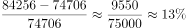
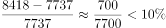
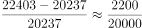
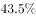
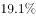
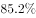
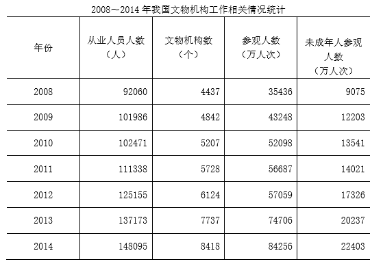

# 同比增速比较（增长率大小比较）

考点：[[20-考点/资料分析/增长/同比增速比较（增长率大小比较）|增长 / 同比增速比较（增长率大小比较）]]
材料：[[15-材料/资料分析/185154 我国文物机构（含博物馆）2008～2|185154 我国文物机构（含博物馆）2008～2]]

**问法模型**：题干以『2014年……相关指标同比增速最快的是』并列四个统计指标 → 对每个选项分别用增长率公式（现期−基期）/基期计算后比大小

## 推理链
1. 第1步：从统计表提取2013年（基期）与2014年（现期）数据：从业人员137173→148095人、文物机构数7737→8418个、参观人数74706→84256万人次、未成年人参观人数20237→22403万人次
2. 第2步：同比增速公式＝(现期−基期)/基期＝增长量/基期，四个指标单位不同但各自求率无需统一单位
3. 第3步：代入计算：从业人员10922/137173≈8.0%；文物机构数681/7737≈8.8%；参观人数9550/74706≈12.8%；未成年人参观人数2166/20237≈10.7%
4. 第4步：比较四个率：12.8%＞10.7%＞8.8%＞8.0%，参观人数增速最大，对应选项B

**最快解法**：⚡ 截位直除速比：先求各增长量（10922、681、9550、2166），再除以各自基期取首两位：1.1万/13.7万≈8%、6.8/77≈8.8%、9.6/74.7≈12.8%、2.2/20.2≈10.7%，一眼锁定参观人数12.8%最大

## 易错点
- ⚠ 只比增长量会误选A：从业人员增长量10922人反而比参观人数9550万人次大，但基期137173远大于74706，增长量大≠增速快，必须除以各自基期
- ⚠ C与D排序陷阱：未成年人参观人数增速10.7%高于文物机构数8.8%，不能凭增量小（2166＜681×10量级错乱）或直觉错排
- ⚠ 文段中基本陈列、临时展览、接待观众后的增速百分数在材料中留空，不能凭印象填数，本题四个选项均须回到表格用2013年基期现算；另注意参观人数单位为『万人次』（84256万人次≈8.43亿），求增速时基期现期同单位不影响结果，但读数勿串列

## 母题抽象
> 🧩 当题干出现『某年××相关指标同比增速最快/最慢』且选项为多个不同指标时，用（现期−基期）/基期对每个选项统一求率，再截位直除比大小；若各基期相近可先比增量初筛，基期悬殊必须除基期

**同类特征**：同比增速最快、四个候选指标并列、现期2014 vs 基期2013、表格多列指标统一求增长率、增长率大小比较、跨列取数、单位各异

## 相关题
- [[10-真题/资料分析/增长/10204493 同比增速（一般增长率）比较|10204493]]（甘肃 2024，相关度2）
- [[10-真题/资料分析/增长/16437523 同比增速比较（增长率大小比较）|16437523]]（山东 2024，相关度2）
- [[10-真题/资料分析/增长/4673212 同比增长率（同比增幅）大小比较|4673212]]（广东 2022，相关度1）
- [[10-真题/资料分析/增长/14403675 同比增长率比较（逐年增速取最大）|14403675]]（山东 2025，相关度1）
- [[10-真题/资料分析/增长/17097815 同比增速（增长率）大小比较|17097815]]（山西 2024，相关度1）

---

### 题干
2014年，我国文物机构相关指标同比增速最快的是：

### 选项
- A. 从业人员数
- B. 参观人数　✅
- C. 文物机构数
- D. 未成年人参观人数

### 官方解析

根据题干“2014年，文物机构相关指标同比增速最快的是”，可判定本题为一般增长率问题。定位表格材料，根据公式：，可得，

从业人员人数增长率：；

参观人数增长率：；

文物机构数增长率：；

未成年人参观人数增长率：。

比较可得，参观人数的同比增速最快。

故正确答案为B。

### 给定材料

        截至2014年末，我国共有博物馆3658个，占文物机构总数的。全国文物机构拥有文物藏品4063.58万件，比上年末增加222.77万件。其中，博物馆文物藏品2929.97万件，文物商店文物藏品770.00万件。文物藏品中，一级文物9.82万件，二级文物68.82万件，三级文物340.51万件。

        2014年全国文物机构共安排基本陈列9996个，比上年增长；举办临时展览11174个，增长；接待观众84256万人次，增长，其中博物馆接待观众71774万人次，占文物机构接待观众总人次的。

> [!warning] 疑点（官方解析可能有误，待人工复核）
> 官方解析中公式与四项增长率的具体算式数字因排版缺失而留空，但其比较结论与表格数据核算结果（参观人数约12.8%最大）一致，答案B无误

<!-- CODEX-ANSWER-REVIEW:BEGIN -->
### 本次独立复核

**复核状态：** `resolved`（答案与解析已核定）

**计分答案：** B（可计分）

**复核解析：**

2014年四项相对2013年同比增速：从业人员(148095−137173)/137173≈8.0%；文物机构数(8418−7737)/7737≈8.8%；参观人数(84256−74706)/74706≈12.8%；未成年人参观人数(22403−20237)/20237≈10.7%。参观人数最快，B。

**相关信息：**

四项基数均取各自2013年；人数类和机构数口径不得交叉。

**题源依据：** [固定版本原题](https://github.com/Mentat-Uran/kaogongzhentizhengliu/blob/84ab93d4b64b61d897bece8a1c0a5bab06b4feb2/10-%E7%9C%9F%E9%A2%98/%E8%B5%84%E6%96%99%E5%88%86%E6%9E%90/%E5%A2%9E%E9%95%BF/2028280%20%E5%90%8C%E6%AF%94%E5%A2%9E%E9%80%9F%E6%AF%94%E8%BE%83%EF%BC%88%E5%A2%9E%E9%95%BF%E7%8E%87%E5%A4%A7%E5%B0%8F%E6%AF%94%E8%BE%83%EF%BC%89.md)；固定内容 commit `84ab93d4b64b61d897bece8a1c0a5bab06b4feb2`，Markdown blob `65d5699ca78adf9a37fe781ebddd785ff12fec03`。
<!-- CODEX-ANSWER-REVIEW:END -->
