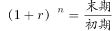
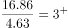
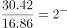
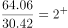
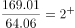

# 年均增长率比较

考点：[[20-考点/资料分析/增长/年均增长率比较|增长 / 年均增长率比较]]
材料：[[15-材料/资料分析/185242 某市非公有制经济发展情况：2015年|185242 某市非公有制经济发展情况：2015年]]

**问法模型**：题干问'以下各时间段中年均增速最快的是'→年均增长率比较模型r=(末值/初值)^(1/n)−1；四个选项间隔年数相同（均5年），直接比较末值/初值倍数即可排序。

## 推理链
1. 第1步：定位柱状图取数：1990年4.63、1995年16.86、2000年30.42、2005年64.06、2010年169.01（亿元），四个选项时段均为5年（n=5）。
2. 第2步：年均增速公式r=(末值/初值)^(1/n)−1；因各段n相同，开5次方不改变大小顺序，只需比较总倍数(末值/初值)。
3. 第3步：计算各段总倍数：A为16.86/4.63≈3.64；B为30.42/16.86≈1.80；C为64.06/30.42≈2.11；D为169.01/64.06≈2.64。
4. 第4步：比较得3.64＞2.64＞2.11＞1.80，A项（1990—1995年）总倍数最大，年均增速最快，对照选项选A。

**最快解法**：⚡ 同间隔倍数比较法（公式法简化）：各段均为5年，跳过开方，直接截位直除比较末值/初值——16.86/4.63≈3.6、169.01/64.06≈2.6、64.06/30.42≈2.1、30.42/16.86≈1.8，最大者A，秒选。

## 易错点
- ⚠ 误用增量绝对值比较：D段增量为169.01−64.06=104.95亿元最大，若按增量排序会误选D；年均增速必须看倍数（相对幅度）而非增量。
- ⚠ 间隔年数口径：1990—1995、1995—2000、2000—2005、2005—2010均为5年（n=5），柱状图年份间隔不均（2011—2015才逐年），勿机械套用其他间隔。
- ⚠ 柱状图数据为各年当年总量（期末值）而非累计值，直接取末值/初值即可，勿混入文字段'净增加23.69亿元'等数据。

## 母题抽象
> 🧩 当题干出现'年均增速最快/最慢'且各选项时间跨度相同时，直接比较末值/初值的总倍数(1+r)^n，倍数最大（最小）者即为答案，无需逐项开方计算。

**同类特征**：年均增速最快、各时间段（多点对多点）、柱状图取数、间隔年数相同（均5年）、末值/初值倍数比较、年均增长率比较

## 相关题
- [[10-真题/资料分析/增长/19452629 年均增长率比较|19452629]]（上海 2026，相关度3）
- [[10-真题/资料分析/增长/2172277 年均增长率比较|2172277]]（江苏 2018，相关度2）
- [[10-真题/资料分析/增长/15121362 年均增速比较（年均增长率大小比较）|15121362]]（江苏 2024，相关度1）
- [[10-真题/资料分析/增长/2024190 年均增长率（平均增速）比较|2024190]]（重庆 2016，相关度1）
- [[10-真题/资料分析/增长/13504662 增长率计算与趋势比较（折线图匹配）|13504662]]（辽宁 2025，相关度1）

---

### 题干
以下各时间段中，该市非公有制经济增加值年均增速最快的是：

### 选项
- A. 1990—1995年　✅
- B. 1995—2000年
- C. 2000—2005年
- D. 2005—2010年

### 官方解析

根据“······年均增速最快的是”判断本题为年均增长率比较问题。年均增长率：。定位图表，直接比较。A项：；B项：；C项：；D项：。1990—1995年的年均增速最快。

故正确答案为A。

### 给定材料

        2015年，某市非公有制经济实现增加值348.12亿元，比上年净增加23.69亿元，非公有制经济增加值占GDP的比重为。其中，民营经济增加值335.24亿元，外商经济增加值11.84亿元，港澳台经济增加值1.04亿元，分别比“十一五”末（2010年）增长、和。

        2015年，非公有制经济第一、二、三产业结构之比由上年的调整为。与“十一五”末相比，第一、三产业比重下降了3.9和3.5个百分点，第二产业比重上升了7.4个百分点。在第二产业中，工业增加值占非公有制经济增加值比重为，比“十一五”末提高7.8个百分点。

