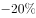

# 混合增长率（基期差值模型，求部分增速）

考点：[[20-考点/资料分析/增长/混合增长率（基期差值模型，求部分增速）|增长 / 混合增长率（基期差值模型，求部分增速）]]
材料：[[15-材料/资料分析/185290 2015年上半年全国渔业经济运行情况|185290 2015年上半年全国渔业经济运行情况]]

**问法模型**：题干给出整体（水产品总产量2700.09万吨）与其中一部分（养殖2114.38万吨）的现期量及各自同比增速，问另一部分（非养殖）同比变化最接近哪个数 → 用混合增长率模型：整体基期=两部分基期之和，列方程反解非养殖增速r

## 推理链
1. 第1步：定位材料第二段，提取整体与部分数据——2015年上半年水产品总产量2700.09万吨（同比增速设为a），其中养殖产量2114.38万吨（同比增速设为b，两增速具体数值在原卷中给出）
2. 第2步：求另一部分现期量：非养殖（捕捞）产量=2700.09−2114.38=585.71万吨，设其同比增速为r
3. 第3步：依据混合增长率规则列基期守恒方程：2700.09/(1+a)=2114.38/(1+b)+585.71/(1+r)（与官方解析'设非养殖水产品增长率为r'列式一致）
4. 第4步：代入原卷完整的a、b数值解方程，得r（因整体增速a必介于b与r之间，可先按权重585.71/(1+r)所占约两成比重确定r偏离a的方向与大致幅度）
5. 第5步：将求得的r与四个百分数选项逐一对照，取最接近者，官方判定为B

**最快解法**：⚡ 线段法（混合增长率十字交叉）：整体增速a按基期权重加权介于养殖增速b与非养殖增速r之间，权重比≈2114.38:585.71≈3.6:1，故r偏离a的距离≈(a−b)偏离距离的3.6倍且方向相反，据此快速锁定选项区间；需精算时用基期差值式 585.71/(1+r)=2700.09/(1+a)−2114.38/(1+b) 直除求解

## 易错点
- ⚠ 用现期量代替基期量做加权平均：混合增长率必须用基期量（除以1+增速后）作权重，两部分基期量都不能直接拿现期量代替
- ⚠ 误将非养殖产量585.71万吨当作答案：题干问的是'与上年同期相比的变化'即增速（百分数），不是产量本身（万吨）
- ⚠ 材料文本中所有同比增速数值均为空缺，切勿默认为0或凭空补数；同时注意混合方向：若整体增速a高于养殖增速b，则非养殖增速r必低于a，方向判反即错

## 母题抽象
> 🧩 当题干出现'整体量及其增速、其中某一部分量及其增速，问另一部分的变化'特征时，用混合增长率（基期守恒）模型：先求另一部分现期量=整体−已知部分，再由 整体/(1+a)=部分1/(1+b)+部分2/(1+r) 解出r，并用'整体增速介于两分量增速之间'验证方向

**同类特征**：非养殖水产品产量、与上年同期相比、变化最接近、整体—其中部分结构（总量与养殖量）、选项为百分数、混合增长率

## 相关题
- [[10-真题/资料分析/增长/2730985 混合增长率（居中且偏向基期大者）|2730985]]（深圳市考 2020，相关度2）
- [[10-真题/资料分析/增长/9629 一般增长率计算（现期需由增量倒推）|9629]]（安徽 2009，相关度1）
- [[10-真题/资料分析/比重/2604234 现期比重计算|2604234]]（广东 2020，相关度1）
- [[10-真题/资料分析/增长/27835 一般增长率计算（已知现期量与增长量求增长率）|27835]]（河北 2012，相关度1）
- [[10-真题/资料分析/平均数/10204497 平均数增长率（均价=值-量的比值增长率）|10204497]]（海南 2024，相关度1）

---

### 题干
2015年上半年，非养殖水产品产量与上年同期相比的变化最接近以下哪个数字？

### 选项
- A. 

- B. 

　✅
- C. 

- D. 

### 官方解析
由题干“与上年同期相比”结合选项都为百分比，且题干给了水产品和养殖水产品的量以及增长率，可判断该题是混合增长率问题。定位材料第二段，2015年上半年全国水产品产量2700.09万吨，同比增长，其中养殖水产品产量2114.38万吨，同比增长，所以，所以设非养殖水产品增长率为，则，。
故正确答案为B。

### 给定材料

        据统计，2015年上半年全国渔业产值4152.56亿元，同比增长；渔业增加值2260.05亿元，同比增长，高出农林牧渔业增加值的增幅2.2个百分点。

        2015年上半年全国水产品产量2700.09万吨，同比增长，其中养殖水产品产量2114.38万吨，同比增长。

        2015年上半年全国水产品进出口总量383.08万吨，同比下降，进出口总额137.28亿美元，同比下降。

        其中，出口量189.28万吨，出口额95.81亿美元，同比分别增长和。主要出口国家和地区中，对美国、欧盟、东盟、日本、中国香港、韩国和中国台湾的出口额分别增长、、、、、和。

        进口量193.80万吨，进口额41.47亿美元，同比分别下降和，其中鱼粉进口量、进口额同比分别下降和。

> [!warning] 疑点（官方解析可能有误，待人工复核）
> 材料原文中所有同比增速的具体百分数均显示为空缺，官方解析所列方程的关键数值处（'，。'）亦为空白，故无法仅凭给定文本复算r的精确值并逐一核对四个选项；本题结论以官方答案B为准，实际数值须以原始试卷为准
