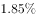
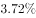
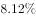

# 增速之差（百分点加减还原，简单计算题）

考点：[[20-考点/资料分析/增长/增速之差（百分点加减还原，简单计算题）|增长 / 增速之差（百分点加减还原，简单计算题）]]
材料：[[15-材料/资料分析/185290 2015年上半年全国渔业经济运行情况|185290 2015年上半年全国渔业经济运行情况]]

**问法模型**：题干给出'A增幅高出B增幅2.2个百分点'→求B增幅，直接用减法：B增幅=A增幅−2.2个百分点，一步加减即可

## 推理链
1. 第1步：定位材料第①段，提取条件——2015年上半年渔业增加值2260.05亿元，同比增长（原卷具体增速值，本文本空缺），并明确钩子'高出农林牧渔业增加值的增幅2.2个百分点'
2. 第2步：确立运算规则——'高出2.2个百分点'是增速之差，即 渔业增加值增幅−农林牧渔业增幅=2.2个百分点，求后者须用减法还原，不涉及乘除或倍数关系
3. 第3步：代入计算——农林牧渔业增加值增幅=渔业增加值增幅（原卷数值a）−2.2个百分点，将原卷中渔业增加值增速的完整数值代入后即得具体增幅
4. 第4步：与选项对照——按上述减法还原的结果与B项一致，且与官方解析'简单加减计算'的判定吻合，故正确答案为B

**最快解法**：⚡ 公式法（一步减法）：农林牧渔业增加值增幅=渔业增加值同比增幅−2.2个百分点；读题定位第①段末句，直接做增速差，无需列任何综合算式，几秒锁定B

## 易错点
- ⚠ 把'高出2.2个百分点'误读成倍数/比例关系（如×1.022或除法换算），正确做法是增速之差用减法直接还原
- ⚠ '增幅'与'增加值'混淆：题目比较的是增长率（百分比），而非2260.05亿元这一现期总量，切勿把亿元量代入运算
- ⚠ 本材料文本中所有同比增速数值空缺，不能默认为0或凭空补数，须以原卷完整数值代入后再减2.2个百分点，否则无法与选项数值比对

## 母题抽象
> 🧩 当题干出现'A增幅高出/低于B增幅x个百分点'并求B时，用加减还原法：B=A−x（或A+x）个百分点，一步简单计算即可锁定选项，切勿按倍数关系处理

**同类特征**：与上年同期相比、增幅为、高出……增幅2.2个百分点、百分点（增速之差表述）、农林牧渔业增加值、简单加减计算

## 相关题
- [[10-真题/资料分析/比重/1789664 比重差值计算（百分点搭桥）|1789664]]（江苏 2016，相关度1）
- [[10-真题/资料分析/其他/2139424 两现期水平值相减求差额（百分点差计算）|2139424]]（天津 2017，相关度1）
- [[10-真题/资料分析/其他/1796142 累计值与当月值差值计算（1-10月=1-11月累计−11月当月）|1796142]]（贵州 2016，相关度1）
- [[10-真题/资料分析/其他/1796248 多期数据区间加总（简单加减计算）|1796248]]（黑龙江 2016，相关度1）
- [[10-真题/资料分析/增长/2031160 混合增长率（基期差值模型，求部分增速）|2031160]]（北京 2017，相关度1）

---

### 题干
与上年同期相比，2015年上半年全国农林牧渔业增加值增幅为：

### 选项
- A. 

- B. 

　✅
- C. 

- D. 

### 官方解析
由题干“与上年同期相比， 2015年上半年全国农林牧渔业增加值增幅为”，结合材料第一段最后一句话，可判定该题属于简单加减计算问题。定位材料第一段，渔业增加值同比增长，高出农林牧渔业增加值的增幅2.2个百分点，可得。
故正确答案为B。

### 给定材料

        据统计，2015年上半年全国渔业产值4152.56亿元，同比增长；渔业增加值2260.05亿元，同比增长，高出农林牧渔业增加值的增幅2.2个百分点。

        2015年上半年全国水产品产量2700.09万吨，同比增长，其中养殖水产品产量2114.38万吨，同比增长。

        2015年上半年全国水产品进出口总量383.08万吨，同比下降，进出口总额137.28亿美元，同比下降。

        其中，出口量189.28万吨，出口额95.81亿美元，同比分别增长和。主要出口国家和地区中，对美国、欧盟、东盟、日本、中国香港、韩国和中国台湾的出口额分别增长、、、、、和。

        进口量193.80万吨，进口额41.47亿美元，同比分别下降和，其中鱼粉进口量、进口额同比分别下降和。

