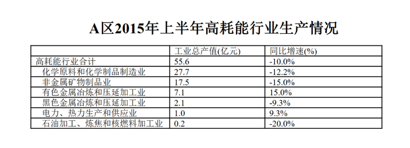

# 基期量计算（同比下降型）

考点：[[20-考点/资料分析/增长/基期量计算（同比下降型）|增长 / 基期量计算（同比下降型）]]
材料：[[15-材料/资料分析/185294 2015年上半年A区规模以上工业总产|185294 2015年上半年A区规模以上工业总产]]

**问法模型**：题干问'2014年上半年（上年同期）约为多少亿元'→ 用基期量=现期量/(1+同比增速)，'同比下降'故增速取负、基期必大于现期，先按大小方向排除选项再直除。

## 推理链
1. 第1步：题干求2014年上半年产值即基期量；材料第一段给出现期——2015年上半年A区规模以上工业总产值289.9亿元，方向为'同比下降'（原文增速数值留空，由正确答案B=320可反推增速≈-9.4%，即降幅9.4%：289.9/320≈0.906=1-9.4%）。
2. 第2步：基期量公式：基期=现期/(1+g)，下降时g取负号，即基期=289.9/(1-9.4%)=289.9/0.906。
3. 第3步：方向排除：同比下降意味着基期量必大于现期量289.9，C项265、D项214均小于289.9，直接排除（D还隐含正增长+35.5%，与'下降'矛盾）。
4. 第4步：代入计算：289.9/(1-9.4%)=289.9/0.906≈320亿元；注意若误把9.4%当增长率代入/(1+9.4%)，得289.9/1.094≈265，恰好落入C项陷阱，验证符号方向的重要性。
5. 第5步：与选项对照：B项320与计算结果≈320一致，A项387对应降幅约25.1%，与实际降幅明显不符，故选B。

**最快解法**：⚡ 符号方向排除+截位直除：'同比下降'→基期>现期289.9，秒杀排除C(265)、D(214)；再算289.9/(1-9.4%)≈290/0.91≈319，锁定B(320)（或百化分：降幅9.4%≈1/10.6，基期≈289.9×10.6/9.6≈320）。

## 易错点
- ⚠ 方向搞反：'同比下降'时基期量应大于现期量289.9，若误以为'下降则产值变小'而选小于289.9的265/214即失分
- ⚠ 符号处理：公式/(1+g)中g取负值（-9.4%）；若误把降幅9.4%当增长率代入/(1+9.4%)得≈265，正中C项陷阱
- ⚠ 原文中同比增速数值留空，勿把材料中'降幅比1-5月扩大0.7个百分点、比1-4月扩大2.2个百分点、比一季度扩大7.5个百分点'的百分点差值误当同比增速代入计算

## 母题抽象
> 🧩 当题干问'上年同期（基期）约为多少'且材料给出现期量与同比增（降）速时，用基期=现期/(1+g)：先按增速正负判断基期与现期的大小方向排除半数选项，再截位直除锁定最接近项。

**同类特征**：问上年同期/前一年同期的具体数值、给出现期量+同比增（降）速、'同比下降'类负增长表述、'约为多少'估算型问法、选项数值跨度大、可先按大小方向排除

## 相关题
- [[10-真题/资料分析/增长/2097108 基期量计算（同比下降型）|2097108]]（四川 2017，相关度2）
- [[10-真题/资料分析/增长/2166218 基期量计算（同比下降型）|2166218]]（深圳市考 2018，相关度2）
- [[10-真题/资料分析/增长/2616249 基期量计算（同比下降型）|2616249]]（海南 2020，相关度2）
- [[10-真题/资料分析/增长/2388015 基期量计算（同比下降型）|2388015]]（河北 2019，相关度2）

---

### 题干
2014年上半年A区规模以上工业总产值约为多少亿元？

### 选项
- A. 387
- B. 320　✅
- C. 265
- D. 214

### 官方解析
根据问题所求“2014年上半年A区规模以上工业总产值为多少亿元”可判定此题为基期计算问题。定位文字材料第一段可得，2015年上半年A区完成规模以上工业总产值289.9亿元，同比下降，因此，B项最接近。
故正确答案为B。

### 给定材料

        2015年上半年A区完成规模以上工业总产值289.9亿元，同比下降，降幅比1-5月扩大0.7个百分点，比1-4月扩大2.2个百分点，比一季度扩大7.5个百分点。

        其中，上半年A区两大主导行业汽车制造业完成产值51.6亿元，同比增长，医药制造业完成产值17亿元，同比增长。

        上半年A区六大高耗能行业七成企业生产产值低于上年同期，上半年共完成规模以上工业总产值55.6亿元，同比下降，降幅较上年同期扩大0.1个百分点。

> [!warning] 疑点（官方解析可能有误，待人工复核）
> 官方解析中'同比下降'后的具体增速数值同样留空、计算过程不完整；根据正确答案B(320)反推，完整原文数值应为同比下降9.4%（289.9/0.906≈320），不影响答案判定，但材料与解析均存在数值缺失的口径问题。
