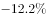
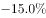
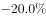

# 同比增速（降幅）大小比较与计数

考点：[[20-考点/资料分析/增长/同比增速（降幅）大小比较与计数|增长 / 同比增速（降幅）大小比较与计数]]
材料：[[15-材料/资料分析/185294 2015年上半年A区规模以上工业总产|185294 2015年上半年A区规模以上工业总产]]

**问法模型**：'降幅快于全区'的问法 → 将降幅比较转化为同比增速数值比较（增速更负＝降幅更快），在统计表中逐一比对6个分行业增速并数出符合条件的个数

## 推理链
1. 第1步：题干要求统计'2015年上半年产值同比降幅快于全区规模以上工业总产值'的行业个数，比较基准是全区289.9亿元总产值的同比增速（文字第一段，方向为下降即增速为负；给定原文该数值留空，以完整原始材料数值为准）。
2. 第2步：规则转换——'降幅快于'等价于同比增速数值更小（更负）；表中唯一正增长的电力、热力生产和供应业（+9.3%）产值同比增长，先直接排除。
3. 第3步：读表提取其余5个分行业2015年上半年同比增速：化学原料和化学制品制造业-12.2%、非金属矿物制品业-15.0%、有色金属冶炼和压延加工业-15.0%、黑色金属冶炼和压延加工业-9.3%、石油加工炼焦和核燃料加工业-20.0%。
4. 第4步：逐一与全区增速比较：非金属矿物制品业-15.0%、有色金属-15.0%、石油加工-20.0%三个行业增速低于全区增速（据官方结论全区降幅介于12.2%与15.0%之间），降幅快于全区；化学原料-12.2%与黑色金属-9.3%降幅慢于全区，不入选。
5. 第5步：符合条件的行业共3个，对照选项A.2、B.3、C.4、D.5，锁定B。

**最快解法**：⚡ 排除＋数负法（表格直接比较，零计算）：先剔除唯一正增长的电力+9.3%；再从增速最负端起数——石油加工-20.0%、非金属-15.0%、有色金属-15.0%三项必快于全区，化学原料-12.2%、黑色金属-9.3%按全区增速（介于-12.2%与-15.0%之间）排除，直接数出3个选B；注意-15.0%有两个并列行业，勿漏数。

## 易错点
- ⚠ 基准口径错配：误用高耗能行业合计增速-10.0%（55.6亿元口径）作比较基准，会多算化学原料-12.2%而错选C.4；题干基准是全区规模以上工业总产值（289.9亿元）的同比增速，两套口径不能混用。
- ⚠ 符号方向搞反：'降幅快于'＝增速更负，不是增速数值更大；黑色金属-9.3%虽为负增长但降幅慢于全区，不能入选；电力+9.3%为正增长更须排除。
- ⚠ 并列漏数与数据缺失：非金属矿物制品业与有色金属冶炼和压延加工业增速同为-15.0%，数数时极易漏计一个；给定原文中全区同比增速数值留空缺失，判断分界须以完整原始材料中的数值为准。

## 母题抽象
> 🧩 当题干出现'降幅（增速）快于/慢于某基准的对象有几个'时，先把'降幅'统一翻译成带符号的同比增速，剔除正增长项，再以基准增速为界从最负端逐一计数，并列同速项勿漏。

**同类特征**：六大高耗能行业、降幅快于全区、同比增速数值比较、统计表直接查找、符合条件行业计数、正负增长筛选

## 相关题
（暂无）

---

### 题干
在A区六大高耗能行业中，2015年上半年产值同比降幅快于全区规模以上工业总产值的行业有几个？

### 选项
- A. 2
- B. 3　✅
- C. 4
- D. 5

### 官方解析

定位文字材料第一段可得，全区规模以上工业总产值同比下降。定位表格，同比降幅快于全区的六大高耗能行业有：、、，共3个。

故正确答案为B。

### 给定材料

        2015年上半年A区完成规模以上工业总产值289.9亿元，同比下降，降幅比1-5月扩大0.7个百分点，比1-4月扩大2.2个百分点，比一季度扩大7.5个百分点。

        其中，上半年A区两大主导行业汽车制造业完成产值51.6亿元，同比增长，医药制造业完成产值17亿元，同比增长。

        上半年A区六大高耗能行业七成企业生产产值低于上年同期，上半年共完成规模以上工业总产值55.6亿元，同比下降，降幅较上年同期扩大0.1个百分点。

> [!warning] 疑点（官方解析可能有误，待人工复核）
> 给定材料原文中全区总产值同比增速数值留空缺失，官方解析中也未给出该数值及入选行业名称；按官方答案B（3个）反推，全区降幅应大于12.2%且小于15.0%（增速介于-15.0%与-12.2%之间），入选行业为非金属矿物制品业、有色金属冶炼和压延加工业、石油加工业，与官方结论一致，非官方错误；但若误以高耗能合计-10.0%为基准将得4个，属口径错误，做本题时须以全区增速为界。
