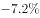
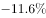
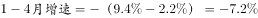

# 增长率计算——由'降幅比前期扩大X个百分点'反推前期增速（增速与降幅的百分点符号换算）

考点：[[20-考点/资料分析/增长/增长率计算——由'降幅比前期扩大X个百分点'反推前期增速（增速与降幅的百分点符号换算）|增长 / 增长率计算——由'降幅比前期扩大X个百分点'反推前期增速（增速与降幅的百分点符号换算）]]
材料：[[15-材料/资料分析/185294 2015年上半年A区规模以上工业总产|185294 2015年上半年A区规模以上工业总产]]

**问法模型**：题干问某前期时段（1-4月）的同比增速，材料给出本期（上半年）增速及'降幅比1-4月扩大2.2个百分点'→ 用符号平移：前期增速＝本期增速＋2.2个百分点，直接对照选项

## 推理链
1. 第1步：题干求2015年1-4月A区规模以上工业总产值同比增速，定位文字第一段：上半年总产值289.9亿元、同比下降（增速设为−g%，该数值在给定原文中留空缺失，以完整原始材料为准），且'降幅比1-4月扩大2.2个百分点'。
2. 第2步：提取降幅口径关系：'上半年降幅＝1-4月降幅＋2.2个百分点'，即1-4月降幅比上半年小2.2个百分点（降幅逐期扩大：一季度再加7.5、1-5月再加0.7）。
3. 第3步：做增速与降幅的符号换算（增速＝−降幅）：1-4月增速＝−(上半年降幅−2.2)＝上半年增速＋2.2个百分点＝−g%＋2.2%＝−(g−2.2)%。
4. 第4步：代入完整原始材料中上半年增速的负值，得1-4月增速为比上半年增速高2.2个百分点的负值（降幅收窄2.2个百分点），全程不需用289.9亿元等产值数据。
5. 第5步：与选项对照：C项与'上半年增速＋2.2个百分点'的结果一致（方向算反得到的−(g＋2.2)%及不修正的−g%均为干扰项），故正确答案为C。

**最快解法**：⚡ 符号平移口诀法：见'降幅比1-4月扩大2.2个百分点'，直接写'1-4月增速＝上半年增速＋2.2个百分点'（扩大＝本期更负＝前期增速更高、降幅更小），把原文上半年负增速加2.2后对照选项秒选C；289.9亿元与表格数据一概不用。

## 易错点
- ⚠ 方向搞反（最大失分点）：把'降幅扩大2.2个百分点'错处理成上半年增速再减2.2，误选−(g＋2.2)%方向的干扰项；正确方向是1-4月降幅更小、增速加2.2个百分点。
- ⚠ 降幅与增速符号口径混用：同比增速为负即下降，'百分点'差值必须在同一符号体系下加减；切勿拿表中高耗能行业合计−10.0%充当全区增速代入（两套口径：55.6亿元/−10.0%是六大高耗能行业，289.9亿元才是全区）。
- ⚠ 数据干扰与数值缺失：产值绝对额（289.9亿元）对本题无用；且给定原文中上半年全区增速数值留空，不可凭空捏造或用−10.0%等表中数据顶替，须以完整原始材料数值代入。

## 母题抽象
> 🧩 当题干出现'本期增速（降幅）比另一时期扩大/收窄X个百分点'并求那一时期的增速时，用符号平移法：'扩大X'⇒前期增速＝本期增速＋X个百分点（前期降幅更小），'收窄X'则反向相减，直接对已知增速做百分点加减，产值数据一概不参与计算。

**同类特征**：求1-4月（某前期累计期）同比增速、'降幅比1-4月扩大2.2个百分点'、增速与降幅的符号换算、百分点差直接平移、无需产值绝对额（289.9亿元为干扰量）、选项设方向相反的干扰项

## 相关题
（暂无）

---

### 题干
2015年1-4月A区完成规模以上工业总产值同比增速约为：

### 选项
- A. 

- B. 

- C. 

　✅
- D. 

### 官方解析

根据问题所求“2015年1-4月A区完成规模以上工业总产值同比增速”，可判定此题为增长率计算问题。定位文字材料第一段可得，上半年同比下降，降幅比1-4月扩大2.2个百分点，因此。

故正确答案为C。

### 给定材料

        2015年上半年A区完成规模以上工业总产值289.9亿元，同比下降，降幅比1-5月扩大0.7个百分点，比1-4月扩大2.2个百分点，比一季度扩大7.5个百分点。

        其中，上半年A区两大主导行业汽车制造业完成产值51.6亿元，同比增长，医药制造业完成产值17亿元，同比增长。

        上半年A区六大高耗能行业七成企业生产产值低于上年同期，上半年共完成规模以上工业总产值55.6亿元，同比下降，降幅较上年同期扩大0.1个百分点。

> [!warning] 疑点（官方解析可能有误，待人工复核）
> 给定材料原文中'上半年同比下降___'的增速数值留空（材料导读已注明缺失），官方解析中该数值及完整算式亦被省略，故推理链只能以符号−g%呈现代入过程，无法用纯数字复算核验C项的具体百分数；本题结论以官方答案C为准，实际计算须以完整原始材料中的全区增速数值代入'增速＋2.2个百分点'。
