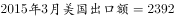
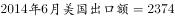
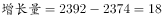
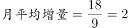

# 月均增长量计算（年均增长量模型的月份版）

考点：[[20-考点/资料分析/增长/月均增长量计算（年均增长量模型的月份版）|增长 / 月均增长量计算（年均增长量模型的月份版）]]
材料：[[15-材料/资料分析/185366 2014年6月—2015年3月美国进|185366 2014年6月—2015年3月美国进]]

**问法模型**：题干出现'某时间段＋××额月平均增量'→套用年均增长量模型的月份版：月平均增量＝（末期值−基期值）÷间隔月数，本题官方按'2014年7月至2015年3月共9个月'口径、基期取2014年6月值2374亿美元

## 推理链
1. 第1步：由'月平均增量'判定为年均（月均）增长量模型，时段2014年7月至2015年3月共9个月（2014年7—12月6个月＋2015年1—3月3个月）
2. 第2步：从柱状图柱顶上排读美国出口额：末期2015年3月为2392亿美元，基期（时段起点前一个月）2014年6月为2374亿美元
3. 第3步：公式：月平均增量＝（末期值−基期值）÷月份数＝（2392−2374）÷9
4. 第4步：代入计算：总增量＝2392−2374＝18亿美元，18÷9＝2.0亿美元
5. 第5步：与选项对照：2.0亿美元恰为选项D，故正确答案为D

**最快解法**：⚡ 公式法＋整除速判：锁定两端点读数2014年6月2374与2015年3月2392，差值18，18÷9＝2.0为整除精确值直接锁定D；同时可排除以7月值2385为基期的差值7（7÷8≈0.9对应B、7÷9≈0.8对应A，均非官方口径）

## 易错点
- ⚠ 基期与分母口径坑：若按'基期取2014年7月值2385、间隔8个月'计算得0.875≈0.9会误选B；官方口径为'共9个月、基期取2014年6月值2374'，18÷9＝2.0选D
- ⚠ 柱顶双行数字看串行：上排为美国出口、下排为美国进口，若误代入进口值（7月1977、3月1878）会得负增量
- ⚠ 跨年月份数错：2014年7月至2015年3月跨年，月份数易数成7或10，须按图逐月点数：7—12月6个＋1—3月3个＝9个月

## 母题抽象
> 🧩 当题干出现'某时段＋月平均增量/月平均增速'特征时，先按时段逐月点数确定分母，再锁定两端点读数作差，用'差值÷月数'计算并优先验证能否整除以快速锁定选项（本题18÷9＝2.0）

**同类特征**：月平均增量、2014年7月至2015年3月、美国出口额、跨年时间跨度、柱状图柱顶读数、小数亿美元量级选项

## 相关题
- [[10-真题/资料分析/增长/2032188 环比变动方向（增长量正负）比对计数|2032188]]（江苏 2016，相关度1）
- [[10-真题/资料分析/增长/2032194 月均（年均）增长率比较|2032194]]（江苏 2016，相关度1）

---

### 题干
2014年7月至2015年3月美国出口额月平均增量是：

### 选项
- A. 0.8亿美元
- B. 0.9亿美元
- C. 1.8亿美元
- D. 2.0亿美元　✅

### 官方解析

由问题所求“2014年7月至2015年3月······月平均增量”，可判定此题为年均增长量问题。这里是月份，时间换为月份。定位柱状图可得，，。2014年7月至2015年3月共9个月的，。

故正确答案为D。

### 给定材料

> [!warning] 疑点（官方解析可能有误，待人工复核）
> 官方解析中具体数值被省略（'，。'处空缺）。按其'2014年7月至2015年3月共9个月'口径反推，官方计算应为（2392−2374）÷9＝2.0，即基期取时段前一个月2014年6月的2374亿美元；若按常规年均增长量口径'基期取2014年7月值2385、间隔8个月'，则为（2392−2385）÷8＝0.875≈0.9对应B，且与材料导读'分母是8个间隔'的提示一致。两种口径结果不同（B与D），本笔记以官方答案D为准，仅作口径存疑记录

<!-- CODEX-ANSWER-REVIEW:BEGIN -->
### 本次独立复核

**复核状态：** `confirmed`（独立复算确认答案）

**计分答案：** D（可计分）

**复核解析：**

所求2014年7月至2015年3月共9个月。由图读2014年6月2374亿美元、2015年3月2392亿美元，净增18亿美元，月均增量=18/9=2.0亿美元，选D。

**相关信息：**

复核增长量时先确认数据口径与时间间隔；混合增长率应由合计现期量与重建的合计基期量求得。

**题源依据：** [固定版本原题](https://github.com/Mentat-Uran/kaogongzhentizhengliu/blob/84ab93d4b64b61d897bece8a1c0a5bab06b4feb2/10-%E7%9C%9F%E9%A2%98/%E8%B5%84%E6%96%99%E5%88%86%E6%9E%90/%E5%A2%9E%E9%95%BF/2032186%20%E6%9C%88%E5%9D%87%E5%A2%9E%E9%95%BF%E9%87%8F%E8%AE%A1%E7%AE%97%EF%BC%88%E5%B9%B4%E5%9D%87%E5%A2%9E%E9%95%BF%E9%87%8F%E6%A8%A1%E5%9E%8B%E7%9A%84%E6%9C%88%E4%BB%BD%E7%89%88%EF%BC%89.md)；固定内容 commit `84ab93d4b64b61d897bece8a1c0a5bab06b4feb2`，Markdown blob `3a64e658200e0e20aa51fecef856673d2eacdc76`。
<!-- CODEX-ANSWER-REVIEW:END -->
