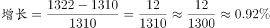

# 一般增长率（同比增速）计算

考点：[[20-考点/资料分析/增长/一般增长率（同比增速）计算|增长 / 一般增长率（同比增速）计算]]
材料：[[15-材料/资料分析/185368 2010-2014年全国劳动就业状况|185368 2010-2014年全国劳动就业状况]]

**问法模型**：题干出现'比…增长'且选项为百分数 → 采用增长率模型：增长率=(现期值-基期值)/基期值

## 推理链
1. 第1步：题干求2014年末城镇新增就业人数比2013年末的增长率，定位表格'城镇新增就业人数'行，2013年为1310万人、2014年为1322万人（注意不能用文字段的39310万或1070万）
2. 第2步：一般增长率公式：增长率=(现期值-基期值)/基期值=增长量/基期值
3. 第3步：代入计算：(1322-1310)/1310=12/1310
4. 第4步：截位直除：12/1310≈0.00916，即约0.9%
5. 第5步：与选项对照，约0.9%对应选项B，故正确答案为B

**最快解法**：⚡ 截位直除：先减后除，(1322-1310)/1310=12/1310，分子12不变、分母1310截取前两位13，商首两位约0.9%，锁定B（若选项间差距大可再粗略化：12/1310<12/1200=1%）

## 易错点
- ⚠ 口径混淆：表格'城镇新增就业人数'1322万是当年全年流量，≠城镇就业人员比上年增加量1070万，≠城镇就业人员存量39310万，本题只能用表格中1322对1310
- ⚠ 看串行：表中相邻行'再就业人数551/566'、'登记失业人数952/926'数值量级相近，误取相邻行数据即算错
- ⚠ 时间口径：表格中新增就业、再就业为当年发生额，'2014年末'实指2014年当年数据，直接与2013年对比，无需倒推基期

## 母题抽象
> 🧩 当题干出现'某指标现期比基期增长'且选项为百分数时，锁定同一口径的现期与基期数据，用(现期-基期)/基期，以截位直除快速估算并对照选项

**同类特征**：比…增长、城镇新增就业人数、2014年末对2013年末、选项均为百分数、一般增长率、表格单行取数

## 相关题
- [[10-真题/资料分析/增长/14355346 一般增长率计算（隔多年两期值比较）|14355346]]（浙江 2024，相关度1）
- [[10-真题/资料分析/增长/4651660 增长率计算（两期汇总值比较：二季度较一季度增长率）|4651660]]（江苏 2022，相关度1）
- [[10-真题/资料分析/增长/5101671 同比增长率计算（先定位首破阈值年份再算增速）|5101671]]（云南 2022，相关度1）
- [[10-真题/资料分析/增长/18643744 一般增长率计算（现期在文字段、基期需图表两来源加总的跨材料拼接）|18643744]]（天津 2026，相关度1）
- [[10-真题/资料分析/增长/2049546 间隔增长率（隔年增长率，含百分点还原中间年增速）|2049546]]（黑龙江 2017，相关度1）

---

### 题干
2014年末全国城镇新增就业人数比2013年末增长：

### 选项
- A. 

- B. 

　✅
- C. 

- D. 

### 官方解析

由题干“比…增长”，结合选项都为百分数，可判定该题是求一般增长率问题。定位表格数据可得，2013年末全国城镇新增就业人数1310万人，2014年末全国城镇新增就业人数1322万人。，因此2014年末全国城镇新增就业人数比2013年末。

故正确答案为B。

### 给定材料

        2014年末全国就业人员77253万人，比上年末增加276万人。其中，城镇就业人员39310万人，比上年末增加1070万人。

