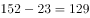
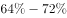
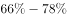
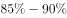
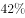

# 基期量计算（增长量为绝对量型）

考点：[[20-考点/资料分析/增长/基期量计算（增长量为绝对量型）|增长 / 基期量计算（增长量为绝对量型）]]

**问法模型**：已知现期值和同比增加的绝对量，求上年（基期）数值 → 基期 = 现期 − 增长量

## 推理链
1. 第1步：定位材料第三段，提取条件：2014年河北省城市空气优良天数平均为152天，同比增加23天
2. 第2步：明确'同比增加23天'是增长量（绝对天数）而非增长率，故2013年量 = 2014年量 − 23
3. 第3步：代入计算：152 − 23 = 129天
4. 第4步：与选项对照，129天对应C项，故选C

**最快解法**：⚡ 直接减法（无需求增速、不需截位直除）：152 − 23 = 129天，关键在于一眼识别'增加23天'为增长量而非增长率

## 易错点
- ⚠ 把'同比增加23天'误读为2013年的数据或误当作23%的增长率，去用152÷(1+23%)计算
- ⚠ 现期基期混淆，误选A项152天（把2014年数据当成2013年）
- ⚠ 材料涉及京津冀多地数据，天津为175天，勿张冠李戴误选D项

## 母题抽象
> 🧩 当题干出现'某年某量为X，同比增加/减少N（带单位的绝对量），求上年量'时，直接用基期 = 现期 − 增长量（增加取减、减少取加），对照选项验证即可

**同类特征**：基期量求解、同比增加+绝对量（天）、求上一年数值、现期减增长量、材料文字定位、单一天数指标

## 相关题
（暂无）

---

### 题干
资料显示，2013年河北省城市空气优良天数平均为：

### 选项
- A. 152天
- B. 23天
- C. 129天　✅
- D. 175天

### 官方解析

定位文字材料第三段可得，2014年，河北省城市空气优良天数平均为152天，同比增加23天。因此，2013年河北省城市空气优良天数平均为天。

故正确答案为C。

### 给定材料

        《大气污染防治行动计划》践行一年以来，京津冀地区治“霾”战果如何？数据显示，2014年，京津冀区域13个城市空气质量平均达标天数为156天，与2013年相比平均达标天数比例上升5.3个百分点。

        2014年，北京市达标天数比例为，与2013年相比下降1.1个百分点，PM2.5年均浓度与2013年相比下降。从PM2.5来源解析最新研究成果看，北京全年PM2.5主要来源于本地污染排放（占），其中，机动车排放占比达成为主导因素。

        2014年，河北省城市空气优良天数平均为152天，同比增加23天。全省PM2.5平均浓度同比下降。当年河北省完成大气减排项目2151个，压减炼铁产能1500万吨、炼钢产能1500万吨、水泥产能3918万吨、平板玻璃产能2533.5万重量箱。煤炭消费总量减少1500万吨，首次实现负增长。此外，河北省淘汰黄标车和老旧机动车81.24万辆，超额完成国家下达任务。

        2014年，天津市达标天数为175天，同比增加30天，全年PM2.5浓度下降。从PM2.5、PM10来源解析最新研究成果看，天津市全年PM2.5、PM10主要来源于本地污染排放（分别占和），其中，扬尘为首要因素（占比分别为和），其次是燃煤（占比分别为和）和机动车（占比分别为和）。

