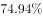
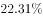
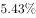
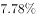

# 增长率计算（同比增速）

考点：[[20-考点/资料分析/增长/增长率计算（同比增速）|增长 / 增长率计算（同比增速）]]
材料：[[15-材料/资料分析/185416 2009~2015年全国发电量、火力|185416 2009~2015年全国发电量、火力]]

**问法模型**：题干'某年××量比上年增长'+选项为百分数 → 增长率计算模型 r=(现期−基期)/基期，其中基期为上一年（2012年）数值

## 推理链
1. 第1步：从表格'其中：火力发电量'行提取数据——2013年火电42470亿千瓦时，2012年火电38928亿千瓦时
2. 第2步：注意表中'全国发电量增速(%)'行只针对全国发电量（2013年为8.80%），火电增速表中未给，必须用火电两行数值自行计算
3. 第3步：代入增长率公式 r=(42470−38928)/38928=3542/38928
4. 第4步：截位直除，38928×9%≈3503，3542−3503≈39，故 r≈9.1%
5. 第5步：与选项对照，C项（约9.1%）最接近，故选C

**最快解法**：⚡ 截位直除：分子3542≈3500，分母38928≈39000，3542/38928≈9.1%（先商首位9验证：39000×9%≈3510≈3542），秒杀对应C项约9.1%

## 易错点
- ⚠ 误用表中'全国发电量增速'行的8.80%当作火电增速——该增速行仅对应全国发电量，火电增速必须用两行火电数据自算
- ⚠ 基期现期混淆：增长是相对'上年(2012年)'，除数应为38928而非42470，颠倒会得约8.3%
- ⚠ 数据行看错：'其中：火力发电量'与'全国发电量''全社会用电量'三行并排，勿取错行（如误取全国发电量54316/49878）

## 母题抽象
> 🧩 当题干出现'某年A量比上年增长约'且选项为百分数时，若表中增速行不含A指标，则定位A的当年值与上年值，用(现期−基期)/基期截位直除，再与选项对照

**同类特征**：某年…比上年增长、选项为百分数、其中：火力发电量（表中'其中'包含项）、表中增速行未覆盖该指标，需自算、年度当期值相邻两年相减

## 相关题
- [[10-真题/资料分析/增长/9629 一般增长率计算（现期需由增量倒推）|9629]]（安徽 2009，相关度1）
- [[10-真题/资料分析/比重/2604234 现期比重计算|2604234]]（广东 2020，相关度1）
- [[10-真题/资料分析/增长/27835 一般增长率计算（已知现期量与增长量求增长率）|27835]]（河北 2012，相关度1）
- [[10-真题/资料分析/平均数/10204497 平均数增长率（均价=值-量的比值增长率）|10204497]]（海南 2024，相关度1）
- [[10-真题/资料分析/增长/12536395 隔年（间隔）增长率|12536395]]（四川 2024，相关度1）

---

### 题干
2013年火力发电量约比上年增长：

### 选项
- A. 

- B. 

- C. 

　✅
- D. 

### 官方解析
由问题所求“2013年火力发电量比上年增长”，且选项为百分数，可判定本题为增长率计算问题。定位表格可得，2013年火力发电量为42470亿千瓦时，2012年火力发电量为38928亿千瓦时，增长率，C项最接近。
故正确答案为C。

### 给定材料

        2015年全国发电量为56184亿千瓦时，其中，火力发电量为42102亿千瓦时，占全部发电量的；水力发电量为9960亿千瓦时，同比增长。 

        2015年12月份，全国重点电厂供煤11240万吨，环比增长，同比下降，耗煤11211万吨，环比增长，同比减少。

