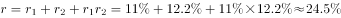
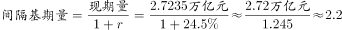

# 隔年基期量（间隔基期）计算

考点：[[20-考点/资料分析/增长/隔年基期量（间隔基期）计算|增长 / 隔年基期量（间隔基期）计算]]
材料：[[15-材料/资料分析/185418 2015年全国文化及相关产业增加值（|185418 2015年全国文化及相关产业增加值（]]

**问法模型**：题干以'2013年……约为多少万亿元'隔两年回推基期量→现期量÷(1+2015年增速)÷(1+2014年增速)，并做亿元→万亿元换算

## 推理链
1. 第1步：由题干与材料时间口径，现期2015年增加值27235亿元，间期2014年、基期2013年，判定为间隔基期量问题；设问单位为万亿元而材料单位为亿元
2. 第2步：列间隔基期公式：2013年量=27235÷(1+r2015)÷(1+r2014)，其中间隔增长率=r2015+r2014+r2015×r2014
3. 第3步：代入计算：r2015与r2014在给定文本中被挖空（仅知两年均为两位数增长），依官方解析按间隔增长率合并后代入，27235÷(1+间隔增长率)≈22000亿元量级，即约2.2万亿元
4. 第4步：换算单位并对照选项：约2.2万亿元落在A.1.8/B.2.0/C.2.2/D.2.5中的C.2.2上，与官方答案一致，故选C

**最快解法**：⚡ 间隔基期公式法+截位直除：先把27235亿元截位为2.72万亿元，再合并间隔增长率≈r2015+r2014+r2015×r2014（两位数增速合并后约25%量级），2.72÷1.25≈2.2万亿元，一步锁定C；考场需回原图表补读被挖空的两个增速数值

## 易错点
- ⚠ 量级陷阱：材料用'亿元'、设问用'万亿元'，必须÷10000换算（27235亿元≈2.7万亿元），不换算易错选其他量级
- ⚠ 隔年基期只除一次：误算成27235÷(1+2015年增速)只回推到2014年，必须连除(1+2015年增速)(1+2014年增速)两个因子，或合并间隔增长率时漏掉乘积项r2015×r2014
- ⚠ 数据残缺+口径陷阱：给定文本中两处增速百分数被挖空，需回原图补数、不得臆造；材料中'提高0.16个百分点'是占GDP比重的变化量，绝不能当增速代入除法

## 母题抽象
> 🧩 当题干出现'隔一年回推求基期量'特征（现期N年、求N−2年，材料给出N年总量及N年与N−1年增速）时，用现期量÷(1+r1)÷(1+r2)即÷(1+r1+r2+r1r2)模型，并验证单位换算与间隔增长率合并速算

**同类特征**：隔年回推（现期2015年求2013年）、间隔基期量/间隔增长率、设问为'约为'+万亿元（估算+单位换算）、选项间距大（1.8/2.0/2.2/2.5）可粗算锁定、定位文字材料第一段总量27235亿元

## 相关题
（暂无）

---

### 题干
2013年全国文化及相关产业的增加值约为多少万亿元？

### 选项
- A. 1.8
- B. 2.0
- C. 2.2　✅
- D. 2.5

### 官方解析

根据题干“2013年……增加值”结合材料年份可判定此题为间隔基期量问题。定位文字材料第一段“2015年，全国文化及相关产业增加值27235亿元，比上年增长（未扣除价格因素），在2014年增长的基础上…”，间隔增长率,万亿元。

故正确答案为C。

### 给定材料

       2015年，全国文化及相关产业增加值27235亿元，比上年增长（未扣除价格因素）。在2014年增长的基础上继续保持两位数增长，呈快速增长态势。2015年文化及相关产业增加值占GDP的比重为，比上年提高0.16个百分点。

       2015年，代表文化内容的“文化产品的生产”创造的增加值为17071亿元，而“文化相关产品的生产”创造的增加值为10165亿元；且“文化产品的生产”作为我国文化产业的主体，增速达，远高于“文化相关产品的生产”的的增速。从产品类型看，文化制造业增加值11053亿元，比上年增长，占，文化批发零售业增加值2542亿元，增长，占；文化服务业增加值13640亿元，增长，占。

       2015年文化休闲娱乐服务业和以“互联网+”为主要形式的文化信息传输服务业实现增加值分别为2044亿元和2858亿元，增速分别达和，占文化及相关产业的比重分别为和，均比上年提高0.5个百分点；广播电视电影服务业实现增加值1227亿元，占比，比上年提高0.2个百分点，文化创意和设计服务业实现增加值4953亿元，增长，占比，比上年提高0.4个百分点。

> [!warning] 疑点（官方解析可能有误，待人工复核）
> 给定文本中2015年、2014年增速的百分数被挖空缺失，官方解析中间隔增长率的具体数值无法用所给文本复算验证（属材料导读标注的数据残缺型）；本笔记依官方答案C（≈2.2万亿元）为准，不臆造增速数值

<!-- CODEX-ANSWER-REVIEW:BEGIN -->
### 本次独立复核

**复核状态：** `confirmed`（独立复算确认答案）

**计分答案：** C（可计分）

**复核解析：**

原图读出2015年同比增长11.0%，2014年同比增长12.2%。2013年基期值=27235/(1.11×1.122)=21868.1亿元=2.1868万亿元，四舍五入约2.2万亿元，选C。

**相关信息：**

混合增长率须以基期量加权；隔年基期量以两个年度的增长因子连除。

**题源依据：** [固定版本原题](https://github.com/Mentat-Uran/kaogongzhentizhengliu/blob/84ab93d4b64b61d897bece8a1c0a5bab06b4feb2/10-%E7%9C%9F%E9%A2%98/%E8%B5%84%E6%96%99%E5%88%86%E6%9E%90/%E5%A2%9E%E9%95%BF/2033352%20%E9%9A%94%E5%B9%B4%E5%9F%BA%E6%9C%9F%E9%87%8F%EF%BC%88%E9%97%B4%E9%9A%94%E5%9F%BA%E6%9C%9F%EF%BC%89%E8%AE%A1%E7%AE%97.md)；固定内容 commit `84ab93d4b64b61d897bece8a1c0a5bab06b4feb2`，Markdown blob `f8f98df82a43a35e1a781e8cfc412337573b06bb`。
<!-- CODEX-ANSWER-REVIEW:END -->
