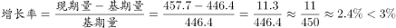

# 一般增长率计算（同比增长率+区间判定）

考点：[[20-考点/资料分析/增长/一般增长率计算（同比增长率+区间判定）|增长 / 一般增长率计算（同比增长率+区间判定）]]
材料：[[15-材料/资料分析/185420 2015年年末全国公路状况：公路总里|185420 2015年年末全国公路状况：公路总里]]

**问法模型**：题干'2015年比2014年增长'+选项为百分数区间 → 用(现期-基期)/基期算增长率，再对照区间边界；边界附近可用'基期×边界%'反向估算快速定档

## 推理链
1. 第1步：题干要求2015年（现期）相对2014年（基期）的增长率；从图1柱状图读基期2014年全国公路总里程446.4万公里
2. 第2步：现期取文字精确值2015年公路总里程457.73万公里（图1柱值仅一位小数457.7，为跨图+文字拼接）
3. 第3步：代入增长率公式（457.73-446.4)/446.4=11.33/446.4≈2.5%
4. 第4步：2.5%小于区间下界3%（若用图值457.7计算：(457.7-446.4)/446.4=11.3/446.4≈2.5%，结论一致），对照选项落入'不到3%'，故选A

**最快解法**：⚡ 截位直除+边界估算法：先求增量457.73-446.4=11.33万公里，再反向验证：基期446.4×3%≈13.4>11.33，说明增长率必小于3%，无需精算直接锁定A（或11.33/450≈2.5%截位直除）

## 易错点
- ⚠ 基期现期混淆：'比2014年增长'中2014年是基期、2015年是现期，分母必须用446.4，误用457.73作分母会得约2.6%仍选对但过程错，若方向颠倒则全错
- ⚠ 数据精度口径：图1柱值只标一位小数（457.7），文字给精确值457.73，计算宜用文字精确值，但注意本题两值结果均约2.5%，不影响选A
- ⚠ 双轴图误读：图1左侧柱为总里程（万公里）、右侧折线为公路密度（公里/百平方公里），本题只能用柱状数据，误取折线47.7/46.5会算出约2.6%的密度口径且单位错误
- ⚠ 题问是增长率而非增长量：选项为百分数区间，若误算增长量11.33万公里则无法与任何选项匹配

## 母题抽象
> 🧩 当题干出现'某年比上一年增长'+选项为百分数区间（不到X%/X%~Y%之间/超过Y%）时，先算增量，再用'基期×区间下界%'与增量比较快速定档，必要时截位直除验证

**同类特征**：现期与基期为相邻年份（2015比2014）、问法为'增长'且选项是百分数区间而非具体数值、现期精确值在文字段、基期值只在图1，需跨图+文字拼接、图1为双轴图，须取柱状（总里程）而非折线（密度）、区间边界判定型（不到3%/3%~5%/5%~8%/超过8%）

## 相关题
（暂无）

---

### 题干
2015年全国公路总里程比2014年增长：

### 选项
- A. 
不到
　✅
- B. 
~之间

- C. 
~之间

- D. 
超过

### 官方解析

由题干“2015年······比2014年增长”，结合选项都为百分数，可判定本题是一般增长率计算问题。定位图1数据，2014年全国公路总里程446.4万公里，2015年全国公路总里程457.7万公里，。

故正确答案为A。

### 给定材料

        2015年年末全国公路总里程457.73万公里，其中技术等级公路里程404.63万公里，占公路总里程的比重比上一年提高1.0个百分点。

        各行政等级公路里程分别为：国道18.53万公里、省道32.97万公里、县道55.43万公里、乡道111.32万公里、专用公路8.17万公里，比上年末分别增加0.61万公里、0.69万公里、0.23万公里、0.81万公里和0.14万公里。

         全国高速公路里程12.35万公里，比上年末增加1.16万公里。其中，国家高速公路7.96万公里，增加0.65万公里。全国高速公路车道里程54.84万公里，增加5.28万公里。

> [!warning] 疑点（官方解析可能有误，待人工复核）
> 官方解析使用图1柱值457.7而非文字精确值457.73，两口径算得增长率分别约2.53%与2.54%，均落在'不到3%'区间内，不影响答案，仅为精度表述差异

<!-- CODEX-ANSWER-REVIEW:BEGIN -->
### 本次独立复核

**复核状态：** `resolved`（答案与解析已核定）

**计分答案：** A（可计分）

**复核解析：**

图1给2014年全国公路总里程446.4万公里、2015年457.7万公里，按增长率=(现期−基期)/基期，(457.7−446.4)/446.4≈2.531%。按文字更精确的457.73计算约2.538%，都小于3%，故选A“不到3%”。

**相关信息：**

457.7为图表舍入值，文字457.73为精确值；两者不改变区间选项。

**题源依据：** [固定版本原题](https://github.com/Mentat-Uran/kaogongzhentizhengliu/blob/84ab93d4b64b61d897bece8a1c0a5bab06b4feb2/10-%E7%9C%9F%E9%A2%98/%E8%B5%84%E6%96%99%E5%88%86%E6%9E%90/%E5%A2%9E%E9%95%BF/2033378%20%E4%B8%80%E8%88%AC%E5%A2%9E%E9%95%BF%E7%8E%87%E8%AE%A1%E7%AE%97%EF%BC%88%E5%90%8C%E6%AF%94%E5%A2%9E%E9%95%BF%E7%8E%87%2B%E5%8C%BA%E9%97%B4%E5%88%A4%E5%AE%9A%EF%BC%89.md)；固定内容 commit `84ab93d4b64b61d897bece8a1c0a5bab06b4feb2`，Markdown blob `66f256eedbd2c8af8c0bc8e6ff1faa1cdf328531`。
<!-- CODEX-ANSWER-REVIEW:END -->
