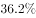
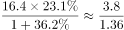
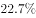
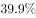
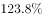
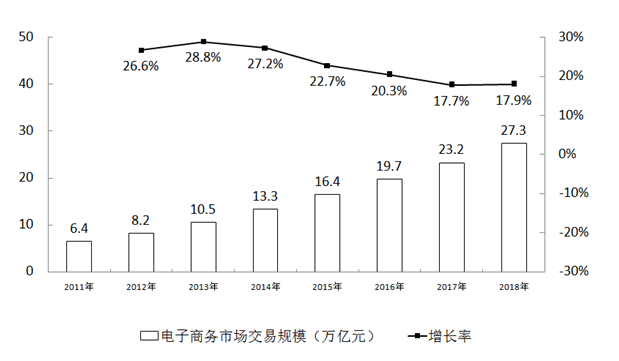

# 基期量计算（总量×饼图占比换算现期后÷(1+r)）

考点：[[20-考点/资料分析/增长/基期量计算（总量×饼图占比换算现期后÷(1+r)）|增长 / 基期量计算（总量×饼图占比换算现期后÷(1+r)）]]
材料：[[15-材料/资料分析/185422 2015年中国电子商务市场：总体交易|185422 2015年中国电子商务市场：总体交易]]

**问法模型**：题干问'2014年（基期）网络购物规模在哪个范围内'→先用'总量×饼图占比'换算出现期规模，再套基期量=现期/(1+增长率)，用首数法对照区间端点定选项。

## 推理链
1. 第1步：锁定时间口径——题干求2014年（基期），现期为2015年；从饼图读出2015年网络购物占比23.1%，从文字与柱状图读出2015年电子商务市场总规模16.4万亿元（总体同比22.7%）
2. 第2步：跨图换算现期网络购物规模：16.4×23.1%≈3.79万亿元（保持'万亿元'口径直接乘除，避免量级错误）
3. 第3步：套用基期量公式：2014年网络购物规模=现期÷(1+网络购物同比增速)=3.79÷(1+r)，r须取网络购物自身增速（原卷文字数据），不能用图中总体增速22.7%替代
4. 第4步：按官方解析代入增速计算，'首数商不到3'，即商为2万多亿元，2014年规模低于3万亿元（快速验证：3.79÷3≈1.26，只要增速高于约26%，商必小于3）
5. 第5步：与选项对照：A'超过7万亿元'、B'5~7万亿元'、C'3~5万亿元'均不低于3万亿元，仅D'不到3万亿元'与首数不到3的结果吻合，故选D

**最快解法**：⚡ 基期公式法+首数法（截位直除）：16.4×23.1%≈3.8万亿元，除以(1+增速)只看商首数——3.8÷3≈1.27，只要网络购物增速高于约27%，商首数必为2、结果不到3万亿元，直接锁定D，无需精算。

## 易错点
- ⚠ 增速口径错误：给定文字中网络购物增速数值留空，若图省事误用图中总体增速22.7%，得3.79÷1.227≈3.1万亿元，恰落入'3~5万亿元'而错选B；细分行业必须用其自身增速
- ⚠ 漏做第二步：只算16.4×23.1%≈3.79万亿元就对照区间，该值本身恰落在'3~5万亿元'内而误选C；基期细分规模必须'先乘占比、再÷(1+增速)'两步走
- ⚠ 双轴图与时间口径陷阱：22.7%是增长率不是规模、16.4是规模不是增速；图中2016-2018年的19.7/23.2/27.3为后续期数，禁止混入2014年基期运算

## 母题抽象
> 🧩 当题干出现'基期年份+某细分行业规模+在哪个范围内'的特征时，先用'总量×饼图占比'换算出现期规模，再'÷(1+该行业自身增速)'求基期量，用首数法对照区间端点即可锁定答案。

**同类特征**：基期时间（2014年）+区间范围式选项、细分行业（网络购物）规模、饼图占比×总量跨图换算、基期量=现期/(1+r)、首数法判断区间、双轴折线柱状图+饼图复合材料

## 相关题
- [[10-真题/资料分析/综合/2033414 综合判断题（倍数验证+增长率大小比较）|2033414]]（河南 2016，相关度1）
- [[10-真题/资料分析/综合/2742218 综合分析题（基期量计算＋基期占比比较＋增速计数比较＋比重趋势读图）|2742218]]（江苏 2021，相关度1）
- [[10-真题/资料分析/综合/4663224 综合判断题（混合增长率居中+基期量+多年加总+负增长计数逐项验证）|4663224]]（山东 2022，相关度1）
- [[10-真题/资料分析/增长/4743018 基期量计算（图文结合取增速）|4743018]]（安徽 2019，相关度1）
- [[10-真题/资料分析/综合/5509777 综合判断（数据可推性验证+当月量与月均量比较）|5509777]]（甘肃 2023，相关度1）

---

### 题干
2014年网络购物交易规模在以下哪个范围内？

### 选项
- A. 超过7万亿元
- B. 5~7万亿元
- C. 3~5万亿元
- D. 不到3万亿元　✅

### 官方解析

根据“2014年网络购物交易规模在以下哪个范围内”可知，判断本题为基期计算问题。定位文字材料和图表，2015年中国电子商务市场交易规模16.4万亿元，2015年网络购物所占比重为，且网络购物增长，则2014年网络购物交易规模为，首数商不到3，因此低于3万亿元。

故正确答案为D。

### 给定材料

        2015年中国电子商务市场交易规模16.4万亿元，增长。其中网络购物增长，在线旅游增长，本地生活服务O2O增长。2015年中国移动网购市场交易规模达2.1万亿元，同比增长。

> [!warning] 疑点（官方解析可能有误，待人工复核）
> 给定文字材料中'网络购物增长'的增速数值留空（官方解析同样省略了具体增速与算式，仅给结论'首数商不到3'），解题须以原卷完整增速代入；由官方答案D反推，该增速须高于约26.3%（3.79÷3≈1.26），若误用图中总体增速22.7%将得约3.1万亿元而错选B。此系材料转录缺空的口径问题，官方答案D本身无矛盾，维持D不变。
