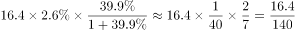

# 增长量计算（比重换算型：总量×饼图占比求现期规模，再套增长量=现期×r-(1+r)）

考点：[[20-考点/资料分析/增长/增长量计算（比重换算型：总量×饼图占比求现期规模，再套增长量=现期×r-(1+r)）|增长 / 增长量计算（比重换算型：总量×饼图占比求现期规模，再套增长量=现期×r/(1+r)）]]
材料：[[15-材料/资料分析/185422 2015年中国电子商务市场：总体交易|185422 2015年中国电子商务市场：总体交易]]

**问法模型**：题干'2015年在线旅游市场交易规模约增长了多少万亿元'→现期增长量计算模型：先用'总量×占比'跨图换算现期规模，再乘r/(1+r)得增长量。

## 推理链
1. 第1步：从图1柱状图读出2015年电子商务市场总交易规模16.4万亿元，从饼图读出在线旅游占2.6%，在线旅游同比增速r=39.9%（原卷文字数值，所给文字此处留空，按官方解析口径代入）。
2. 第2步：先跨图换算现期规模：在线旅游2015年规模=16.4×2.6%=0.4264（≈0.43）万亿元。
3. 第3步：套增长量公式：增长量=现期×r/(1+r)；39.9%≈40%=2/5，故r/(1+r)≈(2/5)÷(7/5)=2/7。
4. 第4步：代入计算：增长量≈0.4264×2/7≈0.12万亿元，直除有效数字首位为1。
5. 第5步：对照选项排除：增长量<现期×r=0.43×40%≈0.17万亿元，B(0.22)、C(0.33)、D(0.43)均大于该上界，只有A(0.12)满足，故选A。

**最快解法**：⚡ 百化分+上界排除：①现期=16.4×2.6%≈0.43万亿元；②r=39.9%≈2/5，增长量=0.43×(2/5)/(7/5)=0.43×2/7≈0.12；或更快的上界法：增长量必<0.43×40%≈0.17，四个选项中仅A(0.12)<0.17，直接锁定A。

## 易错点
- ⚠ D选项0.43正是现期规模（16.4×2.6%），把'现期量'误当'增长量'直接选D是最强陷阱；增长量必小于现期量。
- ⚠ 漏除(1+r)：若只算16.4×2.6%×39.9%≈0.17万亿元，会误判选项；公式必须是现期×r/(1+r)（等价于先求基期再作差）。
- ⚠ 饼图小扇区混淆：在线旅游2.6%与本地生活服务O2O 2.2%数值接近易看串扇区；另所给文字中增速恰为留空，须以原卷39.9%代入，不能凭空编数或把总增速22.7%错用到在线旅游上。

## 母题抽象
> 🧩 当题干出现'某年某细分行业增长了多少（绝对量）'且材料只给'总量+饼图占比+该行业增速'时，两步走：总量×占比=现期规模，再乘r/(1+r)=增长量，并用上界'增长量<现期×r'快速排除选项。

**同类特征**：现期年2015+细分行业在线旅游、'约增长了多少万亿元'（增长量问法）、饼图占比2.6%须先换算现期规模、增速39.9%≈40%=2/5（百化分）、选项中含现期值0.43作陷阱、'约'字提示估算允许

## 相关题
（暂无）

---

### 题干
2015年在线旅游市场交易规模约增长了多少万亿元？

### 选项
- A. 0.12　✅
- B. 0.22
- C. 0.33
- D. 0.43

### 官方解析

根据“2015年在线旅游市场规模约增长了多少”可知，判定此题为增长量计算问题。定位文字材料和图表，2015年中国电子商务市场交易规模16.4万亿元，在线旅游所占比重为，且增长，则在线旅游市场规模增长量为，直除有效数字首位为1，只有A项满足。

故正确答案为A。

### 给定材料

        2015年中国电子商务市场交易规模16.4万亿元，增长。其中网络购物增长，在线旅游增长，本地生活服务O2O增长。2015年中国移动网购市场交易规模达2.1万亿元，同比增长。

> [!warning] 疑点（官方解析可能有误，待人工复核）
> 所给材料原文与官方解析中的比重、增速及算式数值均被排版吞空（'比重为，且增长，增长量为'），系呈现缺漏而非解析错误；按原卷口径代入在线旅游增速39.9%后算得≈0.12，与官方答案A完全一致，无实质矛盾。
