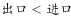
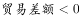

# 增长率符号与贸易逆差变化方向判断（负差额×负增速=逆差缩小）＋计数比较

考点：[[20-考点/资料分析/增长/增长率符号与贸易逆差变化方向判断（负差额×负增速=逆差缩小）＋计数比较|增长 / 增长率符号与贸易逆差变化方向判断（负差额×负增速=逆差缩小）＋计数比较]]
材料：[[15-材料/资料分析/185452 2015年前7个月中国对欧盟、美国、|185452 2015年前7个月中国对欧盟、美国、]]

**问法模型**：题干问'贸易逆差同比减少的伙伴有几个'→先用符号筛出贸易差额为负（逆差）的行，再用'负差额×负增速=逆差缩小'的规则判断方向，纯判断计数、无需计算

## 推理链
1. 第1步：读表格'贸易差额（亿元）'列，差额为正（顺差）的有欧盟+4607.0、美国+8704.8、东盟+3133.8、香港+9932.2、印度+1519.2；差额为负（逆差）的有日本-345.8、韩国-2473.1、台湾-3388.1、澳大利亚-1360.4、巴西-432
2. 第2步：规则——差额B<0时，现期B=基期B×(1+g)，若同比增长率g<0则(1+g)<1，|现期差额|<|基期差额|，即逆差同比减少
3. 第3步：读右侧'贸易差额同比增长（%）'列，5个逆差伙伴的增速全部为负：日本-11.1、韩国-15.3、台湾-6.0、澳大利亚-42.1、巴西-44.7
4. 第4步：排除干扰项——香港增速-10.1虽为负，但其差额+9932.2为正（顺差），负增速作用在顺差上是顺差缩小，不符合'逆差'前提，不能计入
5. 第5步：满足'逆差且逆差同比减少'的伙伴共5个（日本、韩国、台湾、澳大利亚、巴西），对照选项选C（5个）

**最快解法**：⚡ 符号筛查法——只看贸易差额列中带负号的5行（日本、韩国、台湾、澳大利亚、巴西），再扫一眼对应'贸易差额同比增长'列是否同为负号，全负直接数行数得5，全程零计算

## 易错点
- ⚠ 左右串列：金额区与增速区四列结构完全相同，易把'进出口/出口/进口'的同比增速误当贸易差额增速读
- ⚠ 符号逻辑误判：误以为'增速为负=逆差扩大'，实际负差额×负增速=逆差缩小（如巴西-432、增速-44.7，基期约-781，逆差是缩小不是扩大）
- ⚠ 前提遗漏：不先限定'差额为负'就把香港（顺差+9932.2、增速-10.1）也数进来，误选D（6个）

## 母题抽象
> 🧩 当题干出现'逆差/负债/赤字等负值指标同比减少（扩大）的有几个'特征时，先用符号筛出指标为负的个体，再用'负值×负增速=绝对值变小（减少）'的符号规则定方向，最后计数对照选项，无需具体计算

**同类特征**：贸易逆差同比减少、主要贸易伙伴有几个、贸易差额正负号、同比增长率为负、计数类判断、顺差逆差限定前提

## 相关题
（暂无）

---

### 题干
2015年前7个月，中国对其贸易逆差同比减少的主要贸易伙伴有：

### 选项
- A. 3个
- B. 4个
- C. 5个　✅
- D. 6个

### 官方解析

贸易逆差即，对应表格中，定位表格可得，中国对其实现贸易逆差的有日本、韩国、台湾、澳大利亚、巴西，其对应的增长率均小于0。因此5个贸易伙伴的贸易差额均同比减少。

故正确答案为C。

### 给定材料

