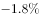
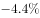
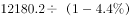
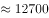
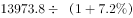
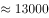
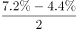
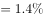
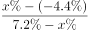
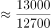

# 混合增长率（基期反推+线段法）

考点：[[20-考点/资料分析/增长/混合增长率（基期反推+线段法）|增长 / 混合增长率（基期反推+线段法）]]
材料：[[15-材料/资料分析/185452 2015年前7个月中国对欧盟、美国、|185452 2015年前7个月中国对欧盟、美国、]]

**问法模型**：题干问两主体（欧盟+美国）出口额合计的'同比平均增长'且选项为百分数 → 混合增长率模型：先用现期÷(1+增速)反推各自基期量，再按（现期和÷基期和−1）或线段法求解

## 推理链
1. 第1步：从表格增速区'出口'列取数——2015年前7个月对欧盟出口12180.2亿元、同比−4.4%；对美国出口13973.8亿元、同比+7.2%（勿串到进出口的−2.7%或进口的−7.5%）
2. 第2步：基期量=现期量÷(1+增长率)：欧盟基期=12180.2÷(1−4.4%)=12180.2÷0.956≈12741亿元；美国基期=13973.8÷(1+7.2%)=13973.8÷1.072≈13035亿元
3. 第3步：混合增速定性判断——应介于−4.4%与7.2%之间，中点=(−4.4%+7.2%)÷2=1.4%；因美国基期13035亿元略大于欧盟基期12741亿元，混合增速'偏向基期量较大者'，即略高于1.4%，排除A、B
4. 第4步：合并现期量=12180.2+13973.8=26154.0亿元；合并基期量≈12741+13035≈25776亿元
5. 第5步：精算混合增速=26154.0÷25776−1≈1.5%（线段法验证：增速差与基期量成反比，两基期量接近，故混合增速贴近中点1.4%且略偏大）
6. 第6步：对照选项，C（约1.5%）代入成立，D偏离较大，故选C

**最快解法**：⚡ 混合增长率口诀+基期反推：先速算两个基期量 12180.2÷0.956≈12741、13973.8÷1.072≈13035，发现两基期量几乎相等，混合增速≈(−4.4%+7.2%)÷2=1.4%且略偏向美国(7.2%)一侧，直接锁定略大于1.4%的C；必要时用26154÷25776−1≈1.5%精算验证

## 易错点
- ⚠ 横向串列：美国出口增速必须取'出口'列的+7.2%，误读成'进出口'列的−2.7%或'进口'列的−7.5%，混合增速会严重偏差
- ⚠ 负增速基期分母写错：欧盟同比−4.4%，基期=12180.2÷0.956（即1−4.4%），误写成÷1.044会算错基期
- ⚠ 线段法用现期量替代基期量：本题C、D选项差距小，官方解析明确指出用现期量近似替代基期量会误选D，必须以基期量为权重
- ⚠ 时间口径：数据为2015年前7个月累计，基期是2014年前7个月，不能当作全年数据或直接从表中读基期值

## 母题抽象
> 🧩 当题干出现'两/多主体合计的同比平均（混合）增速'特征时，先用现期÷(1+增速)反推各自基期量，按'居中但不中、偏向基期量较大者'定性排除，选项接近时用线段法（增速差与基期量成反比）或（现期和÷基期和−1）精算验证

**同类特征**：两个主体合并（欧盟和美国）、出口额、同比平均增长、选项为百分数、现期值与同比增速均已知、需反推基期量

## 相关题
- [[10-真题/资料分析/增长/9629 一般增长率计算（现期需由增量倒推）|9629]]（安徽 2009，相关度1）
- [[10-真题/资料分析/比重/2604234 现期比重计算|2604234]]（广东 2020，相关度1）
- [[10-真题/资料分析/增长/27835 一般增长率计算（已知现期量与增长量求增长率）|27835]]（河北 2012，相关度1）
- [[10-真题/资料分析/平均数/10204497 平均数增长率（均价=值-量的比值增长率）|10204497]]（海南 2024，相关度1）
- [[10-真题/资料分析/增长/12536395 隔年（间隔）增长率|12536395]]（四川 2024，相关度1）

---

### 题干
2015年前7个月，中国对欧盟和美国的出口额同比平均增长：

### 选项
- A. 

- B. 

- C. 

　✅
- D. 

### 官方解析

由问题所求“2015年前7个月，中国对欧盟和美国的出口额同比平均增长”，选项为百分数，可判定此题为混合增长率问题。定位表格可得，2015年前7个月，中国对欧盟的出口额为12180.2亿元，同比增长，对美国的出口额为13973.8亿元，同比增长，则2014年前七个月，中国对欧盟的出口额为亿元，中国对美国的出口额为亿元。根据混合增长率口诀“居中但不中，偏向基期较大的”，则混合增长率应略大于，排除A、B选项。C、D选项相差较小，考虑线段法，因，基期量即为分母，所以增速差与基期量成反比（因选项差距小，不能用现期量近似替代基期量计算，否则会误选D选项）。设2015年前7个月，中国对欧盟和美国的出口额同比平均增长，则根据线段法“增速差与基期量成反比”，可得，直接求解比较复杂，代入C选项成立，而D选项差距较大。

故正确答案为C。

### 给定材料

> [!warning] 疑点（官方解析可能有误，待人工复核）
> 材料导读示例将美国出口写作13875.8亿元，与表格及官方解析所用13973.8亿元不一致（系导读笔误，以表格13973.8为准）；即便按13875.8计算，混合增速≈1.45%，答案仍为C，不影响结论。另官方解析文本中增速数值因公式图片未渲染而缺失，属排版问题而非口径错误。
