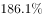
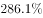
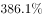
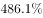
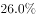
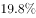
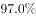
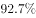
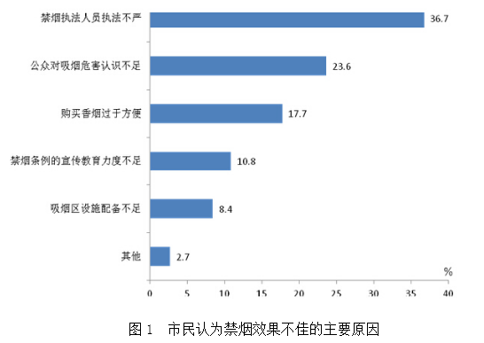
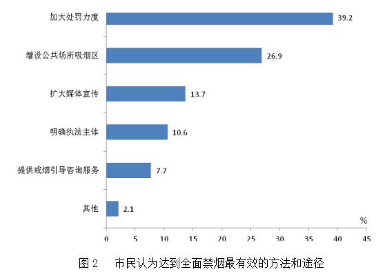

# 增长率计算（同总体占比代人数，求A比B多百分之几）

考点：[[20-考点/资料分析/增长/增长率计算（同总体占比代人数，求A比B多百分之几）|增长 / 增长率计算（同总体占比代人数，求A比B多百分之几）]]
材料：[[15-材料/资料分析/185454 2015年某市统计局一次控制吸烟状况|185454 2015年某市统计局一次控制吸烟状况]]

**问法模型**：题干为'表示“加大处罚力度”的受访市民人数比表示“扩大媒体宣传”的人数多（选项为百分数）'→ 同一调查总人数下以占比代人数，套增长率模型：(大占比−小占比)÷小占比

## 推理链
1. 第1步：从图2直接读数，全体受访市民中选'加大处罚力度'的占39.2%，选'扩大媒体宣传'的占13.7%，两者分母相同（同一调查总人数）
2. 第2步：同一总人数下占比之差/之比即人数之差/之比；问'多'且选项为百分数，判定为增长率模型：多=(A−B)÷B，基数为'比'字后被比较项
3. 第3步：代入计算：多=(39.2%−13.7%)÷13.7%=25.5%÷13.7%≈1.861，即约186.1%
4. 第4步：与选项对照：四个选项均为百分数，仅A项约186%与计算值吻合（其余量级均不符），故正确答案为A

**最快解法**：⚡ 量级估算+截位直除：先求差25.5，再看25.5÷13.7——13.7×1.8≈24.7、13.7×1.9≈26.0，商介于1.8与1.9之间（约1.86），即多约186%；四选项中仅A落在此区间，无需精算即可锁定

## 易错点
- ⚠ 百分点陷阱：39.2%−13.7%=25.5个百分点只是差值，问'人数多百分之几'必须再除以基数13.7%得约186.1%，直接选25.5%即错
- ⚠ 分母放错：增长率基数为'比'字后的'扩大媒体宣传'13.7%，若误用39.2%作分母得25.5÷39.2≈65%，错
- ⚠ 口径混用：39.2%与13.7%均为全体受访市民口径可直接比较；勿混入图1'认为效果不佳者内部结构'或文字中老年/中年/青年分年龄差值（1.0、3.9个百分点等）口径

## 母题抽象
> 🧩 当题干出现'同一总体中A的人数比B的人数多/少（选项为百分数）'时，用增长率公式(大占比−小占比)÷小占比（基数为'比'字后的项），先心算差值与小项的倍数量级再对照选项

**同类特征**：受访市民人数比……多、选项为百分数（增长率问法）、图2条形图直接读数、加大处罚力度39.2%、扩大媒体宣传13.7%、同一调查总人数，占比代人数、'A比B多'→(A−B)/B模型

## 相关题
- [[10-真题/资料分析/增长/2616171 增长率计算（'A比B少'的百分比-减少率模型）|2616171]]（海南 2020，相关度1）

---

### 题干
对于“公共场所全面禁烟最有效的方法与途径”表示“加大处罚力度”的受访市民人数比表示“扩大媒体宣传”的受访市民人数多：

### 选项
- A. 

　✅
- B. 

- C. 

- D. 

### 官方解析
由问题所求“······的受访市民人数比······的受访市民人数多”，选项为百分数，可判定本题为增长率问题。定位图2可得，表示“加大处罚力度”的受访市民人数占，表示“扩大媒体宣传”的受访市民人数占，则前者比后者多，仅A项满足。
故正确答案为A。

### 给定材料

        2015年某市统计局进行了一次有关该市控制吸烟状况的调查。

        对“公共场所控烟状况改善效果”问题的调查结果显示：的受访市民表示效果明显，的表示效果一般，的表示没有效果，的表示效果很差。当对认为控烟“没有效果”“效果很差”的受访市民询问原因时，的女性受访市民认为“购买香烟过于方便”，比男性市民高出5.0个百分点；的市民认为“禁烟执法不严”（其它原因见图1），其中的老年市民选择“禁烟执法不严”，比中年、青年市民分别高出2.9和5.6个百分点。

        对“公共场所全面禁烟最有效的方法与途径”问题的调查结果显示：的受访市民表示应该“加大处罚力度”（其他调查结果见图2）。其中，的中年市民表示应该加大处罚力度，比青年和老年市民分别高出1.0和3.9个百分点。

        对“公共场所控烟条例修订及立法”问题的调查结果显示：的受访市民表示支持，的表示不支持，的表示无所谓；的女性受访市民表示支持，的男性市民表示支持。

