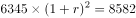
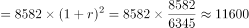

# 年均增速不变外推（现期预测值计算）

考点：[[20-考点/资料分析/增长/年均增速不变外推（现期预测值计算）|增长 / 年均增速不变外推（现期预测值计算）]]
材料：[[15-材料/资料分析/186404 2015年（含'十二五'2011—2|186404 2015年（含'十二五'2011—2]]

**问法模型**：题干以'若2016-2017年与2014-2015年保持相同的年平均增速，则2017年将是'设问 → 采用年均增速不变模型：由(1+r)²=2015年值/2013年值定增速，再以2015年值为基准同跨度外推两期得2017年值

## 推理链
1. 第1步：从统计图提取国际航线旅客吞吐量：2013年6345万人次、2014年7089万人次、2015年8582万人次（现期值，与文字段8582一致）
2. 第2步：设2014-2015年的年平均增速为r，该两年期含两期增长，则(1+r)²=2015年/2013年=8582/6345≈1.3526
3. 第3步：2016-2017年同为两年期且增速不变，2017年国际航线吞吐量=8582×(1+r)²=8582²/6345=73650724/6345≈11608万人次
4. 第4步：与选项对照：C项11608万人次与计算结果一致，B项10389为仅外推一期的干扰值，故选C

**最快解法**：⚡ 公式法+截位直除：同跨度年均增速外推可一步写成'2017年=2015年值²/2013年值'，即8582²/6345；截位8582/6345≈1.35，8582×1.35≈11590，与11608最接近，直接锁定C

## 易错点
- ⚠ 基期口径坑：误把'2014-2015年平均增速'当作单年增速（以2014年7089为基、r≈21%），外推两期得约12579万人次，与四个选项均不符；官方口径以2013年6345为基期、(1+r)²=8582/6345
- ⚠ 期数坑：只外推一期得8582×(8582/7089)=8582²/7089≈10389万人次，恰好对应B项，但这是2016年值而非2017年值
- ⚠ 数据与量级坑：勿把国内航线82895误作国际航线数据；结果约1.16亿人次但选项单位为万人次，勿在万人次/亿人次换算中错级

## 母题抽象
> 🧩 当题干出现'若保持相同的年平均增速，则某未来年份将达到'的特征时，用年均增速不变模型：先由跨期两端值定(1+r)^n=末值/初值，再以现期为基准同跨度外推n期，同跨度时可化简为'现期值²/跨期初值'一步算出，对照最接近选项

**同类特征**：保持相同的年平均增速、2017年……将是（未来外推设问）、国际航线旅客吞吐量、现期（预测值）计算、从统计图取多年数据、年均增速不变外推

## 相关题
（暂无）

---

### 题干
若2016-2017年与2014-2015年保持相同的年平均增速，则2017年中国机场国际航线旅客吞吐量将是：

### 选项
- A. 10075万人次
- B. 10389万人次
- C. 11608万人次　✅
- D. 13781万人次​

### 官方解析

由题干“保持相同的年平均增速，则2017年中国机场国际航线旅客吞吐量将是”判定该题为现期计算问题。由统计图可知15年国际航线旅客吞吐量为8582，2013年国际航线旅客吞吐量为6345，设2014-2015的平均增速为，则。若2016-2017年与2014-2015年保持相同的年平均增速，则2017年国际航线旅客吞吐量，与C项最接近。

故正确答案为C。

### 给定材料

        2015年中国机场旅客吞吐量91477万人次，比上年增长，其中，国内航线完成82895万人次，增长；国际航线完成8582万人次，增长，“十二五”时期中国机场旅客吞吐量如下图。

        2015年中国机场旅客吞吐量100万人次以上的有70个，比上年增长6个，完成旅客吞吐量占全国机场旅客吞吐量的；旅客吞吐量1000万人次以上的有26个，比上年增长2个，完成旅客吞吐量占全部机场旅客吞吐量的；北京、上海和广州三大城市占全部机场旅客吞吐量的。

        2015年中国各地区机场旅客吞吐量的分布情况是：华北地区占，比上年降低0.5个百分点；东北地区占，降低0.1个百分点；华东地区占，提高0.2个百分点；中南地区占，降低0.6个百分点；西南地区占，提高0.6个百分点；西北地区占，提高0.2个百分点；新疆地区占，提高0.2个百分点。

> [!warning] 疑点（官方解析可能有误，待人工复核）
> 材料导读建议的公式8582×(8582/7089)²≈12579与四个选项均不吻合；官方解析以2013年6345为基期按两年年均增速计算（2017=8582²/6345≈11608），与答案C一致，本题基期口径应以官方解析为准
