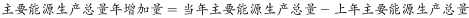
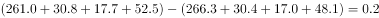
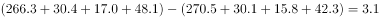

# 增长量比较（多列求和后逐年作差）

考点：[[20-考点/资料分析/增长/增长量比较（多列求和后逐年作差）|增长 / 增长量比较（多列求和后逐年作差）]]
材料：[[15-材料/资料分析/186502 2005—2015年（含'十一五''|186502 2005—2015年（含'十一五'']]

**问法模型**：题干问'年增加最少的年份'→ 先将四个分项列相加得各年生产总量，再用'当年总量−上年总量'逐年求增量并比较，增量最小者即答案

## 推理链
1. 第1步：表格只给原煤、原油、天然气、水风核电四个分项列，无'生产总量'列，须逐年四列相加：2011年=264.7+28.9+13.9+32.7=340.2，2012年=267.5+29.8+14.4+39.3=351.0
2. 第2步：继续求和得2013年=270.5+30.1+15.8+42.3=358.7，2014年=266.3+30.4+17.0+48.1=361.8，2015年=261.0+30.8+17.7+52.5=362.0（百万吨标准煤）
3. 第3步：'年增加'即同比增量=当年总量−上年总量，逐年作差：2012年=351.0−340.2=10.8
4. 第4步：2013年=358.7−351.0=7.7；2014年=361.8−358.7=3.1；2015年=362.0−361.8=0.2
5. 第5步：比较四个增量0.2<3.1<7.7<10.8，增量最少的是2015年，对照选项选A

**最快解法**：⚡ 口算各分项增量之和（总增量=各分项增量之和）：2015年=−5.3+0.4+0.7+4.4=0.2，2014年=−4.2+0.3+1.2+5.8=3.1，2013年=4.2+0.3+1.4+1.6=7.7，2012年=7.0+0.9+0.5+6.6=10.8；一看到2015年增量仅0.2（原煤大降5.3抵消水风核电增4.4），即为最小，直接锁定A，无需完整列加总

## 易错点
- ⚠ 表格无'生产总量'列，直接到表中找总量会落空，必须将四个分项列相加（如2015年=362.0）
- ⚠ '年增加'是同比增量（逐年相减），勿与'年增长率'（除以基期）混淆；且2012年增量的基期是2011年（表内340.2），本题不涉及文字段2005年数据
- ⚠ 2015年原煤产量266.3→261.0为负增长（−5.3），而水风核电增4.4，正负抵消后总量仅增0.2；只看原煤大降或只看水风核电大增都会误判增量大小
- ⚠ 总量求和须保留一位小数后再作差，否则0.2与3.1这类小量级的差异可能被舍入误差掩盖

## 母题抽象
> 🧩 当题干出现'某指标年增加最多/最少的年份'且表格只给分项不给总量时，先逐年加总（或直接对各分项增量求和得总增量），再逐年作差比较，验证最小（或最大）者即答案

**同类特征**：年增加最少、主要能源生产总量、2012-2015年份区间、增量比较模型、表格多列需四列相加、选项为具体年份

## 相关题
- [[10-真题/资料分析/倍数/13255448 两指标比值（城乡收入比）逐年比较找最小年份|13255448]]（选调 2023，相关度1）
- [[10-真题/资料分析/增长/15121335 增长量比较|15121335]]（江苏 2024，相关度1）
- [[10-真题/资料分析/增长/2377075 增长率比较（同比增速逐年计算）|2377075]]（选调 2019，相关度1）
- [[10-真题/资料分析/增长/2452736 增长量比较（逐年做差找最大年份）|2452736]]（江苏 2020，相关度1）
- [[10-真题/资料分析/增长/4637158 增长量比较（相邻年份做差找最大）|4637158]]（国考 2022，相关度1）

---

### 题干
2012-2015年我国主要能源生产总量年增加最少的年份是：

### 选项
- A. 2015年　✅
- B. 2014年
- C. 2013年
- D. 2012年

### 官方解析

根据题干所求“年增加最少的年份”可判定本题为增长量比较问题。，。代入表格数据，可得：

2015年主要能源生产总量增加量：

2014年主要能源生产总量增加量：

2013年主要能源生产总量增加量：

2012年主要能源生产总量增加量：

增长量最少的为2015年。

故正确答案为A。 

### 给定材料

        2005年我国GDP为187318.9亿元人民币，主要能源生产总量为228.9百万吨标准煤，主要能源为原煤、原油、天然气和水风核电，分别生产177.2百万吨标准煤、25.9百万吨标准煤、6.6百万吨标准煤和19.2百万吨标准煤。“十一五”“十二五”时期我国主要能源生产情况见下表。

         <b>表2006-2015年我国主要能源生产情况         单位：百万吨标准煤</b>

> [!warning] 疑点（官方解析可能有误，待人工复核）
> 官方解析中四个增量的具体算式在题面显示为空白，未给出计算过程；但按表格数据复核（10.8、7.7、3.1、0.2），结论'2015年最少'与答案A一致，答案本身无误

<!-- CODEX-ANSWER-REVIEW:BEGIN -->
### 本次独立复核

**复核状态：** `confirmed`（独立复算确认答案）

**计分答案：** A（可计分）

**复核解析：**

表中2011—2015年主要能源总产量为340.2、351.0、358.7、361.8、362.0百万吨标准煤；对应2012—2015年增量约10.8、7.7、3.1、0.2，最小为2015年，选A。

**相关信息：**

同比增量=相邻两期总量之差。

**题源依据：** [固定版本原题](https://github.com/Mentat-Uran/kaogongzhentizhengliu/blob/84ab93d4b64b61d897bece8a1c0a5bab06b4feb2/10-%E7%9C%9F%E9%A2%98/%E8%B5%84%E6%96%99%E5%88%86%E6%9E%90/%E5%A2%9E%E9%95%BF/2042786%20%E5%A2%9E%E9%95%BF%E9%87%8F%E6%AF%94%E8%BE%83%EF%BC%88%E5%A4%9A%E5%88%97%E6%B1%82%E5%92%8C%E5%90%8E%E9%80%90%E5%B9%B4%E4%BD%9C%E5%B7%AE%EF%BC%89.md)；固定内容 commit `84ab93d4b64b61d897bece8a1c0a5bab06b4feb2`，Markdown blob `6b8f2e7f8c7320218671a1dd0ed90963bd8af39d`。
<!-- CODEX-ANSWER-REVIEW:END -->
