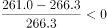
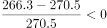
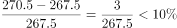
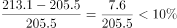
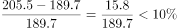
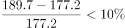

# 逐年增长率计算与阈值比较计数（超过某百分比的年份个数）

考点：[[20-考点/资料分析/增长/逐年增长率计算与阈值比较计数（超过某百分比的年份个数）|增长 / 逐年增长率计算与阈值比较计数（超过某百分比的年份个数）]]
材料：[[15-材料/资料分析/186502 2005—2015年（含'十一五''|186502 2005—2015年（含'十一五'']]

**问法模型**：题干问'2006-2015年原煤产量年增长率超过X%的年份个数'→逐年代入r=(当年−上年)/上年×100%，与阈值比较后计数

## 推理链
1. 第1步：从表格提取原煤2006—2015年产量：189.7、205.5、213.1、219.7、237.8、264.7、267.5、270.5、266.3、261.0百万吨标准煤；2006年的基期取文字段的2005年原煤177.2（表格无2005年行）
2. 第2步：公式：年增长率=(当年−上年)/上年×100%，逐一年份与阈值10%比较
3. 第3步：代入计算：2006年12.5/177.2≈7.1%；2007年15.8/189.7≈8.3%；2008年7.6/205.5≈3.7%；2009年6.6/213.1≈3.1%；2010年18.1/219.7≈8.2%；2011年26.9/237.8≈11.3%；2012年2.8/264.7≈1.1%；2013年3.0/267.5≈1.1%；2014年−4.2/270.5≈−1.6%；2015年−5.3/266.3≈−2.0%
4. 第4步：比较计数：仅2011年（≈11.3%）超过10%，其余年份均低于10%，2014、2015年为负增长
5. 第5步：超过的年份个数为1个，对照选项选B

**最快解法**：⚡ 阈值判定法（增量对照基期十分之一）：增长率>10%等价于'当年增量>上年×10%（即基期/10）'，免算增长率。2006年12.5<17.7✗；2007年15.8<19.0✗；2008年7.6<20.6✗；2009年6.6<21.3✗；2010年18.1<22.0✗；2011年26.9>23.8✓；2012年2.8、2013年3.0远不足，2014年−4.2、2015年−5.3为负✗。仅2011年超过，秒选B

## 易错点
- ⚠ 2006年增速的基期必须取文字段的2005年原煤177.2，表格首年为2006年、无2005年行，误用表内相邻年份或漏算2006年是高频错点
- ⚠ 混淆'年增长率'（除以基期）与'年增加'（逐年相减，第1小题模型）：本题是比较增长率而非增量大小，两模型不可混用
- ⚠ 接近阈值的2007年（8.3%）、2010年（8.2%）易凭增量绝对值大（15.8、18.1）而误判为超过；本题面中'超过'后的阈值10%显示不完整，判断须以官方答案口径（仅2011年超过）为准

## 母题抽象
> 🧩 当题干出现'某指标年增长率超过X%的年份个数'特征时，用'当年增量是否大于上年×X%'逐行判定计数，并核查首年基期是否须回文字段取数、负增长年份直接排除

**同类特征**：2006-2015年逐年、原煤产量、年增长率超过、年份个数（计数型）、基期2005年数据在文字段（177.2）、单指标时序比较

## 相关题
（暂无）

---

### 题干

2006-2015年我国原煤产量年增长率超过的年份个数有

### 选项
- A. 0个
- B. 1个　✅
- C. 2个
- D. 3个

### 官方解析

根据题干所求“年增长率超过的年份个数”，可判定本题为增长率问题。，代入材料数据可得：

2015年：；2014年：；2013年：；

2012年：；2011年：；

2010年：；2009年：；

2008年：；2007年：；2006年：。超过的年份为2011年。

故正确答案为B。 

### 给定材料

        2005年我国GDP为187318.9亿元人民币，主要能源生产总量为228.9百万吨标准煤，主要能源为原煤、原油、天然气和水风核电，分别生产177.2百万吨标准煤、25.9百万吨标准煤、6.6百万吨标准煤和19.2百万吨标准煤。“十一五”“十二五”时期我国主要能源生产情况见下表。

         <b>表2006-2015年我国主要能源生产情况         单位：百万吨标准煤</b>

> [!warning] 疑点（官方解析可能有误，待人工复核）
> 题干'超过'后的阈值数值在给定题面中缺失（材料导读已注明），按官方答案（仅2011年、增速11.3%超过）反推阈值为10%；官方解析中各年增速算式数值亦被省略，本笔记按表格数据补全逐年增长率，结论与官方答案B一致，官方答案本身无错误

<!-- CODEX-ANSWER-REVIEW:BEGIN -->
### 本次独立复核

**复核状态：** `resolved`（答案与解析已核定）

**计分答案：** B（可计分）

**复核解析：**

阈值公式图为10%。逐年计算2007—2015年原煤产量增速，仅2011年约(264.7/237.8−1)×100%=11.3%超过10%，其余年份未超过；共1年，选B。

**相关信息：**

用相邻年度产量之比计算同比增速；“超过10%”不包含恰好10%的年份。

**题源依据：** [固定版本原题](https://github.com/Mentat-Uran/kaogongzhentizhengliu/blob/84ab93d4b64b61d897bece8a1c0a5bab06b4feb2/10-%E7%9C%9F%E9%A2%98/%E8%B5%84%E6%96%99%E5%88%86%E6%9E%90/%E5%A2%9E%E9%95%BF/2042798%20%E9%80%90%E5%B9%B4%E5%A2%9E%E9%95%BF%E7%8E%87%E8%AE%A1%E7%AE%97%E4%B8%8E%E9%98%88%E5%80%BC%E6%AF%94%E8%BE%83%E8%AE%A1%E6%95%B0%EF%BC%88%E8%B6%85%E8%BF%87%E6%9F%90%E7%99%BE%E5%88%86%E6%AF%94%E7%9A%84%E5%B9%B4%E4%BB%BD%E4%B8%AA%E6%95%B0%EF%BC%89.md)；固定内容 commit `84ab93d4b64b61d897bece8a1c0a5bab06b4feb2`，Markdown blob `9718d75f525b708437f0dc7650c4e673de99ec3d`。
<!-- CODEX-ANSWER-REVIEW:END -->
