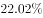
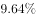
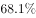
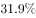
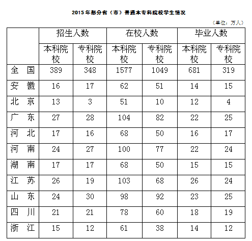

# 增长率变化比较（两期增速作差、百分点）

考点：[[20-考点/资料分析/增长/增长率变化比较（两期增速作差、百分点）|增长 / 增长率变化比较（两期增速作差、百分点）]]
材料：[[15-材料/资料分析/186642 2011—2015年全国教育经费总投|186642 2011—2015年全国教育经费总投]]

**问法模型**：'2014年增速较上年相比约提高/下降几个百分点' → 分别求2014年与2013年的增速（基期量用上题结论），再用现期增速减基期增速，差为负即'下降'，单位为百分点

## 推理链
1. 第1步：由材料第一段提取：2011年总投入23869.29亿元，2012年只给'比上年增加3826.68亿元'，故2012年总量=23869.29+3826.68=27695.97亿元；2014年总量32806.46亿元；结合上题（题1）结论2013年总投入约30400亿元
2. 第2步：锁定口径——本题只用'全国教育经费总投入'（全年口径），排除材料中'2015年1—9月全国财政教育支出'这一不同指标
3. 第3步：所用公式：某年增速=（该年总量−上年总量）/上年总量；增速变化=2014年增速−2013年增速（单位：个百分点）
4. 第4步：代入求2014年增速：（32806.46−30400）/30400≈2406/30400≈7.9%~8.0%（按原卷精确值2013年为30364.72亿元时为8.04%）
5. 第5步：2013年增速由材料直接给出约9.6%（原卷数值9.64%；用27695.97→30400估算亦在9.6%~9.8%区间）
6. 第6步：作差：8.0%−9.6%≈−1.6个百分点，即2014年增速较2013年下降约1.6个百分点，对照选项只有C'下降了1.6个百分点'，故选C

**最快解法**：⚡ 连环题复用+截位直除：直接沿用上题结论2013年≈30400亿元；2014年增速≈2406/30400≈8%（截位直除），2013年增速原卷已给约9.6%，8.0%−9.6%=−1.6个百分点且为负即'下降'，秒选C，无需精算

## 易错点
- ⚠ 增量当总量：2012年材料只给'比上年增加3826.68亿元'（增量非总量），必须先加总得27695.97亿元再用，否则2013年增速及全题皆错
- ⚠ 口径混排：'全国教育经费总投入'（全年）与'全国财政教育支出'（2015年1—9月累计）是两个不同指标，后者不能参与本题2013/2014年增速计算
- ⚠ 百分点与百分数混淆+方向误判：选项问的是增速之差（百分点），须用2014年增速减2013年增速，结果为负对应'下降'；只算绝对值会误选B/D

## 母题抽象
> 🧩 当题干出现'A年增速较上年相比提高/下降约几个百分点'时，先用上题结论或'增量+总量'加总确定两年基期量，分别求增速后作差，差值为负即'下降'，单位是百分点而非百分数

**同类特征**：增速较上年相比、提高/下降的方向判断、单位为个百分点、全国教育经费总投入（全年口径）、需复用上一题的2013年总量结论、两期增速作差

## 相关题
- [[10-真题/资料分析/增长/2051434 两期同比增长率作差（百分点差比较）|2051434]]（新疆 2017，相关度1）

---

### 题干
2014年，全国教育经费投入增速较上年相比约（  ）。

### 选项
- A. 下降了3.2个百分点
- B. 提高了3.2个百分点
- C. 下降了1.6个百分点　✅
- D. 提高了1.6个百分点

### 官方解析
由题干“2014年，全国教育经费投入增速较上年相比”，结合材料2013年的增长率已经给出，可判定该题为一般增长率问题。定位文字材料第一段，2013年，全国教育经费总投入比上年增长，2014年全国教育经费总投入32806.46亿元，结合上题，2013年全国教育经费总投入约为30400亿元。可得2014年全国教育经费投入增速，2014年全国教育经费投入增速较上年相比，约下降了1.6个百分点。
故正确答案为C。

### 给定材料

        2011年，全国教育经费总投入为23869.29亿元，比上年增长。2012年，全国教育经费总投入比上年增加3826.68亿元。2013年，全国教育经费总投入比上年增长，比2009年翻了一番。2014年，全国教育经费总投入32806.46亿元。2015年1-9月，全国财政教育支出累计同比增长。

        2015年，全国普通本专科院校招生人数约为737万人，其中普通本科院校招生人数389万人，比普通专科院校多41万人；在校人数约为2626万人，其中普通本科院校约1577万人，普通专科院校约1049万人；毕业人数约为1000万人，其中普通本科院校约占，普通专科院校约占。

> [!warning] 疑点（官方解析可能有误，待人工复核）
> 本版本文字材料中2013年增速处为空白缺失，而官方解析称'材料2013年的增长率已经给出'（对应原卷数值9.64%）；若仅用本版本可推数据计算（2013≈30400亿元、2012=27695.97亿元），2013年增速≈9.8%、2014年增速≈7.9%，差约1.8~1.9个百分点，与官方'1.6个百分点'略有出入（系2013年总量取整30400所致）；但'下降'的方向判断与正确答案C完全一致，不影响选C
