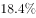
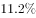
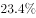
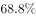
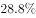

# 增长量计算（两期部分量之差：各期总体×各期占比作差）

考点：[[20-考点/资料分析/增长/增长量计算（两期部分量之差：各期总体×各期占比作差）|增长 / 增长量计算（两期部分量之差：各期总体×各期占比作差）]]
材料：[[15-材料/资料分析/186648 某次社会调查（样本1328人）的受访|186648 某次社会调查（样本1328人）的受访]]

**问法模型**：题干问'去年月收入6000元以上的受访者比今年约少了多少人'→ 用两期部分量分别等于各期总体×各期占比再作差，其中去年占比=今年占比−4.2个百分点（占比差，非增长率）。

## 推理链
1. 第1步：从题干提取去年受访者总人数1467人，材料第一段给出今年总受访者1328人；材料第五段：月收入6000元以上占比'比去年增加4.2个百分点'——注意是占比之差4.2个百分点，不是增长率4.2%。
2. 第2步：公式规则：部分量=总体×占比；设今年占比为a，则去年占比=a−4.2%，所求=今年部分量−去年部分量=1328×a−1467×(a−4.2%)。
3. 第3步：整理化简：差值=1467×4.2%−(1467−1328)×a=61.6−139a，把与占比无关的固定项1467×4.2%≈61.6先行算出。
4. 第4步：代入该档占比（材料正文数值空缺，由官方结论B反推a≈22.7%）：61.6−139×22.7%≈61.6−31.6≈30人，即去年比今年约少30人。
5. 第5步：与选项对照：A.10、B.30、C.60、D.100，差值约30人最接近B项，故选B。

**最快解法**：⚡ 公式变形+百化分速算：差=1467×4.2%−139a≈61.6−139a（4.2%≈1/24，1467÷24≈61）；选项间隔大（10/30/60/100），只要占比a为'两成多'（139×0.2≈28，139×0.25≈35），差值必落在27~34之间，直接锁定B.30。

## 易错点
- ⚠ '个百分点'陷阱：4.2个百分点是两期占比之差，去年占比=今年占比−4.2个百分点；误当作相对增长率（占比×(1−4.2%)）或把4.2%当成占比本身都会算错。
- ⚠ 两期基数不同必须分开乘：今年用1328×今年占比、去年用1467×(今年占比−4.2%)，再作差；共用一个总体或只比较占比高低都会出错，且'谁比谁少'的方向易搞反。
- ⚠ 材料正文各档占比数值均空缺（'6000元以上占__'留白），占比须由原题/解析补全后代入，严禁凭空编数；若只算1467×4.2%≈61.6而不减139a，会得到错误量级。

## 母题抽象
> 🧩 当题干出现'基期总体N₀、现期总体N₁、某部分占比两期相差x个百分点，求两期部分量之差'的特征时，用'差=N₀×x%−(N₀−N₁)×a'先算固定项N₀×x%，再代入占比a（去年占比=今年占比−x个百分点），用截位直除/百化分验证差值落在哪个选项。

**同类特征**：去年受访者总人数为1467人、月收入在6000元以上、比今年约少了（ ）人、比重比去年增加4.2个百分点、两期总体不同（1328 vs 1467）需分别乘各自占比、增长量计算/两期部分量作差

## 相关题
（暂无）

---

### 题干
已知去年受访者总人数为1467人，则月收入在6000元以上的受访者比今年约少了（  ）人。

### 选项
- A. 10
- B. 30　✅
- C. 60
- D. 100

### 官方解析
根据问题所求“……比今年约少了多少人”可判定此题为增长量计算。定位材料第五段，“收入在6000元以上的受访者占，其比重比去年增加了4.2个百分点”，则去年比重为；定位材料第一段今年“受访者人数为1328人”，则今年收入在6000元以上的受访者为，去年人数为，去年比今年少，最接近B项。
故正确答案为B。

### 给定材料

        在我国某次调查中，受访者人数为1328人，其中男性受访者共673人，略高于女性受访者的655人。

        从年龄结构看，30-44岁的受访者居多，占；其次是45-59岁的受访者，占；20-29岁的受访者占；60-74岁的受访者占；20岁以下（不含20岁）和75岁以上的受访者占比比较低，分别是和。

        就受教育程度而言，大学本科的受访者居多，占；其次是中专和大专的受访者，分别占和；高中、初中的受访者分别占和；小学及以下的受访者占；研究生及以上的受访者较少，仅占。

        从职业来看，本次调查涵盖了各类职业人群。其中，专业技术人员占，位居首位，紧跟其后的是商业、服务人员，占；受访者中有较多的学生和离退休人员，分别占和。

        就月收入情况而言，无收入的受访者占；收入在2000元以内的受访者占；收入在2001-3000元的受访者占。的受访者收入在3001-4000元，收入在4001-6000元的受访者占；收入在6000元以上的受访者占，其比重比去年增加了4.2个百分点。

        从婚姻状况来看，的受访者已婚，的受访者未婚，离婚和丧偶的受访者分别占和。

> [!warning] 疑点（官方解析可能有误，待人工复核）
> 材料正文与官方解析中的各占比数值均被空缺略去（解析中'去年比重为；…今年收入在6000元以上的受访者为'等处留白），具体人数无法从本卷独立复算；按官方答案B（约少30人）与公式差=61.6−139a反推，今年'6000元以上'占比应约为22.7%（此时差值≈30.0人），此为口径补全说明，不改变官方答案B。
