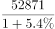
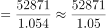

# 基期量计算（由现期量与同比增速倒推上一年）

考点：[[20-考点/资料分析/增长/基期量计算（由现期量与同比增速倒推上一年）|增长 / 基期量计算（由现期量与同比增速倒推上一年）]]
材料：[[15-材料/资料分析/186742 2012年我国农业种植面积与主要农产|186742 2012年我国农业种植面积与主要农产]]

**问法模型**：题干问'2007年粮食产量约为'，而材料只给2008年现期量及同比增速 → 用基期量=现期量/(1+增速)倒推，再与选项首位对照

## 推理链
1. 第1步：题干求2007年粮食产量，材料文字和图中均未直接给出2007年数值，只能由图中2008年数据倒推
2. 第2步：从统计图读取：2008年柱状粮食产量52871万吨，对应折线同比增长5.4%（即2008年相对2007年的增速）
3. 第3步：套用基期量公式：2007年产量=52871/(1+5.4%)=52871/1.054
4. 第4步：截位直除：52871÷1.054≈50162万吨（1.054×50162≈52871，首位商50）
5. 第5步：与选项对照：A 55889、B 50162、C 55726、D 52866，仅B项约50162符合计算结果，故选B

**最快解法**：⚡ 首位法（截位直除）：52871÷1.054，先看首位商'50'，四个选项中仅B（50162）首两位为50，直接锁定，无需精算；同时可识别C（52871×1.054≈55726）为方向算反的干扰项

## 易错点
- ⚠ 基期/现期方向混淆：误用52871×(1+5.4%)≈55726万吨，正好落入干扰项C；正确是除以1.054
- ⚠ 年份混淆：D项52866≈2008年产量52871本身，误把2008年当2007年、没有倒推一年
- ⚠ 数据来源陷阱：2007年数值材料未直接给出，勿误用2012年数据58957或其增速3.2%倒推；同时注意图中柱值（左轴，万吨）与折线（右轴，%）是双轴，不能把折线数值当产量

## 母题抽象
> 🧩 当题干求'上一年（基期）'的量、材料只给后一年现期量与同比增速时，用基期量=现期量/(1+增速)倒推，并用首位/截位直除对照选项首两位快速锁定答案

**同类特征**：求上一自然年（2007年）的产量、现期量与同比增速来自统计图（柱值+折线增速）、基期量计算型提问（'约为'）、四个选项量级相近（5.0万~5.6万），需精确区分、目标年份数据需倒推、无法直接读取

## 相关题
（暂无）

---

### 题干
2007年我国的粮食产量约为（    ）。

### 选项
- A. 55889万吨
- B. 50162万吨　✅
- C. 55726万吨
- D. 52866万吨

### 官方解析

第一步：分析问题

材料中给出现期量和增长率，求基期量，为基期量的计算。现期量为2008年我国粮食产量，增长率为2008年相对2007年的增长率。基期量。

第二步：计算过程

根据图形材料可知，2008年我国粮食产量为52871万吨，增长率为5.4%，故2007年我国粮食产量为：，首位商50，只有B项符合。

第三步：再次标注答案

故正确答案为B。

### 给定材料

        2012年我国粮食种植面积11127万公顷，比上年增加69万公顷；棉花种植面积470万公顷，减少34万公顷，油科种植面积1398万公顷，增加12万公顷；糖料种植面积203万公顷，增加9万公顷。

        全年粮食产量58957万吨，比上年增加1836万吨，增产3.2%。全年棉花产量684万吨，比上年增产3.8%，油料产量3476万吨，比上年增产5.1%，糖料产量13493万吨，比上年增产7.8%，烤烟产量320万吨，比上年增产11.5%；茶叶产量180万吨，比上年增产11.2%。

        全年肉类产量8384万吨，比上年增产5.4%；禽蛋产量2861万吨，比上年增产1.8%，牛奶产量3744万吨，比上年增产2.3%；水产品产量5906万吨，比上年增产5.4%；全年木材产量8088万立方米，比上年下降0.7%；全年新增产效灌溉面积172万公顷，新增节水灌溉面积235万公顷。

