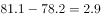
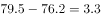
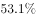
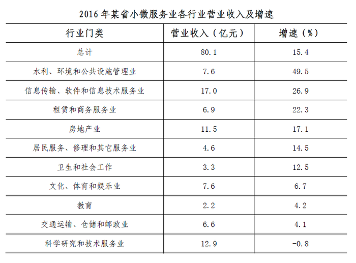

# 同比扩大幅度（百分点差值）比较——折线图逐季同季对比

考点：[[20-考点/资料分析/增长/同比扩大幅度（百分点差值）比较——折线图逐季同季对比|增长 / 同比扩大幅度（百分点差值）比较——折线图逐季同季对比]]
材料：[[15-材料/资料分析/186750 2016年某省小微服务业发展状况：营|186750 2016年某省小微服务业发展状况：营]]

**问法模型**：题干问'同比扩大最显著的是哪个季度'→ 对图1中2016年各季度与2015年同季平稳面作差（单位：个百分点），比较差值取最大者

## 推理链
1. 第1步：从图1提取同季对应数据——2015年Q1-Q4平稳面为79.5%、77.2%、78.2%、76.2%，2016年Q1-Q4为77.9%、76.5%、81.1%、79.5%（注意2014Q4=76.7不参与本题同比）
2. 第2步：规则为'同比扩大幅度=2016年同季值−2015年同季值'，单位是个百分点，不是增长率
3. 第3步：代入计算：1季度=77.9−79.5=−1.6个百分点，2季度=76.5−77.2=−0.7个百分点，3季度=81.1−78.2=+2.9个百分点，4季度=79.5−76.2=+3.3个百分点
4. 第4步：1、2季度差值为负（同比缩小），排除A、B；只需比较3、4季度
5. 第5步：4季度+3.3个百分点＞3季度+2.9个百分点，故4季度同比扩大最显著，对照选项选D
6. 第6步：交叉验证——文字段'2016年4季度…同比提高3.3个百分点'与79.5−76.2=3.3完全吻合，印证结论

**最快解法**：⚡ 同季对位心算法：先逐季对位比较，77.9<79.5、76.5<77.2，1、2季度同比缩小直接排除A、B；再心算81.1−78.2=2.9、79.5−76.2=3.3，3.3更大秒选D；亦可用文字段中'同比提高3.3个百分点'直接锁定4季度

## 易错点
- ⚠ 单位陷阱：图1纵轴是%，同比变化量是'百分点'而非增长率，比较的是差值大小，不能套增速或增长量公式
- ⚠ 对位陷阱：必须用2016年某季与2015年同季比（如2016Q1对2015Q1），不能拿相邻季度比（如误拿2016Q3的81.1对2016Q2的76.5）
- ⚠ '最高点'≠'扩大最多'：81.1%是图中历史最高值（出现在2016年3季度），但3季度同比差2.9个百分点小于4季度的3.3个百分点，且图1首端2014Q4的76.7不参与2016年同比

## 母题抽象
> 🧩 当题干出现'折线图多期数据+同比扩大/提高最显著（同比差值比较）'特征时，用'现期同季−基期同季'逐期求百分点差并取最大，先排除差值为负的期，再用文字段中'提高X个百分点'的表述交叉验证

**同类特征**：同比扩大最显著、经营平稳面、折线图逐季数据、百分点差值比较、同季同比对位、排除同比缩小项

## 相关题
- [[10-真题/资料分析/比重/4637157 占比的同比百分点差值比较（做差计数）|4637157]]（国考 2022，相关度1）
- [[10-真题/资料分析/增长/4817772 增速差值临界计数（两线逐年作差与阈值比较）|4817772]]（四川 2022，相关度1）
- [[10-真题/资料分析/其他/5101669 两率差值比较（覆盖率与绿地率逐年作差找最大年份）|5101669]]（云南 2022，相关度1）
- [[10-真题/资料分析/比重/2261600 比重（比例）变化幅度比较——百分点差值找最小|2261600]]（选调 2017，相关度1）

---

### 题干
2016年，小微服务业经营平稳面同比扩大最显著的是：

### 选项
- A. 1季度
- B. 2季度
- C. 3季度
- D. 4季度　✅

### 官方解析

定位折线图中数据，第1季度：个百分点；第2季度：个百分点；2016年第1季度和第2季度同比均减少，因此只比较第3季度和第4季度，第3季度扩大个百分点，第4季度扩大个百分点，所以2016年第4季度同比扩大最显著。

故正确答案为D。

### 给定材料

        2016年，某省小微服务业呈现出经营平稳面、资产规模、享受税收优惠政策范围“三扩大”的特点，主要行业实现较快增长。

        2016年，该省小微服务业样本企业实现营业收入80.1亿元，同比增长，高于规模以上重点服务业企业8.2个百分点，增速比上年回落0.6个百分点。经营平稳面扩大，2016年4季度，的企业认为本企业综合经营状况良好或稳定，同比提高3.3个百分点，处于历史较高水平。

        2016年，小微服务业样本企业资产总计367亿元，同比增长，户均1643.7万元。负债合计194.8亿元，同比增长，低于资产增长速度1.2个百分点。资产负债率为，处于较为合理水平。实现利润总额4.6亿元，销售利润率为。小微服务业企业的资金和盈利水平均处于平稳状态。

        各主要行业中，水利、环境和公共设施管理业，信息传输、软件和信息技术服务业，租赁和商务服务业，房地产业的增速明显高于平均水平。

