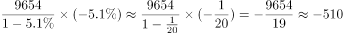

# 增长量计算（同比减少量、负增长求基期）

考点：[[20-考点/资料分析/增长/增长量计算（同比减少量、负增长求基期）|增长 / 增长量计算（同比减少量、负增长求基期）]]
材料：[[15-材料/资料分析/186842 2015年全国社会捐助与慈善服务情况|186842 2015年全国社会捐助与慈善服务情况]]

**问法模型**：'2015年较2014年约增/减多少个'→已知现期9654个与同比降幅，用增长量=现期×r/(1−r)（r取负）一步求减少量。

## 推理链
1. 第1步：题干问'2015年较2014年'且选项为增减绝对个数（±519/±686对称设置），判定为增长量计算；从文字段提取现期：2015年慈善超市9654个，且原文表述为'同比下降'（方向为负）。
2. 第2步：所用公式：基期2014年=现期÷(1−r)，减少量=现期×r÷(1−r)；注意给定文本中'同比下降'后的百分比数值缺失（材料导读已标注数据缺口），按官方解析计算口径降幅r约为5.1%。
3. 第3步：代入计算：2014年慈善超市≈9654÷(1−5.1%)=9654÷0.949≈10173个，减少量≈10173−9654≈519个（官方解析记为'约减少510个'）。
4. 第4步：与选项对照：同比'下降'定减少方向，排除增加项A、C；量级519与D的686不符（686需降幅约6.6%），故选B'减少519个'。

**最快解法**：⚡ 定性排除+百化分速算：先由'同比下降'排除A、C；再将降幅5.1%化为r/(1−r)=5.1/94.9≈1/18.6，减少量≈9654÷18.6≈519个，锁定B（即便只粗算现期×5.1%≈490，也知道真实减少量略大于此、落在500+档，与686明显区分）。

## 易错点
- ⚠ 方向陷阱：'同比下降'对应负增长，误判为'增加'会错选A或C。
- ⚠ 增长量公式陷阱：负增长时减少量=现期×r/(1−r)，若直接用9654×5.1%≈492，会把约519算偏约27个。
- ⚠ 指标与单位混淆：'比上一年减少0.2万个（=2000个）'是捐助站点+慈善超市总数的变化，不是慈善超市的变化；'同比减少10.4万小时'属志愿服务指标且是减少量非减少率，均不可挪用；另给定文本中慈善超市降幅百分比缺失，须依赖原卷数值（约5.1%），不得臆造其他率值。

## 母题抽象
> 🧩 当题干给'现期量+同比增/降率'问'较上年增/减多少'时，先用增/降定方向排除一半选项，再用增长量=现期×r/(1−r)百化分速算量级验证。

**同类特征**：慈善超市较2014年、同比下降（负增长）、求增减绝对个数、现期9654个、选项±519/±686对称设置、'个'与'万个'单位混排

## 相关题
- [[10-真题/资料分析/增长/2262599 基期量计算（带下降率）|2262599]]（选调 2016，相关度1）
- [[10-真题/资料分析/增长/2388015 基期量计算（同比下降型）|2388015]]（河北 2019，相关度1）

---

### 题干
2015年，全国建立的慈善超市较2014年约：

### 选项
- A. 增加519个
- B. 减少519个　✅
- C. 增加686个
- D. 减少686个​

### 官方解析

由题干“2015年……较2014年”结合选项增加或减少多少个，可判断本题是增长量计算问题。定位文字材料第一段，2015年慈善超市9654个，同比下降，增长量=（约减少510个），与B项最接近。

故正确答案为B。

### 给定材料

        2015年全国共建立社会捐助工作站、点和慈善超市3.0万个，比上一年减少0.2万个，其中：慈善超市9654个，同比下降。全年共接收社会捐赠款654.5亿元，其中：民政部门接收社会各界捐款44.2亿元，各类社会组织接收捐款610.3亿元。全年民政部门接收捐赠衣被4537.0万件，捐赠物资价值折合人民币5.2亿元。全年有1838.4万人次困难群众受益，同比增长，增长率较上一年下降27.5个百分点。全年有934.6万人次在社会服务领域提供了2700.7万小时的志愿服务，同比减少10.4万小时。 

> [!warning] 疑点（官方解析可能有误，待人工复核）
> 给定材料文本中'慈善超市9654个，同比下降'后的百分比缺失（材料导读已标注该数据缺口），官方解析公式中亦未显式写出率值；按官方答案B（减少519个）反推降幅应约为5.1%（9654÷0.949−9654≈519）。另官方解析表述'约减少510个'与精确值519略有出入，属近似口径，不影响答案B。

<!-- CODEX-ANSWER-REVIEW:BEGIN -->
### 本次独立复核

**复核状态：** `confirmed`（独立复算确认答案）

**计分答案：** B（可计分）

**复核解析：**

公式图读到同比下降5.1%。减少量=9654×5.1%/(1−5.1%)=约519.0个，方向为减少，对应B项减少519个。

**相关信息：**

资料分析需把图表中缺失或低清公式数据核读后再代入公式；比重百分点变化直接加减，增速变化按基期/现期增长因子还原。

**题源依据：** [固定版本原题](https://github.com/Mentat-Uran/kaogongzhentizhengliu/blob/84ab93d4b64b61d897bece8a1c0a5bab06b4feb2/10-%E7%9C%9F%E9%A2%98/%E8%B5%84%E6%96%99%E5%88%86%E6%9E%90/%E5%A2%9E%E9%95%BF/2049534%20%E5%A2%9E%E9%95%BF%E9%87%8F%E8%AE%A1%E7%AE%97%EF%BC%88%E5%90%8C%E6%AF%94%E5%87%8F%E5%B0%91%E9%87%8F%E3%80%81%E8%B4%9F%E5%A2%9E%E9%95%BF%E6%B1%82%E5%9F%BA%E6%9C%9F%EF%BC%89.md)；固定内容 commit `84ab93d4b64b61d897bece8a1c0a5bab06b4feb2`，Markdown blob `2f290414ccf710de70b06e994447ff7d8787a62e`。
<!-- CODEX-ANSWER-REVIEW:END -->
