# 环比增长率计算（已知现期量与环比增长量）

考点：[[20-考点/资料分析/增长/环比增长率计算（已知现期量与环比增长量）|增长 / 环比增长率计算（已知现期量与环比增长量）]]
材料：[[15-材料/资料分析/186850 2016年一季度（重点3月单月）我国|186850 2016年一季度（重点3月单月）我国]]

**问法模型**：题干问'3月出口煤及褐煤环比约增长多少个百分点'且材料直接给出环比增长量36万吨 → 用 增长率=增长量÷(现期量−增长量) 反推基期求环比增速

## 推理链
1. 第1步：题干锁定'2016年3月出口煤及褐煤'的环比增速；文字材料给出'3月出口煤及褐煤127万吨，环比增长36万吨'，统计表出口行3月量127万吨可交叉验证现期值
2. 第2步：环比基期为2016年2月出口量，公式：基期量=现期量−增长量=127−36=91万吨，环比增长率=增长量÷基期量
3. 第3步：代入计算：36÷91≈0.396，即约39.6%
4. 第4步：截位验证：91×40%=36.4略大于36，故结果略低于40%但最接近40
5. 第5步：对照选项，A25/B30/C35均偏差大，仅D.40与39.6%最接近，故选D

**最快解法**：⚡ 公式法+截位直除：环比增长量36万吨已直接给出，基期=127−36=91万吨，36/91≈39.6%≈40，直接选D（无需动用表格279的累计数据）

## 易错点
- ⚠ 环比基期错拆：误把表格1~3月出口279−3月127=152（这是1~2月合计）当作2月基期，错算(127−152)/152≈−16%且无对应选项；应从文字'环比增长36万吨'反推2月=127−36=91万吨
- ⚠ 问法口径瑕疵：题干'多少个百分点'按官方注释应理解为增长率百分比（≈40%），勿因百分点是'两率之差'的定义纠结而错判
- ⚠ 同名数据干扰：3月出口煤及褐煤127万吨与3月进口钢材127万吨数值相同易张冠李戴；出口方向为增长，勿与正文多处'下降'表述语感混淆

## 母题抽象
> 🧩 当题干问'环比增长百分之多少'且材料直接给出环比增长量（多少万吨）时，用 增长率=增长量÷(现期−增长量) 先反推基期，再截位直除对照选项

**同类特征**：3月单月环比增速、出口煤及褐煤、环比增长量直接给出(36万吨)、'增长多少个百分点'问法、现期量与增长量均已知、四选项为正的百分数数值

## 相关题
（暂无）

---

### 题干
2016年3月我国出口煤及褐煤环比约增长多少个百分点？

### 选项
- A. 25
- B. 30
- C. 35
- D. 40　✅

### 官方解析

由题干求“2016年3月我国出口煤及褐煤环比约增长多少个百分点”可知，本题为一般增长率问题。定位材料第一段“2016年3月我国出口煤及褐煤127万吨，环比增长36万吨”，则所求增长率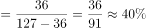。

故正确答案为D。

注意：本题问法有瑕疵，应该问增长了百分之多少而不是多少个百分点，但本题答案为是没有任何问题的。

### 给定材料

        2016年3月我国煤及褐煤进口量为1969万吨，环比增长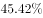，同比增长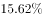。3月我国出口煤及褐煤127万吨，环比增长36万吨，同比增长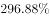。

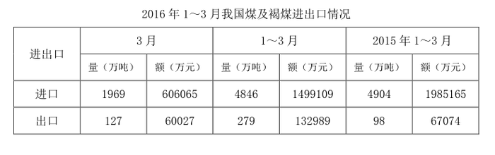

        3月焦炭出口量112万吨，环比增长24万吨，增长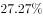，同比增长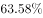；1~3月累计出口焦炭274万吨，累计同比增长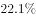。

        3月全国钢材出口量998万吨，环比增长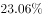，同比增长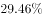；1~3月累计出口钢材2783万吨，累计同比增长。3月份进口钢材127万吨，环比增长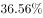，同比增长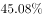；1~3月累计进口钢材313万吨，累计同比下降。

        铁矿石、原油、铜等大宗商品主要进口商品价格持续低位。2016年一季度，我国进口铁矿石2.42亿吨，增长；原油9110万吨，增长；铜143万吨，增长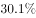。同期，进口煤及褐煤4846万吨，下降；成品油775万吨，下降；钢材313万吨，下降。同期，我国进口价格总体下跌。其中，铁矿石进口均价同比下跌，原油下跌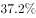，成品油下跌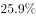，煤及褐煤下跌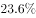，铜下跌，钢材下跌。

> [!warning] 疑点（官方解析可能有误，待人工复核）
> 官方解析自注问法瑕疵：'增长多少个百分点'实为求环比增长率百分比（36/91≈39.6%≈40），非严格意义的百分点之差，答案D不受影响；另材料导读建议'用表格279−127=152作基期求环比'与官方解析（环比增长36万吨→基期=127−36=91）相矛盾且无对应选项，本笔记以官方解析为准
