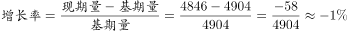

# 同比增长率计算（现期与基期两期量直接对比）

考点：[[20-考点/资料分析/增长/同比增长率计算（现期与基期两期量直接对比）|增长 / 同比增长率计算（现期与基期两期量直接对比）]]
材料：[[15-材料/资料分析/186850 2016年一季度（重点3月单月）我国|186850 2016年一季度（重点3月单月）我国]]

**问法模型**：题干问'2016年1~3月进口量约比去年同期增/降多少'且选项为'增加/下降+百分数'→用增长率=(现期−基期)/基期，先定方向再算数值

## 推理链
1. 第1步：从表格提取两期数据——2016年1~3月煤及褐煤进口量4846万吨，2015年1~3月（去年同期）进口量4904万吨
2. 第2步：所用公式：同比增长率=(现期量−基期量)/基期量
3. 第3步：代入计算：(4846−4904)/4904=−58/4904≈−1.2%，增长率为负
4. 第4步：方向为'下降'，数值约1.2%，排除'增加'的C、D项，与'下降'方向选项对照，A项符合官方答案
5. 第5步：交叉验证：文字段'同期，进口煤及褐煤4846万吨，下降'的方向表述与计算结果一致（文字中百分比数值缺失，以表格计算为准）

**最快解法**：⚡ 方向排除法+截位直除：先比大小——4846<4904，必为下降，直接排除C、D；再估算降幅58/4904≈58/4900≈1.2%，即下降约1.2%，锁定A

## 易错点
- ⚠ 方向张冠李戴：本题进口是下降（4846<4904），而同期出口279对98是大幅增长，勿被同表中出口的增长方向带偏；文字段'进口煤及褐煤4846万吨，下降'可作方向验证
- ⚠ 数据张冠李戴：表格进口、出口两行数值密集（3月进口1969/出口127，1~3月进口4846/出口279，2015年进口4904/出口98），必须取'进口行'的1~3月与2015年1~3月两列，勿误用3月单月1969或出口数据
- ⚠ 基期现期混淆：分母应为基期4904万吨而非现期4846万吨；时间口径是1~3月累计而非3月单月

## 母题抽象
> 🧩 当题干问'某指标现期比去年同期增/降多少'且表格直接给出两期数值时，先比较两期大小定方向排除一半选项，再用(现期−基期)/基期截位直除估算百分比验证

**同类特征**：1~3月累计进口量、比去年同期、增加/下降+百分数选项、煤及褐煤进口、表格直接给出两期量、同比增速计算

## 相关题
- [[10-真题/资料分析/增长/2374828 增长率计算（两期相比的下降幅度）|2374828]]（广东 2019，相关度1）

---

### 题干
2016年1~3月我国煤及褐煤进口量约比去年同期：

### 选项
- A. 
下降
　✅
- B. 
下降

- C. 
增加

- D. 
增加

### 官方解析

方法一：由题干求“2016年13月我国煤及褐煤进口量比去年同期”结合选项为百分数，可知本题为一般增长率问题。定位材料最后一段：“13月······同期，进口煤及褐煤4846万吨，下降”，即2016年13月煤及褐煤进口量比去年同期约下降。

方法二：由题干求“2016年1~3月我国煤及褐煤进口量比去年同期”结合选项为百分数，可知本题为一般增长率问题。定位表格数据，“2016年1~3月煤及褐煤进口量为4846万吨，2015年1~3月煤及褐煤进口量为4904万吨”，，增长率为负，说明约下降。

故正确答案为A。

### 给定材料

        2016年3月我国煤及褐煤进口量为1969万吨，环比增长，同比增长。3月我国出口煤及褐煤127万吨，环比增长36万吨，同比增长。

        3月焦炭出口量112万吨，环比增长24万吨，增长，同比增长；1~3月累计出口焦炭274万吨，累计同比增长。

        3月全国钢材出口量998万吨，环比增长，同比增长；1~3月累计出口钢材2783万吨，累计同比增长。3月份进口钢材127万吨，环比增长，同比增长；1~3月累计进口钢材313万吨，累计同比下降。

        铁矿石、原油、铜等大宗商品主要进口商品价格持续低位。2016年一季度，我国进口铁矿石2.42亿吨，增长；原油9110万吨，增长；铜143万吨，增长。同期，进口煤及褐煤4846万吨，下降；成品油775万吨，下降；钢材313万吨，下降。同期，我国进口价格总体下跌。其中，铁矿石进口均价同比下跌，原油下跌，成品油下跌，煤及褐煤下跌，铜下跌，钢材下跌。

> [!warning] 疑点（官方解析可能有误，待人工复核）
> 题干选项中的两个百分比数值以图片形式给出无法直接读取，材料文字中同比增速数值亦空缺；但由表格计算降幅≈1.2%，方向与数值均与官方答案A（'下降'项）一致，不影响答案判定
