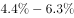

# 混合增长率（居中偏向）

考点：[[20-考点/资料分析/增长/混合增长率（居中偏向）|增长 / 混合增长率（居中偏向）]]
材料：[[15-材料/资料分析/186852 2016年1季度全国规模以上文化及相|186852 2016年1季度全国规模以上文化及相]]

**问法模型**：题干出现'两个产业合并计算的总体增速' → 采用混合增长率模型：整体增速介于两部分增速之间，且偏向基数（收入）大的一方

## 推理链
1. 第1步：定位统计表'按产业分'，收入最高的两个产业为文化用品的生产（6422亿元，增速6.3%）和工艺美术品的生产（3272亿元，增速4.4%）
2. 第2步：混合增长率规则——合并后整体增速必介于4.4%与6.3%之间，且偏向基数大的一方；两产业增速较小，可用现期收入6422、3272近似代替基期量作权重
3. 第3步：定量加权验证：整体增速≈(6422×6.3%+3272×4.4%)÷(6422+3272)=(40459+14397)÷9694≈54856÷9694≈5.66%
4. 第4步：与选项对照：A(4.4)恰为下界、D(6.4)超出上界，先排除A、D
5. 第5步：判断偏向：|5.7-6.3|=0.6<|5.7-4.4|=1.3，5.7%偏向大基数6.3%一侧；而B项5.1%满足|5.1-4.4|=0.7<|6.3-5.1|=1.2，偏向小基数4.4%一侧，与规则矛盾，排除B
6. 第6步：故正确答案为C(5.7)，与定量计算5.66%最接近

**最快解法**：⚡ 混合增长率'居中+偏向大基数'定性排除法+截位直除验证：先由区间(4.4%,6.3%)秒杀排除A、D；再由6422>3272知整体增速偏向6.3%一侧，5.1%偏小排除B；定量核对(6422×6.3+3272×4.4)÷9694≈5.66%≈5.7

## 易错点
- ⚠ 把'收入最高'错看成'增速最快'：增速最快的是文化信息传输服务(27.8%)、文化艺术(25.0%)等，收入最高的却是文化用品(6422亿元)和工艺美术品(3272亿元，增速仅4.4%)，两个口径指向完全不同的产业
- ⚠ 误用简单平均(6.3%+4.4%)÷2=5.35%再就近猜5.1(B)，忽略混合增速必须按基数加权、偏向大基数6.3%一侧
- ⚠ 偏向方向判断颠倒：基数是收入6422（大）对应6.3%，3272（小）对应4.4%，整体增速应更靠近6.3%，不是靠近4.4%

## 母题抽象
> 🧩 当题干出现'两部分合并/加总后的总体增速（或整体增长率）'特征时，用混合增长率模型：整体增速必介于两部分增速之间、偏向基数大的一方，用加权式(Σ现期量×增速)÷Σ现期量定量验证

**同类特征**：营业收入最高的两个产业、合并计算、总体增速、最接近以下哪个数字、混合增长率、按产业分数据

## 相关题
- [[10-真题/资料分析/增长/12536411 混合增长率（整体=限上+限下，线段法-口诀定区间）|12536411]]（四川 2024，相关度1）
- [[10-真题/资料分析/增长/2049536 混合增长率（多主体合计-平均增速，居中偏向基期量大）|2049536]]（新疆 2017，相关度1）
- [[10-真题/资料分析/增长/2050992 混合增长率（居中原则-线段法）|2050992]]（江西 2017，相关度1）
- [[10-真题/资料分析/增长/2274485 混合增速（全年-上半年-下半年增速大小关系推断与计数）|2274485]]（北京 2019，相关度1）
- [[10-真题/资料分析/增长/19526214 混合增长率定性判断（出口+进口整体增速升降计数）|19526214]]（国考 2026，相关度1）

---

### 题干
合并计算2016年1季度营业收入最高的两个产业，其营业收入总体增速最接近以下哪个数字？

### 选项
- A. 4.4
- B. 5.1
- C. 5.7　✅
- D. 6.4

### 官方解析

根据题干所求“合并计算2016年1季度营业收入最高的两个企业，其营业收入总体增速······”可判定此题为混合增长率问题。

定位表格材料可知，收入最高的两个企业为文化用品和工艺美术品，其增长率分别为和，根据混合增长率整体增长率居中，可知整体增长率一定在之间，排除Ａ、Ｄ两项。

混合增长率整体增长率偏向基数大的，已知文化用品的生产收入6422亿元大于工艺美术品的生产收入3272亿元，所以增长率偏向于，而B项与的差值大于与的差值，排除B项。

故正确答案为C。

### 给定材料

        2016年1季度，全国规模以上文化及相关产业企业共4.7万家，实现营业收入16719亿元，比上年同期增长，增速比上年全年增速提高1.7个百分点。 

 

