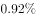

# 同比增速比较（直接读表）

考点：[[20-考点/资料分析/增长/同比增速比较（直接读表）|增长 / 同比增速比较（直接读表）]]
材料：[[15-材料/资料分析/186854 2016年6月及2016年1~6月我|186854 2016年6月及2016年1~6月我]]

**问法模型**：题干问'1-6月四个商品零售分类中同比增速最快的是' → 直接定位统计表'1—6月·同比增长(%)'列，对四个选项的增速数值比大小，无需计算

## 推理链
1. 第1步：从题干确定时间口径为2016年1—6月（累计口径），比较对象为四个选项分类的同比增速，故只能取统计表右栏数据
2. 第2步：定位表格'1—6月'栏'同比增长(%)'列，读取四个选项所在行：汽车（绝对量18270亿元）7.7%、石油及制品（8815亿元）-1.3%、家用电器和音像器材（4076亿元）7.3%、通讯器材（1829亿元）14.9%
3. 第3步：直接比较四个百分数：14.9%＞7.7%＞7.3%＞-1.3%，通讯器材14.9%为最大（负增长的石油及制品排最末）
4. 第4步：与选项对照，14.9%对应D.通讯器材，与官方答案D一致

**最快解法**：⚡ 直接读数比较法：锁定表格'1—6月·同比增长(%)'一列，只扫四个选项所在行——汽车7.7、石油-1.3、家电7.3、通讯器材14.9，一眼锁定14.9%最大即选D，零计算

## 易错点
- ⚠ 时间口径混淆：误看6月单月列（通讯器材12.1%、家用电器12.3%），若用6月数据会误选C家用电器和音像器材；题干问1-6月必须用表格右列
- ⚠ 忽略负值参与排序：石油及制品1-6月为-1.3%（负增长），比较'最快'时负值直接参与比较且垫底，不能跳过或当0处理
- ⚠ 绝对量干扰：汽车1-6月绝对量18270亿元为四项中最大，切勿以规模最大误代增速最快，二者口径不同

## 母题抽象
> 🧩 当题干出现'某时间段、若干分类指标中同比增速最快/最慢'特征时，直接定位统计表对应时间口径（当期列vs累计列）的增速列比大小，并核查正负号与并列值（如本题材料中家具与建筑及装潢材料同为15.6%）

**同类特征**：2016年1-6月份、同比增速最快、商品零售分类选项、直接读表比较、累计口径增速列

## 相关题
- [[10-真题/资料分析/增长/2033330 增长率最值比较+百分点差值计算（纯读表题）|2033330]]（河南 2016，相关度1）
- [[10-真题/资料分析/增长/2097276 同比增速直接读表比较|2097276]]（四川 2017，相关度1）
- [[10-真题/资料分析/增长/2261975 同比增速（增长率）大小比较|2261975]]（广东 2019，相关度1）
- [[10-真题/资料分析/增长/2741707 增长率（同比增速）比较|2741707]]（山东 2021，相关度1）
- [[10-真题/资料分析/增长/5802088 增长率比较（基期需由现期−增量还原）|5802088]]（浙江 2023，相关度1）

---

### 题干
2016年1-6月份，以下选项中，商品零售同比增速最快的是：

### 选项
- A. 汽车
- B. 石油及制品
- C. 家用电器和音像器材
- D. 通讯器材　✅

### 官方解析
定位表格第五列，2016年1-6月份，汽车同比增速为，石油及制品同比增速为，家用电器和音像器材同比增速为，通讯器材同比增速为，所以商品零售同比增速最快的为通讯器材。
故正确答案为D。

### 给定材料

根据以下资料，回答下列小题。

        2016年6月份，我国社会消费品零售总额26857亿元，同比增长，环比增长。其中，限额以上单位消费品零售额13006亿元，同比增长。

        2016年1~6月份，我国社会消费品零售总额156138亿元，同比增长。其中，限额以上单位消费品零售额71075亿元，同比增长。

        按经营单位所在地分，2016年6月份，城镇消费品零售额23082亿元，同比增长；乡村消费品零售额3775亿元，同比增长。1~6月份，城镇消费品零售额134249亿元，同比增长；乡村消费品零售额21889亿元，同比增长。

        按消费类型分，2016年6月份，餐饮收入2907亿元，同比增长；商品零售23951亿元，同比增长。1~6月份，餐饮收入16683亿元，同比增长；商品零售139455亿元，同比增长。

        2016年1~6月份，全国网上零售额22367亿元，同比增长。其中，实物商品网上零售额18143亿元，同比增长。

> [!warning] 疑点（官方解析可能有误，待人工复核）
> 官方解析文字中四个选项的增速数值留白（因原文百分数空缺），补入表格实际值：汽车7.7%、石油及制品-1.3%、家用电器和音像器材7.3%、通讯器材14.9%，结论D无误，不影响答案
