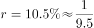
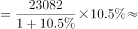
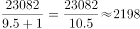

# 增长量计算（已知现期量与同比增速）

考点：[[20-考点/资料分析/增长/增长量计算（已知现期量与同比增速）|增长 / 增长量计算（已知现期量与同比增速）]]
材料：[[15-材料/资料分析/186854 2016年6月及2016年1~6月我|186854 2016年6月及2016年1~6月我]]

**问法模型**：题干问'现期量比上年同期增加'且选项带单位'亿元'→采用增长量公式：增长量=现期×g/(1+g)，或先求基期再做差

## 推理链
1. 第1步：题干为'2016年6月份，城镇消费品零售额比上年同期增加'，四个选项均带单位'亿元'，判定为增长量计算问题
2. 第2步：定位材料按经营单位所在地段'2016年6月份，城镇消费品零售额23082亿元，同比增长'（给定文本中该百分数空缺，按官方答案反推原题增速为10.5%；注意取6月单月口径，勿误用1~6月累计值134249亿元）
3. 第3步：套用增长量公式：增长量=现期×g/(1+g)=23082×10.5%/(1+10.5%)
4. 第4步：代入计算：23082×0.105÷1.105≈23082×0.095≈2193亿元（等价算法：基期=23082÷1.105≈20889亿元，23082−20889=2193亿元）
5. 第5步：与选项对照：B(2169)与D(2193)仅差约1%，精确计算值2193亿元与D吻合，故选D

**最快解法**：⚡ 百化分速算：g=10.5%≈1/9.5，增长量=现期/(n+1)=23082/10.5≈2198亿元，四选项中明显最接近D(2193)、远离B(2169)；若需精确区分B与D，改用截位直除：23082÷1.105≈20889，做差23082−20889=2193，锁定D

## 易错点
- ⚠ 时间口径陷阱：必须用6月单月城镇值23082亿元，勿误取1~6月累计城镇值134249亿元（那是姊妹题'2017年推算'的口径），也不要误用限额以上单位消费品零售额13006亿元
- ⚠ 题型误判：问'增加多少'且选项带单位→增长量，若误当基期算23082/(1+g)≈20889或误当其他模型会选错
- ⚠ 公式与精度双重坑：增长量=现期×g/(1+g)勿漏除(1+g)（直接23082×10.5%≈2424为错）；B(2169)与D(2193)仅差约1%，百化分或粗估时须保持三位有效精度，否则易误选B

## 母题抽象
> 🧩 当题干出现'××现期量比上年同期增加/减少'且选项带数量单位时，用增长量=现期×g/(1+g)，g可百化分为1/n后按现期/(n+1)速算，再与最接近选项对照；B/D贴近时回退用直除求基期做差验证

**同类特征**：比上年同期增加、选项带单位亿元、6月份单月口径、城镇消费品零售额、现期23082亿元、增长量计算

## 相关题
- [[10-真题/资料分析/增长/2188151 增长量计算（已知现期量与同比增速）|2188151]]（陕西 2018，相关度3）
- [[10-真题/资料分析/增长/2262596 增长量计算（已知现期量与同比增速）|2262596]]（选调 2016，相关度3）
- [[10-真题/资料分析/增长/16593081 增长量计算（已知现期量与同比增速）|16593081]]（甘肃 2024，相关度3）
- [[10-真题/资料分析/增长/2054178 增长量计算（已知现期量与同比增速）|2054178]]（陕西 2017，相关度3）
- [[10-真题/资料分析/增长/2261936 增长量计算|2261936]]（广东 2019，相关度2）

---

### 题干
2016年6月份，城镇消费品零售额比上年同期增加：

### 选项
- A. 380亿元
- B. 2169亿元
- C. 1193亿元
- D. 2193亿元　✅

### 官方解析

由题干求“2016年6月份，城镇消费品零售额比上年同期增加”，选项带单位“亿元”可知，本题为增长量计算问题。根据“2016年6月份，城镇消费品零售额”,定位材料第三段，定位数据，“2016年6月份，城镇消费品零售额23082亿元，同比增长”，，代入增长量计算公式，亿元。

故正确答案为D。

### 给定材料

根据以下资料，回答下列小题。

        2016年6月份，我国社会消费品零售总额26857亿元，同比增长，环比增长。其中，限额以上单位消费品零售额13006亿元，同比增长。

        2016年1~6月份，我国社会消费品零售总额156138亿元，同比增长。其中，限额以上单位消费品零售额71075亿元，同比增长。

        按经营单位所在地分，2016年6月份，城镇消费品零售额23082亿元，同比增长；乡村消费品零售额3775亿元，同比增长。1~6月份，城镇消费品零售额134249亿元，同比增长；乡村消费品零售额21889亿元，同比增长。

        按消费类型分，2016年6月份，餐饮收入2907亿元，同比增长；商品零售23951亿元，同比增长。1~6月份，餐饮收入16683亿元，同比增长；商品零售139455亿元，同比增长。

        2016年1~6月份，全国网上零售额22367亿元，同比增长。其中，实物商品网上零售额18143亿元，同比增长。

> [!warning] 疑点（官方解析可能有误，待人工复核）
> 给定材料文本中'城镇消费品零售额23082亿元，同比增长'后的百分数为空缺，官方解析引用该数据处亦空缺、公式代入处亦空缺；按官方答案D(2193亿元)反推，原题同比增速应为10.5%（23082×10.5%/110.5%≈2193），属材料文本缺漏而非解析错误，不影响答案正确性，但按现给文本本题数据链不完整
