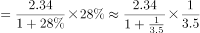
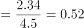

# 增长量计算（已知现期值与同比增速，公式 现期×r-(1+r)）

考点：[[20-考点/资料分析/增长/增长量计算（已知现期值与同比增速，公式 现期×r-(1+r)）|增长 / 增长量计算（已知现期值与同比增速，公式 现期×r/(1+r)）]]
材料：[[15-材料/资料分析/186964 2015年中关村上市公司经营竞争力概|186964 2015年中关村上市公司经营竞争力概]]

**问法模型**：题干'2015年与2014年相比……总营业收入增加了'且选项均带'万亿元'单位→判定为增长量计算，套用公式 增长量=现期×r/(1+r) 求值后对照选项。

## 推理链
1. 第1步：题干关键词'2015年与2014年相比……营业收入增加了'，四个选项均为带'万亿元'的具体数值，判定为增长量计算题。
2. 第2步：定位文字材料第一段：现期（2015年）总营业收入=2.34万亿元（=23400亿元）；同比增速在所给文本中空缺，按官方答案A反推：r/(1+r)=0.51/2.34≈21.8%，故r≈27.9%（原卷增速应为27.9%左右）。
3. 第3步：套用公式：增长量=现期×r/(1+r)=2.34×0.279/1.279万亿元。
4. 第4步：速算：0.28/1.28=7/32≈21.9%，2.34×21.9%≈0.51万亿元。
5. 第5步：对照选项：结果≈0.51万亿元与A项吻合；B(0.65)≈2.34×27.9%系漏除(1+r)、C(1.83)=2.34-0.51系把增长量误当基期量、D(0.41)≈2.34×18%系误用图1净利润增速，均排除，故选A。

**最快解法**：⚡ 公式法+百化分：r≈28%，则r/(1+r)≈0.28/1.28=7/32≈22%，增长量≈2.34×22%≈0.51万亿元，直接锁定A；若增速空缺，可反向验证：选项÷现期=0.51/2.34≈21.8%，反推增速≈27.9%（合理量级），其余选项反推的增速（38.5%、359%、21.2%）无法与之匹配。

## 易错点
- ⚠ 漏除(1+r)：误用'现期×r'得2.34×27.9%≈0.65，恰好错选B项，增长量必须乘r/(1+r)。
- ⚠ 增长量与基期量混淆：算出增长量0.51后误当作2014年营收，用2.34-0.51=1.83错选C项。
- ⚠ 口径与量级陷阱：图1折线的18%是净利润增速，与营收同比增速是两个不同指标，误用会得2.34×18%≈0.42错选D；同时'2.34万亿元'与图表'亿元'混用，若换算为23400亿元计算须把结果5100亿元再换回0.51万亿元。

## 母题抽象
> 🧩 当题干出现'A年比B年增加/增长了'且选项与现期同单位时，用增长量=现期×r/(1+r)，把r化为特殊分数（如28%→r/(1+r)≈22%）速乘后选最接近项；若材料增速空缺，可用'选项÷现期'反推r验证合理性再锁定答案。

**同类特征**：'与2014年相比……增加了'+数值、选项带万亿元量纲单位、现期值在文字材料（2.34万亿元）、需同比增速数据求增长量、公式 现期×r/(1+r)、万亿元与亿元量级换算

## 相关题
- [[10-真题/资料分析/增长/2452566 增长量计算（已知现期量与同比增速，求同比增加量）|2452566]]（江苏 2020，相关度1）

---

### 题干
2015年与2014年相比，中关村上市公司总营业收入增加了：

### 选项
- A. 0.51万亿元　✅
- B. 0.65万亿元
- C. 1.83万亿元
- D. 0.41万亿元

### 官方解析

根据题干所求“2015年与2014年相比······营业收入增加了”，选项带单位，可判定此题为增长量计算问题。定位文字材料第一段，“2015年中关村上市公司总营业收入达到2.34万亿元，同比增长”。代入公式：万亿元，最接近A项。

故正确答案为A。

### 给定材料

        中关村上市公司协会公布的《2016年中关村上市公司竞争力报告》显示，2015年中关村上市公司总营业收入达到2.34万亿元，同比增长，截至2015年底，中关村上市公司总市值达到48175亿元，同比增幅，较2011年增长了约34824亿元。

        中关村上市公司中有接近六成的企业研发投入力度较高，其中有67家（公司数量占比）企业的研发强度在及以上，达到了国际高科技领先企业的水平。

> [!warning] 疑点（官方解析可能有误，待人工复核）
> 所给材料原文与官方解析中的营收同比增速数值均空缺（解析'代入公式：____万亿元'中间数字缺失），本题按官方答案A反推增速≈27.9%（0.51/2.34≈21.8%→r≈27.9%）完成验算，与答案A无矛盾；实际应考须以原卷补全该百分数，不得以图1净利润增速18%等其他口径替代。

<!-- CODEX-ANSWER-REVIEW:BEGIN -->
### 本次独立复核

**复核状态：** `resolved`（答案与解析已核定）

**计分答案：** A（可计分）

**复核解析：**

2015中关村上市公司营业收入2.34万亿元、同比增长28%。增量=2.34×28%/128%≈0.512万亿元，A。

**相关信息：**

增长量=现期量×增长率/(1+增长率)；同比下降题先明确增长量符号。百分点和百分比需按材料口径区分。

**题源依据：** [固定版本原题](https://github.com/Mentat-Uran/kaogongzhentizhengliu/blob/84ab93d4b64b61d897bece8a1c0a5bab06b4feb2/10-%E7%9C%9F%E9%A2%98/%E8%B5%84%E6%96%99%E5%88%86%E6%9E%90/%E5%A2%9E%E9%95%BF/2050634%20%E5%A2%9E%E9%95%BF%E9%87%8F%E8%AE%A1%E7%AE%97%EF%BC%88%E5%B7%B2%E7%9F%A5%E7%8E%B0%E6%9C%9F%E5%80%BC%E4%B8%8E%E5%90%8C%E6%AF%94%E5%A2%9E%E9%80%9F%EF%BC%8C%E5%85%AC%E5%BC%8F%20%E7%8E%B0%E6%9C%9F%C3%97r-(1%2Br)%EF%BC%89.md)；固定内容 commit `84ab93d4b64b61d897bece8a1c0a5bab06b4feb2`，Markdown blob `2b153df915d6f746da5f96a9c89d16d39c72b350`。
<!-- CODEX-ANSWER-REVIEW:END -->
