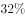

# 两期增速变化比较（百分点差值）

考点：[[20-考点/资料分析/增长/两期增速变化比较（百分点差值）|增长 / 两期增速变化比较（百分点差值）]]
材料：[[15-材料/资料分析/186964 2015年中关村上市公司经营竞争力概|186964 2015年中关村上市公司经营竞争力概]]

**问法模型**：题干问'2015年与2014年相比净利润同比增速上升/下降几个百分点'→ 直接用现期增速减基期增速作差（单位为百分点），无需计算增长率本身

## 推理链
1. 第1步：定位图1折线（增长率%），读出2014年净利润同比增速为23%，2015年为18%
2. 第2步：增速变化量=现期增速-基期增速=18%-23%=-5个百分点，负值即下降
3. 第3步：用柱状数据验算：(902-766)/766≈17.8%≈18%（2015年），(766-621)/621≈23.3%≈23%（2014年），与折线读数互相印证
4. 第4步：2015年增速比2014年下降5个百分点，对照选项只有B'下降了5个百分点'符合

**最快解法**：⚡ 折线直读+作差：图1右轴直接读出2014年23%、2015年18%，18-23=-5，秒选B，完全不用动笔算增长率

## 易错点
- ⚠ 双轴读数错位：柱对应左轴（净利润亿元）、折线对应右轴（增速%），若把902、766误当增速读数，计算方向全错
- ⚠ '百分点'与'%'量纲混淆：两期增速之差是百分点，不能再用增速作除法或把18%当成变化量
- ⚠ 方向与数值错配：23%→18%是下降5个百分点，误把2015年增速18当作变化幅度会错选A'上升18个百分点'，误把18与'下降'组合会错选D

## 母题抽象
> 🧩 当题干出现'两期增速相比上升/下降了X个百分点'时，直接从图中读出两期增速作差（现期-基期），差值正负定升降、绝对值定百分点数，不要重新计算增速

**同类特征**：2015年与2014年相比、净利润同比增速、上升/下降、个百分点、两期增速比较、双轴图折线读数

## 相关题
- [[10-真题/资料分析/比重/1752600 两期比重变化（比重差，百分点表述）|1752600]]（北京 2016，相关度2）
- [[10-真题/资料分析/增长/10718183 名义增速与实际增速之差（百分点计算）|10718183]]（深圳市考 2024，相关度1）
- [[10-真题/资料分析/比重/16070258 现期比重差值（两个部分占比相减）|16070258]]（重庆 2026，相关度1）
- [[10-真题/资料分析/比重/1789664 比重差值计算（百分点搭桥）|1789664]]（江苏 2016，相关度1）
- [[10-真题/资料分析/比重/2042846 两期比重差（比重差值计算）|2042846]]（江苏 2017，相关度1）

---

### 题干
2015年与2014年相比，中关村上市公司净利润同比增速：

### 选项
- A. 上升了18个百分点
- B. 下降了5个百分点　✅
- C. 上升了5个百分点
- D. 下降了18个百分点

### 官方解析
根据题干所求“2015年与2014年相比······同比增速”，选项为百分点变化，可判定此题为增长率问题。定位统计图，2015年中关村上市公司净利润增长率为，2014年为。，即2015年增速比2014年下降5个百分点。
故正确答案为B。

### 给定材料

        中关村上市公司协会公布的《2016年中关村上市公司竞争力报告》显示，2015年中关村上市公司总营业收入达到2.34万亿元，同比增长，截至2015年底，中关村上市公司总市值达到48175亿元，同比增幅，较2011年增长了约34824亿元。

        中关村上市公司中有接近六成的企业研发投入力度较高，其中有67家（公司数量占比）企业的研发强度在及以上，达到了国际高科技领先企业的水平。

