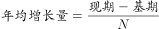
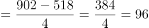

# 年均增长量（年均增加值）计算

考点：[[20-考点/资料分析/增长/年均增长量（年均增加值）计算|增长 / 年均增长量（年均增加值）计算]]
材料：[[15-材料/资料分析/186964 2015年中关村上市公司经营竞争力概|186964 2015年中关村上市公司经营竞争力概]]

**问法模型**：题干出现'2011-2015年间……年均增加值'→ 采用年均增长量模型：年均增加值=（末期值−初期值）÷年份间隔n，n=2015−2011=4

## 推理链
1. 第1步：定位图1柱状图（左轴，单位亿元），读取首尾两年净利润：2011年518亿元、2015年902亿元
2. 第2步：'年均增加值'即年均增长量，公式为（现期值−基期值）÷n，n为年份间隔数
3. 第3步：2011到2015间隔n=2015−2011=4年（5个数据点但只隔4段），分子=902−518=384亿元
4. 第4步：代入计算：384÷4=96亿元
5. 第5步：与选项对照：A为96亿元，与计算结果一致，故选A（若误除以5得76.8≈77，恰好落入B项陷阱）

**最快解法**：⚡ 公式法+口算：直接取图1首尾柱值（902−518）÷4=384÷4=96亿元，一步出答案；速记间隔=年份差4而非数据点5

## 易错点
- ⚠ 间隔数陷阱：2011-2015共5个年份数据，但年均增长量的n=年份差4而非5，误除以5得76.8≈77正是B项干扰
- ⚠ 双轴读数错位：902是柱（净利润，左轴亿元），18是折线（增速%，右轴），勿把18当净利润或902当增速
- ⚠ '年均增加值'是增长量（亿元）而非年均增长率（%），勿套用年均增速公式或误用折线上18%、23%等增速数据

## 母题抽象
> 🧩 当题干出现'某年—某年间……年均增加（增长）值'特征时，用（末期值−初期值）÷年份差计算，并验证间隔数取年份差（如2011-2015取4）而非数据点个数

**同类特征**：2011-2015年间、年均增加值、约为、取柱状图首尾两年数据、增长量计算（单位亿元）

## 相关题
- [[10-真题/资料分析/平均数/13504655 日均发电量×当月天数求季度总量（平均数×天数=总数）|13504655]]（辽宁 2025，相关度1）
- [[10-真题/资料分析/增长/13504658 基期量计算|13504658]]（辽宁 2025，相关度1）
- [[10-真题/资料分析/平均数/19797282 现期平均数（年均生产总值=多个年度GDP算术平均）|19797282]]（山西 2024，相关度1）
- [[10-真题/资料分析/增长/2028362 增长量比较（逐年同比增量计算＋折线趋势图匹配）|2028362]]（国考 2017，相关度1）
- [[10-真题/资料分析/比重/2097170 现期比重计算（复合图取数+最值定位）|2097170]]（重庆 2017，相关度1）

---

### 题干
2011-2015年间，中关村上市公司净利润年均增加值约为：

### 选项
- A. 96亿元　✅
- B. 77亿元
- C. 57亿元
- D. 103亿元

### 官方解析

根据题干所求“2011-2015年间······年均增加值”可判定此题为年均增长量计算问题。定位柱状图可得，2015年净利润为902亿元、2011年为518亿元，代入公式：亿元。

故正确答案为A。

### 给定材料

        中关村上市公司协会公布的《2016年中关村上市公司竞争力报告》显示，2015年中关村上市公司总营业收入达到2.34万亿元，同比增长，截至2015年底，中关村上市公司总市值达到48175亿元，同比增幅，较2011年增长了约34824亿元。

        中关村上市公司中有接近六成的企业研发投入力度较高，其中有67家（公司数量占比）企业的研发强度在及以上，达到了国际高科技领先企业的水平。

