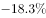
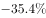
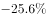
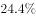
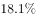
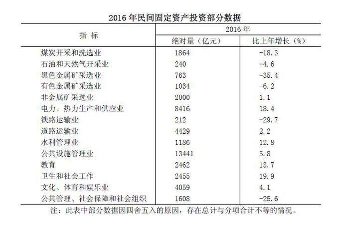

# 增长率变幅比较（增速绝对值比较）

考点：[[20-考点/资料分析/增长/增长率变幅比较（增速绝对值比较）|增长 / 增长率变幅比较（增速绝对值比较）]]
材料：[[15-材料/资料分析/186986 2016年全国民间固定资产投资总体规|186986 2016年全国民间固定资产投资总体规]]

**问法模型**：题干问'较去年变幅最大'→ 变幅=|增长率|，将各行业'比上年增长%'取绝对值后直接比较大小，无需计算增长量

## 推理链
1. 第1步：定位统计表《2016年民间固定资产投资部分数据》，读取四个选项行业的'比上年增长(%)'：煤炭开采和洗选业-18.3、黑色金属矿采选业-35.4、铁路运输业-29.7、公共管理社会保障和社会组织-25.6
2. 第2步：明确'变幅'含义：变化幅度=增长率的绝对值|r|，与增速正负号无关，也与绝对量（亿元）大小无关
3. 第3步：取绝对值比较：|−18.3%|=18.3%，|−35.4%|=35.4%，|−29.7%|=29.7%，|−25.6%|=25.6%
4. 第4步：35.4%为四者最大，对应黑色金属矿采选业；与选项对照，B为黑色金属矿采选业，故选B

**最快解法**：⚡ 符号剥离直接比较法：'变幅'只看增速数值大小、不管正负号，四个选项18.3/35.4/29.7/25.6中35.4最大，秒选B黑色金属矿采选业；零计算，可顺手扫全表14行确认-35.4%确为全表变幅最大（次大为卫生和社会工作+19.9%）

## 易错点
- ⚠ 把'变幅'误解为增长量（绝对额变化），错误地用绝对量×r/(1+r)去算增长额；变幅只比较增速绝对值，与绝对量无关
- ⚠ 忽略负号或误以为负增长'幅度小'：-35.4%的变幅大于表中所有正增长项（如卫生和社会工作+19.9%、电力热力+18.4%），必须取绝对值参与比较
- ⚠ 受绝对量干扰：黑色金属矿采选业绝对量仅763亿元偏小，易被绝对量大的行业吸引而选错；且四个选项均为负增长行业，符号一致，更需比对数值本身

## 母题抽象
> 🧩 当题干出现'变幅最大/变化幅度最大/波动最大'特征时，直接对各行业增长率取绝对值|r|排序比较，切勿计算增长量，也不受正负号和绝对量大小的干扰

**同类特征**：表格中、较去年变幅最大、比上年增长(%)、变化幅度=|增长率|、四个选项均为负增长行业、部分行业数据表

## 相关题
（暂无）

---

### 题干
表格中投资较去年变幅最大的是：

### 选项
- A. 煤炭开采和洗选业
- B. 黑色金属矿采选业　✅
- C. 铁路运输业
- D. 公共管理、社会保障和社会组织

### 官方解析

由题干“较去年变幅最大”可知本题为一般增长率问题。定位表格材料可知，煤炭开采和洗选业为：，黑色金属矿采选业：，铁路运输业：，公共管理、社会保障和社会组织：。问的是变幅即变化幅度，变化幅度最大的是黑色金属矿采选业：。

故正确答案为B。

### 给定材料

       2016年，全国民间固定资产投资为365219亿元，比上年名义增长，增速比1—11月份提高0.1个百分点，民间固定资产投资占全国固定资产投资的比重为，比1—11月份降低0.3个百分点，比上年降低3个百分点。

       分地区看，东部地区民间固定资产投资164674亿元，比上年增长；中部地区107881亿元，比上年增长，增速回落0.1个百分点；西部地区71056亿元，比上年增长，增速回落0.5个百分点；东北地区21608亿元，比上年下降，降幅收窄1.6个百分点。

       分产业看，第一产业民间固定资产投资15039亿元，比上年增长，增速比1—11月份回落0.5个百分点；第二产业增长，增速较去年提高0.3个百分点；第三产业167673亿元，年度增长，增速与1—11月份持平。第二产业中，工业民间固定投资180970亿元，比上年增长，比1—11月份提高0.3个百分点。

