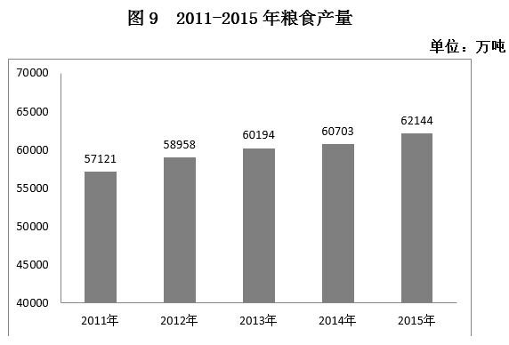

# 基期量计算——基期和差（2014年玉米与小麦基期差值）

考点：[[20-考点/资料分析/增长/基期量计算——基期和差（2014年玉米与小麦基期差值）|增长 / 基期量计算——基期和差（2014年玉米与小麦基期差值）]]
材料：[[15-材料/资料分析/186990 2015年我国粮食生产情况：粮食总产|186990 2015年我国粮食生产情况：粮食总产]]

**问法模型**：题干出现‘基期年份（2014年）A比B多多少’而材料只给2015年现期值与各自增速 → 基期和差模型：分别用'基期量=现期量÷(1+增速)'反推两量再作差，对照选项。

## 推理链
1. 第1步：题干锁定基期2014年，求玉米与小麦产量之差；材料给2015年现期值：玉米22458万吨、小麦13019万吨，各‘增产’后的百分数在所给文本中空缺，原卷数值为玉米增产4.1%、小麦增产3.2%（可由官方答案B与选项代入反推验证）。
2. 第2步：因两分项增速不同，差值=22458÷(1+4.1%)−13019÷(1+3.2%)，不能合并为‘现期差÷(1+r)’一步计算。
3. 第3步：代入基期量公式：2014年玉米≈22458÷1.041≈21574万吨；2014年小麦≈13019÷1.032≈12616万吨。
4. 第4步：作差21574−12616≈8958万吨，与B项8958万吨吻合。
5. 第5步：交叉验证：图中2014年粮食总产量60703万吨、2015年增加1441万吨，1441÷60703≈2.4%与文字总产量增速口径一致，说明增速取值可信、结果无误。

**最快解法**：⚡ 截位直除+先排除现期差陷阱：现期差22458−13019=9439，落在C项9429附近（误用现期差的坑）；因两分项增速（4.1%、3.2%）均为正，基期差必小于现期差，故排除C、D；再粗算22458÷1.04≈21600、13019÷1.03≈12640，差约8960，最接近B。

## 易错点
- ⚠ 现期/基期混淆：直接用2015年现期差22458−13019=9439万吨会误选C（9429），必须先折算回2014年基期再作差。
- ⚠ 两分项增速不同（玉米4.1%、小麦3.2%），不能用‘现期差÷(1+r)’一步套算，须分别除以各自(1+增速)后再相减。
- ⚠ 所给文本中各‘增产’后的百分数空缺，切勿凭空编造增速，需依原卷数值并由选项反推校验；同时玉米22458、小麦13019属‘谷物’分项，勿与稻谷20825或夏粮/秋粮两套三分法口径混淆。

## 母题抽象
> 🧩 当题干出现‘基期年份A比B多（少）多少’且材料给现期值与各自增速时，先算现期差定位最接近的干扰项（增速为正则基期差应更小，反向排除），再用基期量=现期量÷(1+增速)分别反推作差锁定答案。

**同类特征**：基期时间2014年、玉米产量比小麦产量多、求两指标差值、现期值与增速均已给出、两指标增速不同、基期和差问题

## 相关题
- [[10-真题/资料分析/增长/12536430 基期量计算与基期和差比较|12536430]]（四川 2024，相关度1）
- [[10-真题/资料分析/增长/2434309 基期量计算（基期和差问题）|2434309]]（新疆 2019，相关度1）
- [[10-真题/资料分析/增长/2376602 基期量计算与基期差值比较（基期和差问题）|2376602]]（黑龙江 2019，相关度1）
- [[10-真题/资料分析/增长/2444743 基期量和差（基期量反推+期间差求单月值）|2444743]]（四川 2019，相关度1）
- [[10-真题/资料分析/增长/2616168 基期和差（环比基期差值计算）|2616168]]（海南 2020，相关度1）

---

### 题干
2014年，我国玉米产量比小麦产量多：

### 选项
- A. 8642万吨
- B. 8958万吨　✅
- C. 9429万吨
- D. 9915万吨

### 官方解析
由题干“2014年，我国玉米产量比小麦产量多”，结合文字材料2015年的产量与增长率均给出，可判定该题是基期和差问题。定位文字材料，“2015年小麦产量13019万吨，增产；玉米产量22458万吨，增产”，根据基期量，可得2014年小麦产量万吨；2014年玉米产量万吨。2014年，我国玉米产量比小麦产量多万吨。与B项最接近。
故正确答案为B。

### 给定材料

        2015年全年我国粮食产量62144万吨，比上年增加1441万吨，增产。其中，夏粮产量14112万吨，增产；旱稻产量3369万吨，减产；秋粮产量44662万吨，增产。全年谷物产量57225万吨，比上年增产。其中，稻谷产量20825万吨，增产；小麦产量13019万吨，增产；玉米产量22458万吨，增产。

