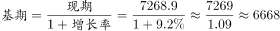

# 基期量计算

考点：[[20-考点/资料分析/增长/基期量计算|增长 / 基期量计算]]
材料：[[15-材料/资料分析/186992 2015年江西省规模以上工业经济运行|186992 2015年江西省规模以上工业经济运行]]

**问法模型**：题干时间（2014年）比材料现期（2015年）前移一年、只给现期值和同比增速 → 用基期量公式：基期值=现期值÷(1+增速)

## 推理链
1. 第1步：题干求2014年规模以上工业增加值，材料现期为2015年：规模以上工业增加值7268.9亿元，比上年增长（原卷该处增速为9.2%，文本中为空缺，需以原卷补全数值为准）
2. 第2步：基期量公式：基期值=现期值÷(1+同比增速)
3. 第3步：代入：7268.9÷(1+9.2%)=7268.9÷1.092，截位直除首两位商约66，即约6656~6657亿元
4. 第4步：与选项对照：A为6656.5亿元，与商吻合；验证D=7268.9×1.092≈7937.6为把除法做成乘法的反向干扰，C=7268.9为现期值原数不动
5. 第5步：结论：只有A符合基期量计算结果，故选A

**最快解法**：⚡ 截位直除：7268.9÷1.092，只需商出首三位'665/666'即可锁定A（6656.5）；同时识别C是现期值原数、D是7268.9×1.092（≈7937.6）的乘除方向坑，秒排

## 易错点
- ⚠ 现期基期混淆：C选项7268.9亿元正是2015年现期值，审题不细看到原数就选C即掉坑；D选项是7268.9×(1+9.2%)≈7937.6，把'÷(1+增速)'做成'×(1+增速)'，方向弄反
- ⚠ 材料文本中该增速处为空白，若凭感觉乱套其他段落缺失的增速（如轻/重工业或六大行业增速）会算错，必须先从原卷确认总体增速为9.2%
- ⚠ 口径陷阱：本材料还有主营业务收入32459.4亿元、利税3543.8亿元等不同口径数据，求'工业增加值'基期只能用增加值7268.9亿元，不能错用销售收入口径数据

## 母题抽象
> 🧩 当题干出现'上年（基期）+某总量指标'且材料只给'现期值+比上年增长x%'时，用 基期值=现期值÷(1+x%)，截位直除对照选项，并检查选项中是否埋有现期原数（C类坑）和乘除反向数（D类坑）

**同类特征**：2014年（时间前移一年求基期）、规模以上工业增加值、基期量计算、比上年增长（增速从材料原文定位）、选项含现期值7268.9干扰、单位亿元

## 相关题
- [[10-真题/资料分析/增长/2033794 基期量计算|2033794]]（江苏 2016，相关度3）
- [[10-真题/资料分析/增长/4651470 基期量计算|4651470]]（江苏 2022，相关度3）
- [[10-真题/资料分析/增长/2187862 基期量计算|2187862]]（山东 2018，相关度3）
- [[10-真题/资料分析/增长/2262591 基期量计算|2262591]]（选调 2016，相关度3）
- [[10-真题/资料分析/增长/2394030 基期量计算|2394030]]（青海 2019，相关度3）

---

### 题干
2014年江西省规模以上工业增加值为（    ）。

### 选项
- A. 6656.5亿元　✅
- B. 6945.3亿元
- C. 7268.9亿元
- D. 7937.6亿元

### 官方解析

材料中给出的时间为2015年，由题干“2014年江西省规模以上工业增加值”可知，本题为基期计算问题。根据“规模以上工业增加值”定位材料第一段，定位数据，“2015年，江西规模以上工业增加值7268.9亿元，比上年增长”，代入基期计算公式，亿元，接近A选项。

故正确答案为A。

### 给定材料

        2015年，江西规模以上工业增加值7268.9亿元，比上年增长。分轻重工业看，轻工业增加值2731.2亿元，增长；重工业4537.7亿元，增长。分经济类型看，国有企业增加值269.1亿元，增长；集体企业19.3亿元，下降；股份合作企业22.3亿元，下降；股份制企业2847.6亿元，增长；私营企业2992.2亿元，增长；外商及港澳台商投资企业1112.5亿元，增长。

        2015年江西省规模以上工业38个行业大类中34个突破增长，占比近九成。其中，电子、电子机械、纺织、农副产品、医药和有色等六大重点行业表现突出，分别增长、、、、、，合计实现增加值2707.0亿元，占规模以上工业的比重为，对规模以上工业增长的贡献率达。高新技术产业增加值1869.7亿元，增长，占规模以上工业的比重为，比上年提高0.8个百分点。抚州、赣州、吉安高新区晋升为国家级高新技术开发区，年末国家级高新技术开发区7家，居全国第六、中部第一；省级高新技术产业园区3家，比上年新增1家；国家高新技术产业化基地27个，居全国第一。

        2015年江西省规模以上工业企业实现主营业务收入32459.4亿元，比上年增长；实现利税总额3543.8亿元，增长，其中，利润总额2128.0亿元，增长。主营业务收入超百亿元的企业10户，其中，江铜集团2010.4亿元，居全省首位。

> [!warning] 疑点（官方解析可能有误，待人工复核）
> 材料原文中'比上年增长'后的增速为空白（本材料所有百分比均空缺），官方解析公式中增速数值亦缺失；由正确答案A反推，2015年规模以上工业增加值同比增速应为9.2%（6656.5×1.092≈7268.9），实际做题须以原卷补全的9.2%代入，官方解析此处存在数据缺漏但不影响答案A的唯一性
