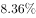
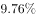
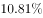
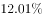
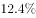
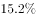

# 同比增长率计算（一般增长率）

考点：[[20-考点/资料分析/增长/同比增长率计算（一般增长率）|增长 / 同比增长率计算（一般增长率）]]
材料：[[15-材料/资料分析/186996 2015年我国全社会固定资产投资总量|186996 2015年我国全社会固定资产投资总量]]

**问法模型**：题干问'2015年全社会固定资产投资同比增长'→ 一般增长率模型：同比增长率=(现期−基期)/基期，用图1相邻两年柱值(562000与512021)直接计算

## 推理链
1. 第1步：题干关键词为'全社会固定资产投资''同比增长'，锁定全社会口径562000亿元，而非文字中'不含农户'口径551590亿元（其增速在文字中留空）
2. 第2步：现期为2015年（562000亿元），基期为2014年，从图1柱状图读出2014年全社会固定资产投资512021亿元
3. 第3步：套用公式：同比增长率=(562000−512021)/512021=49979/512021
4. 第4步：截位直除：49979/512021≈5.0/51.2≈9.76%≈9.8%
5. 第5步：与选项对照，仅B项约为9.8%，故选B

**最快解法**：⚡ 截位直除：分子49979截为5.0，分母512021截为51.2，5.0÷51.2≈9.8%，秒选B；亦可百化分：49979≈5万，512021≈51.2万，5/51.2≈9.8%

## 易错点
- ⚠ 口径混淆：误用文字中'固定资产投资（不含农户）'551590亿元，本题问'全社会'，562000与512021均须取自图1
- ⚠ 基期现期混淆：误把现期562000作分母，得49979/562000≈8.9%，错选其他选项
- ⚠ 增长量与增长率混淆：49979亿元是增长量、9.8%是增长率，两个不同问法勿混

## 母题抽象
> 🧩 当题干出现'某指标（年份）同比增长'且文字中增速留空时，从柱状图取相邻两年柱值，用(现期−基期)/基期截位直除，对照选项验证

**同类特征**：全社会固定资产投资、2015年全年、同比增长、文字增速留空需查图1、相邻两年柱值、亿元大量级

## 相关题
- [[10-真题/资料分析/增长/5509993 同比增长率计算（一般增长率）|5509993]]（江西 2023，相关度2）
- [[10-真题/资料分析/增长/2742301 整体同比增长率计算（整体=私有云+公有云加总后求增速）|2742301]]（北京 2021，相关度1）
- [[10-真题/资料分析/增长/4673121 反事实假设下的一般增长率计算（减征额加回+负增速反推基期）|4673121]]（广东 2022，相关度1）
- [[10-真题/资料分析/增长/5509648 同比增长率计算（柱状图直接给基期、现期）|5509648]]（吉林 2023，相关度1）
- [[10-真题/资料分析/增长/14096274 增长率计算与比较（进出口总额同比增速判断）|14096274]]（选调 2025，相关度1）

---

### 题干
我国2015年全年全社会固定资产投资同比增长（  ）

### 选项
- A. 

- B. 

　✅
- C. 

- D. 

### 官方解析
根据“我国······同比增长”，判定此题为一般增长率问题。定位图表，2015年全年全社会固定资产投资为562000亿元，2014年为512021亿元，故增长率为：。
故正确答案为B。

### 给定材料

        我国2015年全年全社会固定资产投资562000亿元，固定资产投资（不含农户）551590亿元，增长。从各区域看，东部地区投资232107亿元，比上年增长；中部地区投资143118亿元，增长；西部地区投资140416亿元，增长；东北地区投资40806亿元，下降。

