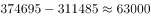
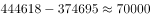
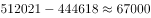
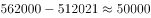

# 逐期（同比）增长量比较

考点：[[20-考点/资料分析/增长/逐期（同比）增长量比较|增长 / 逐期（同比）增长量比较]]
材料：[[15-材料/资料分析/186996 2015年我国全社会固定资产投资总量|186996 2015年我国全社会固定资产投资总量]]

**问法模型**：题干出现'同比增长量最大的年份'→ 直接用图1相邻年份柱值作差（增长量=现期量-基期量），逐项比较取最大。

## 推理链
1. 第1步：从图1提取2011-2015年全社会固定资产投资额：2011年311485、2012年374695、2013年446618、2014年512021、2015年562000（单位：亿元）
2. 第2步：题干问'同比增长量最大'，判定为增长量比较，公式：增长量=现期量-基期量（相邻年份作差）
3. 第3步：2012年增量=374695-311485=63210亿元
4. 第4步：2013年增量=446618-374695=71923亿元
5. 第5步：2014年增量=512021-446618=65403亿元
6. 第6步：2015年增量=562000-512021=49979亿元
7. 第7步：比较四个增量，71923（2013年）>65403（2014年）>63210（2012年）>49979（2015年），最大为2013年，对照选项选C

**最快解法**：⚡ 直接作差口算：各年增量依次约6.3万、7.2万、6.5万、5.0万（亿元），无需速算技巧即可比较；注意末年2015年柱值虽最高，其增量49979亿元反而最小（现期-基期=562000-512021），排除D。

## 易错点
- ⚠ 增长量与增长率混淆：本题问'量'，逐项作差即可；若问增速最大则应为2012年（63210/311485≈20.3%），而2013年增量71923亿元最大，切勿互串
- ⚠ 口径陷阱：题干'社会固定资产投资'指全社会口径（图1数据），勿误用文字材料'固定资产投资（不含农户）'551590亿元
- ⚠ '最高'与'增量最大'混淆：柱状图最高的2015年（562000亿元）其同比增量49979亿元反而最小，勿被柱高直觉误导选D

## 母题抽象
> 🧩 当题干出现'××期间同比增长量最大（多）的年份'特征时，直接对柱状图/表格相邻两期作差（增长量=现期-基期）逐项比较；同时警惕末年柱值最高但增量可能最小，以及'量'与'率'的问法区分。

**同类特征**：同比增长量最大、2011-2015年逐年比较、相邻年份作差、柱状图读数、现期量-基期量、全社会固定资产投资

## 相关题
- [[10-真题/资料分析/增长/2050996 同比增长率计算（一般增长率）|2050996]]（江西 2017，相关度1）
- [[10-真题/资料分析/增长/2136666 增长量比较（进口数量口径，现期×r-(1+r)估算后取最大）|2136666]]（河南 2017，相关度1）
- [[10-真题/资料分析/其他/5509527 直接读数与大小比较（定位最大值）|5509527]]（甘肃 2023，相关度1）
- [[10-真题/资料分析/增长/13504528 增长量比较（图形趋势判断）|13504528]]（云南 2025，相关度1）
- [[10-真题/资料分析/增长/5509993 同比增长率计算（一般增长率）|5509993]]（江西 2023，相关度1）

---

### 题干
2011-2015年，我国社会固定资产投资同比增长量最大的年份是（  ）

### 选项
- A. 2012年
- B. 2014年
- C. 2013年　✅
- D. 2015年

### 官方解析

根据“······同比增长量最大”，判定此题为增长量比较问题。增长量=现期量-基期量。

定位图表，2012年：，2013年：，2014年：，2015年：，最大为2013年。

故正确答案为C。

### 给定材料

        我国2015年全年全社会固定资产投资562000亿元，固定资产投资（不含农户）551590亿元，增长。从各区域看，东部地区投资232107亿元，比上年增长；中部地区投资143118亿元，增长；西部地区投资140416亿元，增长；东北地区投资40806亿元，下降。

