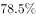
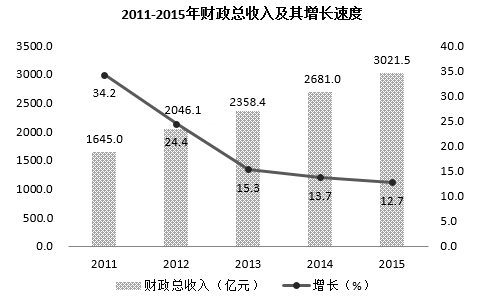

# 增长量计算与比较（逐年增长量与固定阈值比较）

考点：[[20-考点/资料分析/增长/增长量计算与比较（逐年增长量与固定阈值比较）|增长 / 增长量计算与比较（逐年增长量与固定阈值比较）]]
材料：[[15-材料/资料分析/186994 江西省2015年财政总收入运行情况（|186994 江西省2015年财政总收入运行情况（]]

**问法模型**：题干'同比增长低于380亿元'带单位（亿元）→ 问的是增长量而非增速，模型为逐年'增长量=当年总量-上年总量'，统计低于380亿元的年份数

## 推理链
1. 第1步：从统计图柱状图读取2011-2015年财政总收入：1645.0、2046.1、2358.4、2681.0、3021.5亿元
2. 第2步：明确'同比增长低于380亿元'指增长量=当年值-上年值<380亿元，不是增速<380%
3. 第3步：2012年增长量=2046.1-1645.0=401.1亿元>380，排除
4. 第4步：2013年=2358.4-2046.1=312.3亿元、2014年=2681.0-2358.4=322.6亿元、2015年=3021.5-2681.0=340.5亿元，均<380亿元
5. 第5步：2011年缺2010年基期总量（图中仅有增速34.2%），增长量无法计算，不能参与比较，也不能把34.2误当增量
6. 第6步：低于380亿元的为2013、2014、2015年共3年，对照选项选A

**最快解法**：⚡ 相邻年份柱值直接相减的口算比较法：先算2012年401.1>380排除，再快速验证312.3、322.6、340.5均小于380，2011年无基期直接跳过，得3年，全程无需列式书写

## 易错点
- ⚠ 把'同比增长低于380亿元'误读为增速低于380%（增速与增长量混淆，'同比'后带亿元单位是判断关键）
- ⚠ 把2011年的34.2%误当增长量（34.2是增速且以2010年为基期，2010年总量未给出，2011年增长量不可算、不可参与比较）
- ⚠ 双轴图陷阱：误把右轴折线的12.7%等读成总量或与380亿元比较；另注意县级数据的'增加8个'是县区个数增量，与本题无关

## 母题抽象
> 🧩 当题干出现'同比增长低于/高于X亿元（带单位）''有几年'特征时，判定为增长量比较题，用现期-基期逐年相减与阈值比较；凡基期值缺失的年份（如2011年缺2010年总量）不参与比较，且严禁拿增速百分数当增长量

**同类特征**：同比增长低于380亿元、带单位的增长量阈值（亿元）、有几年、2011-2015年逐年比较、统计图相邻柱值相减、基期缺失年份排除

## 相关题
- [[10-真题/资料分析/增长/2136970 增长量计算（逐年增长量与阈值比较计数）|2136970]]（北京 2018，相关度1）
- [[10-真题/资料分析/增长/2188348 两期数值比较（逐期增减判断计数）|2188348]]（江西 2018，相关度1）
- [[10-真题/资料分析/增长/5833651 逐年同比增长率与固定阈值（30%）比较计数|5833651]]（选调 2020，相关度1）
- [[10-真题/资料分析/增长/1752588 增长量比较（同比增长量逐年做差与阈值计数）|1752588]]（北京 2016，相关度1）
- [[10-真题/资料分析/增长/2050998 逐期（同比）增长量比较|2050998]]（江西 2017，相关度1）

---

### 题干
2011-2015年，有几年的江西省财政总收入同比增长低于380亿元？

### 选项
- A. 3　✅
- B. 2
- C. 1
- D. 4

### 官方解析
根据问题所求“有几年……同比增长低于380亿元”，可判定此题为增长量计算问题。，代入统计图数据，可得增长量分别为：
2011年：亿元；
2012年：亿元；
2013年：亿元；
2014年：亿元；
2015年：亿元。
同比增长低于380亿元的为2013、2014、2015年，共3年。
故正确答案为A。

### 给定材料

        江西省2015年财政总收入3021.5亿元，比上年增长，财政总收入占生产总值的比重为，比上年提高1.0个百分点。其中，税收收入2373.0亿元，增长，占财政总收入比重为，其他收入648.5亿元。所有县（市、区）财政总收入突破6亿元，其中，财政总收入超10亿元的县（市、区）85个，比上年增加8个；超20亿元的36个，增加7个；超30亿元的17个，增加2个；超50亿元的5个，增加2个；百亿县实现零突破，南昌县财政总收入达100.9亿元。

