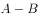
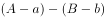
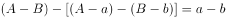
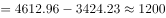
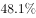
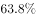

# 增长量计算（存贷差变化量＝存款增量−贷款增量）

考点：[[20-考点/资料分析/增长/增长量计算（存贷差变化量＝存款增量−贷款增量）|增长 / 增长量计算（存贷差变化量＝存款增量−贷款增量）]]
材料：[[15-材料/资料分析/187068 2014年上海市金融业运行情况：金融|187068 2014年上海市金融业运行情况：金融]]

**问法模型**：题干问'存贷款差2014年间增加了/减少了多少'→ 存贷差（存款−贷款）的变化量＝当年存款增量−当年贷款增量，只需两次减法并判断正负与量级

## 推理链
1. 第1步：题干求'2014年间'存贷差的变化，即2014年末与2013年末（年初）两个时点存贷差之差；材料第二段给出年末存款余额73882.45亿元、比年初增加4612.96亿元，贷款余额47915.81亿元、比年初增加3424.23亿元
2. 第2步：由（存款2014−贷款2014）−（存款2013−贷款2013）＝存款增量−贷款增量，故存贷差变化量＝Δ存款−Δ贷款
3. 第3步：代入得4612.96−3424.23＝1188.73亿元
4. 第4步：结果为正且在1000亿～2000亿之间，即'增加了1千多亿元'，对照选项只有A符合，故选A

**最快解法**：⚡ 直接减法+尾数法：4612.96−3424.23，小数位.96−.23＝.73，整数位4612−3424＝1188，得1188.73亿元≈1千多亿元，正号表示增加，秒选A；全程不必还原两年存贷差水平值（25966.64与24777.91亿元）

## 易错点
- ⚠ 水平值与变化量混淆：用年末余额相减得73882.45−47915.81≈2.6万亿元，误以为对应B'增加了2万多亿元'——但那是存贷差的期末水平，不是'2014年间'的增加量，两者相差一个量级
- ⚠ 增减方向算反：若把减法顺序写成3424.23−4612.96得负值，会误选C'减少了1千多亿元'；实际存款增量4612.96＞贷款增量3424.23，差值扩大为'增加'
- ⚠ 量级口径：本题全部数据为'亿元'口径，1188.73亿元应表述为'1千多亿元'，勿与材料第四段'万亿元'量级（1万亿＝10000亿）混淆

## 母题抽象
> 🧩 当题干问'某差值（A−B型指标）一年间增加/减少多少'时，直接用'差值变化量＝A的当年增量−B的当年增量'，只取材料中并排的两个'比年初/上年增加'数据做减法，无需分别还原两期水平

**同类特征**：存贷款差、2014年间（时段变化量问法）、增加了/减少了+量级选项、材料中'余额'与'比年初增加'并排、千多亿元/万多亿元量级辨析、差值指标的变化量

## 相关题
（暂无）

---

### 题干
2014年间，上海市中外资金融机构本外币存贷款差（  ）。

### 选项
- A. 增加了1千多亿元　✅
- B. 增加了2万多亿元
- C. 减少了1千多亿元
- D. 减少了2万多亿元

### 官方解析

题目所求“2014年间······存贷款差增加了或者减少了······”，即2014年和2013年的存贷款之差。假设14年存贷款之差为，且14年存款增量为，贷款增量为，则13年存贷款之差为，则2014年和2013年的存贷款之差为，即增长量之差。定位文字材料第三段，“2014年末，全市中外资金融机构本外币各项存款余额比年初增加4612.96亿元；贷款余额比年初增加3424.23亿元”，所以2014年间上海市中外资金融机构本外币存贷款差亿元，即增加了1千多亿元。

故正确答案为A。

### 给定材料

        2014年，上海市全年实现金融业增加值3268.43亿元，比上年增长。

        全年新增各类金融单位96家。其中，货币金融服务单位37家；资本市场服务单位40家。至年末，全市各类金融单位达到1336家。其中，货币金融服务单位601家；资本市场服务单位292家；保险业单位363家。

        至年末，全市中外资金融机构本外币各项存款余额73882.45亿元，比年初增加4612.96亿元；贷款余额47915.81亿元，比年初增加3424.23亿元。

        全年通过上海证券市场股票筹资3962.59亿元，比上年增长；发行公司债2955.2亿元，比上年下降。至年末，上海证券市场上市证券3758只，比上年增加972只，其中股票1039只，增加42只。

        全年金融市场（包括外汇市场）交易总额达到786.66万亿元，比上年增长。上海证券交易所各类有价证券总成交金额128.15万亿元，增长。其中，股票成交金额37.72万亿元，增长。上海期货交易所总成交金额126.47万亿元，增长。中国金融期货交易所总成交金额164.02万亿元，增长。银行间市场总成交金额361.51万亿元，增长。上海黄金交易所总成交金额6.51万亿元，增长。

> [!warning] 疑点（官方解析可能有误，待人工复核）
> 官方解析中的公式符号存在排版缺失（'存贷款之差为，存款增量为'等变量未显示），但逻辑与数值4612.96−3424.23＝1188.73亿元正确，答案A无误；另注意材料导读中'求存贷款差应用年末余额相减'的提示针对的是水平值类问法，本题问变化量应以增量相减为准
