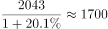
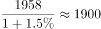

# 基期量回推与顺逆差（出口−进口）符号判定

考点：[[20-考点/资料分析/增长/基期量回推与顺逆差（出口−进口）符号判定|增长 / 基期量回推与顺逆差（出口−进口）符号判定]]
材料：[[15-材料/资料分析/187070 2012年我国货物进出口总体规模（总|187070 2012年我国货物进出口总体规模（总]]

**问法模型**：题干问'2012年贸易顺逆差关系与上年不同的国家或地区' → 对各经济体用'基期量=现期量/(1+增速)'分别回推2011年出口与进口，比较两年'出口−进口'符号是否相反

## 推理链
1. 第1步：从表2提取东盟2012年数据：出口2043亿美元（增长20.1%）、进口1958亿美元（增长1.5%）；明确判定规则：出口>进口为顺差，出口<进口为逆差，需比较两年符号
2. 第2步：所用公式为基期回推：2011年量 = 2012年量 ÷ (1 + 同比增速)
3. 第3步：东盟2012年出口2043>进口1958，为顺差；2011年出口=2043/(1+20.1%)≈1702，进口=1958/(1+1.5%)≈1929，1702<1929为逆差，两年关系由逆差变顺差，A项符合题意
4. 第4步：验证B日本：2012年1516<1778为逆差；2011年出口1516/1.023≈1482<进口1778/(1−8.6%)≈1945，仍为逆差，关系未变，排除
5. 第5步：验证C美国：2012年3518>1329为顺差；2011年出口3518/1.084≈3245>进口1329/1.088≈1222，仍为顺差，排除
6. 第6步：验证D欧盟：2012年3340>2121为顺差；2011年出口3340/(1−6.2%)≈3561>进口2121/1.004≈2113，仍为顺差，排除
7. 第7步：四个选项中仅东盟两年顺逆差关系改变（2011年逆差→2012年顺差），对照选项确定答案为A

**最快解法**：⚡ 符号翻转预判+截位直除：顺逆差翻转只可能发生在2012年差额小的行——东盟2012年顺差额仅2043−1958=85亿美元，且出口增速20.1%远大于进口增速1.5%，最可能翻转；直除回推：出口2043/1.201≈1702，进口1958/1.015≈1929，2011年为逆差，直接锁定A，其余选项可不动笔（命中即停）

## 易错点
- ⚠ 只看2012年符号不回推2011年：日本2012年为逆差、美国/欧盟为顺差，若不做基期回推比较两年符号，无法判断'关系是否不同'，易凭当年状态误选
- ⚠ 看串同名'比上年增长%'列：表2出口、进口各配一列增速，回推东盟必须分别用出口增速20.1%和进口增速1.5%，看串列会算错基期导致符号误判
- ⚠ 基期公式用反或负增速处理错误：基期=现期/(1+增速)，遇负增速如欧盟出口−6.2%应除以0.938；误用'现期×(1+增速)'会把东盟2011年出口算成约2453，误判为仍顺差而错选

## 母题抽象
> 🧩 当题干出现'顺差/逆差关系与上年不同（或发生变化）'特征时，用基期量=现期量/(1+增速)分别回推出口与进口，比较两年'出口−进口'符号是否相反；优先从当年差额小、且出口与进口增速差异大的行验证，命中即停

**同类特征**：顺逆差关系、与上年不同、国家或者地区、出口额与进口额对比、基期回推、符号是否翻转

## 相关题
- [[10-真题/资料分析/增长/13432269 增长量计算（借'比重首次突破50%'对基期部分取临界上界）|13432269]]（深圳市考 2025，相关度1）

---

### 题干
2012年间我国的贸易顺逆差关系与上年不同的国家或者地区是（    ）。

### 选项
- A. 东盟　✅
- B. 日本
- C. 美国
- D. 欧盟

### 官方解析

由题干“2012年间我国的贸易顺逆差关系与上年不同”可知本题为基期和差问题。定位表格材料，贸易顺逆差关系与上年不同，即为一年是顺差、一年是逆差。逐项验证答案：

东盟：2012年出口额和进口额分别为2043、1958，出口额进口额，为贸易顺差；

2011年出口额和进口额分别为、，出口额进口额，为贸易逆差，故东盟两年的贸易顺逆差关系不同。A项满足题意，无需验证剩余选项。

故正确答案为A。

### 给定材料

        2012年全年货物进出口总额38668亿美元，比上年增长。其中，出口20489亿美元，增长；进口18178亿美元，增长。

