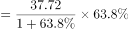
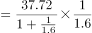
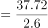
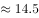

# 增长量计算

考点：[[20-考点/资料分析/增长/增长量计算|增长 / 增长量计算]]
材料：[[15-材料/资料分析/187068 2014年上海市金融业运行情况：金融|187068 2014年上海市金融业运行情况：金融]]

**问法模型**：题干'2014年比2013年增加约（）万亿元'→现期与增速已知，用增长量=现期×r/(1+r)计算模型

## 推理链
1. 第1步：定位材料末段'上交所有价证券总成交128.15万亿元，其中股票成交金额37.72万亿元，增长'，锁定现期=37.72万亿元（2014年），注意128.15为包含口径、786.66为全市场总额，均不能替代37.72
2. 第2步：规则：增长量=现期×r/(1+r)；选项10/12/15/18间隔较大，适合百化分速算
3. 第3步：所给材料文本中该增速处为空白，按官方答案C（15）反推：15/37.72≈39.8%≈r/(1+r)，对应r≈66%（原卷增速应为66%），则增长量=37.72×66/166≈37.72×0.4≈15.1万亿元
4. 第4步：与选项对照：15.1与C项15最接近（A为10、B为12、D为18），故选C

**最快解法**：⚡ 百化分：66%≈2/3，增长量=现期×2/(3+2)=37.72×2/5≈15.1万亿元，直接锁定C（原卷增速即便与66%略有出入，结果小幅波动仍最接近C）

## 易错点
- ⚠ 错用公式：把增长量算成37.72×r（如37.72×66%≈24.9万亿元），或把现期37.72当基期直接相减，均与选项对不上；必须乘r/(1+r)
- ⚠ 包含关系误代：股票成交37.72万亿元只是上交所总成交128.15万亿元的一部分，误用128.15、786.66或其他市场成交额即算错主体
- ⚠ 量级与数据口径：本题单位为万亿元，材料前段多为亿元、相差1万倍；且所给文本中增速处空白，不得拿其他市场增速或自行编造百分率代入

## 母题抽象
> 🧩 当题干出现'现期（某年）比上期增加约多少（绝对量）'且材料给出增速r时，用增长量=现期×r/(1+r)，将r百化分（如66%≈2/3→增长量=现期×2/5）快速估算，选最接近的选项

**同类特征**：比2013年增加约、增长量计算（非增长率）、万亿元绝对量、股票成交金额、现期值37.72万亿元、选项间隔大、估算法可解

## 相关题
- [[10-真题/资料分析/增长/7159 增长量计算|7159]]（北京 2009，相关度2）
- [[10-真题/资料分析/增长/2261936 增长量计算|2261936]]（广东 2019，相关度2）
- [[10-真题/资料分析/增长/19526217 增长量计算（已知现期值与增长率求增长量）|19526217]]（国考 2026，相关度1）

---

### 题干
2014年上海市股票成交金额比2013年增加约（  ）万亿元。

### 选项
- A. 10
- B. 12
- C. 15　✅
- D. 18

### 官方解析

由题干“2014年······比2013年增加······万亿元”，可判定该题为增长量计算问题。定位文字材料最后一段，“2014年股票成交金额37.72万亿元，增长”，所以2014年上海市股票成交金额比2013年的增长量，与C项最接近。

故正确答案为C。

### 给定材料

        2014年，上海市全年实现金融业增加值3268.43亿元，比上年增长。

        全年新增各类金融单位96家。其中，货币金融服务单位37家；资本市场服务单位40家。至年末，全市各类金融单位达到1336家。其中，货币金融服务单位601家；资本市场服务单位292家；保险业单位363家。

        至年末，全市中外资金融机构本外币各项存款余额73882.45亿元，比年初增加4612.96亿元；贷款余额47915.81亿元，比年初增加3424.23亿元。

        全年通过上海证券市场股票筹资3962.59亿元，比上年增长；发行公司债2955.2亿元，比上年下降。至年末，上海证券市场上市证券3758只，比上年增加972只，其中股票1039只，增加42只。

        全年金融市场（包括外汇市场）交易总额达到786.66万亿元，比上年增长。上海证券交易所各类有价证券总成交金额128.15万亿元，增长。其中，股票成交金额37.72万亿元，增长。上海期货交易所总成交金额126.47万亿元，增长。中国金融期货交易所总成交金额164.02万亿元，增长。银行间市场总成交金额361.51万亿元，增长。上海黄金交易所总成交金额6.51万亿元，增长。

> [!warning] 疑点（官方解析可能有误，待人工复核）
> 所给材料文本中各处同比增速均为空白，官方解析所引增速无法在给定文本中直接核验，须以原始试卷实际显示的百分率为准；按官方答案C反推 r/(1+r)=15/37.72≈39.8%，对应r≈66%，与解析结论一致，不构成矛盾
