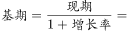
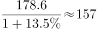

# 基期量计算（已知现期值与同比增长率求基期）

考点：[[20-考点/资料分析/增长/基期量计算（已知现期值与同比增长率求基期）|增长 / 基期量计算（已知现期值与同比增长率求基期）]]
材料：[[15-材料/资料分析/187072 某市2014年社会消费品零售总额（含|187072 某市2014年社会消费品零售总额（含]]

**问法模型**：题干以材料现期（2014年）之前的年份（2013年）求'城镇消费品零售总额约为多少亿元' → 基期量=现期量/(1+该分组自身增长率)，锁定城镇口径而非全市口径

## 推理链
1. 第1步：题干求2013年（早于材料现期2014年）的城镇消费品零售总额，判定为基期量计算问题
2. 第2步：从文字第1段提取条件：2014年城镇消费品零售总额178.6亿元，比上年增长r城镇（原文该增速数值空缺，按官方答案反推约为13.5%）；验算：178.6（城镇）+82.78（乡村）=261.38（全市总额），确认口径无误
3. 第3步：公式：基期量=现期量/(1+增长率)=178.6/(1+r城镇)
4. 第4步：代入计算：178.6/1.135≈157.4亿元（即便粗算178.6/1.13≈158.1、178.6/1.14≈156.7，均落在157附近）
5. 第5步：与选项对照：A.120.5过小、C.178.6恰为现期值未除以(1+r)、D.206.5大于现期不可能，仅B.157.4与计算结果最接近，故选B

**最快解法**：⚡ 截位直除+选项排他：178.6/1.135≈178.6/1.14≈157（首位商1、次位商5），直接锁定157.4；辅助秒杀——基期必小于现期178.6，排除D，C等于现期是未换算的陷阱，A与178.6差距约达13.5%×120≈16亿元量级不符，选B

## 易错点
- ⚠ 现期基期混淆：C项178.6正是2014年现期值，忘记除以(1+r)会误选C
- ⚠ 口径混用：图中折线13.20%是全市零售总额增速，求城镇基期必须用文字段城镇自身增速（约13.5%），不能用全市增速（本题两者结果相近更具迷惑性，但口径必须正确）
- ⚠ 数据定位错误：城镇数据在文字段而非统计图中，双轴图柱高（左轴亿元）与折线（右轴%）量纲不同，不能凭图形直观比较或读数

## 母题抽象
> 🧩 当题干年份早于材料现期、求某一分组（城镇/乡村/某行业）的基期总量时，从文字段取该分组自身现期值与自身增速，套基期量=现期/(1+r)截位直除，并验证结果应略小于现期值（降幅≈r）

**同类特征**：问过去年份（2013年）的量、材料现期为2014年、限定分组口径'城镇消费品零售总额'、'约为多少亿元'估算式提问、现期值与增速均在文字段、需用分组自身增速而非图表总增速

## 相关题
（暂无）

---

### 题干
2013年，该市城镇消费品零售总额约为多少亿元？

### 选项
- A. 120.5
- B. 157.4　✅
- C. 178.6
- D. 206.5

### 官方解析

由题干“2013年……总额约为……亿元”，而且材料给出的时间为2014年，可判定此题为基期计算问题。定位文字第一段，可知2014年城镇消费品零售总额为178.6亿元，增长率为，代入基期计算公式，亿元，与B项最接近。

故正确答案为B。

### 给定材料

        2014年，某市全年实现社会消费品零售总额261.38亿元，比上年增长。按经营地统计，城镇消费品零售总额为178.6亿元，比上年增长，乡村消费品零售总额82.78亿元，比上年增长。按消费形态统计，批发业增长，零售业增长。

        全年消费价格总水平比上年增长。其中家庭设备用品及维修服务类累计下降；食品类、烟酒类、衣着类、医疗保健及个人用品类、交通与通信类、娱乐教育文化用品及服务类、居住类累计分别上升、、、、、、。

> [!warning] 疑点（官方解析可能有误，待人工复核）
> 材料文字与官方解析中城镇同比增速数值均显示空缺（解析'代入基期计算公式，亿元'处数字缺失），无法直接读取原始增速；按官方答案B=157.4反推增速≈13.5%，代入178.6/1.135≈157.4计算自洽，答案判定不受影响
