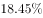
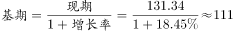
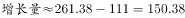

# 基期量反推+跨期增长量计算

考点：[[20-考点/资料分析/增长/基期量反推+跨期增长量计算|增长 / 基期量反推+跨期增长量计算]]
材料：[[15-材料/资料分析/187072 某市2014年社会消费品零售总额（含|187072 某市2014年社会消费品零售总额（含]]

**问法模型**：题干问'与2009年（早于图表首年2010年）相比2014年的增量'→先用基期量=现期量/(1+增速)借2010年数据反推2009年，再用2014年总额减2009年基期求增量

## 推理链
1. 第1步：题干要求2009→2014年的增量，但统计图最早只给2010年（131.34亿元、增速18.45%），2009年数据必须反推
2. 第2步：套用基期量公式：2009年总额=2010年总额/(1+增速)=131.34/(1+18.45%)
3. 第3步：截位直除：131.34/1.1845≈110.9亿元（即2009年基期量）
4. 第4步：从图中读出2014年总额为五年最高的261.38亿元
5. 第5步：增长量=261.38−110.9≈150.5亿元
6. 第6步：与选项对照：150.5与C项150最接近（A为130、B为140、D为160），故选C

**最快解法**：⚡ 截位直除+首位估算：2009年≈131.34/1.18≈111，增量≈261.38−111≈150，直接锁定C；亦可用百化分18.45%≈2/11，基期≈131.34×11/13≈111，增量≈150

## 易错点
- ⚠ 最大陷阱：直接把图中最早的131.34亿元当成2009年数据，得增量261.38−131.34≈130，误选A；必须先除以(1+18.45%)反推2009年基期
- ⚠ 双轴图量纲陷阱：柱形（左轴亿元）与折线（右轴%）量纲不同，18.45%是增速，只能进基期公式的分母，不能与金额直接加减
- ⚠ 增量≠增速：不能按折线增速走势（13.20%、18.45%等）去估算增量，必须用金额之差

## 母题抽象
> 🧩 当题干出现'与某年相比……增量（该年早于图表首年）'时，先用基期量=现期量/(1+增速)借图表首年数据反推上一期基期，再用现期总额减基期，最后与选项对照取最接近值

**同类特征**：与2009年相比（基期早于图表首年）、增量最接近多少亿元、需反推基期量、柱线双轴图取数、跨五年总额比较

## 相关题
- [[10-真题/资料分析/倍数/2255818 现期倍数计算（需先反推未给出的基期量）|2255818]]（江西 2016，相关度1）
- [[10-真题/资料分析/增长/2033796 混合增长率（基期反推+线段法）|2033796]]（江苏 2016，相关度1）

---

### 题干
与2009年相比，2014年该市社会消费品零售总额增量最接近多少亿元？

### 选项
- A. 130
- B. 140
- C. 150　✅
- D. 160

### 官方解析

由题干“与2009年相比，2014年……增量最接近”，可判定此题为增长量计算问题。定位图表可得，2010年社会消费品零售总额为131.34亿元，增长率为，2014年社会消费品零售总额为261.38亿元。代入基期计算公式计算2009年数据，亿元，则2014年比2009年的亿元，与C项最接近。

故正确答案为C。

### 给定材料

        2014年，某市全年实现社会消费品零售总额261.38亿元，比上年增长。按经营地统计，城镇消费品零售总额为178.6亿元，比上年增长，乡村消费品零售总额82.78亿元，比上年增长。按消费形态统计，批发业增长，零售业增长。

        全年消费价格总水平比上年增长。其中家庭设备用品及维修服务类累计下降；食品类、烟酒类、衣着类、医疗保健及个人用品类、交通与通信类、娱乐教育文化用品及服务类、居住类累计分别上升、、、、、、。

