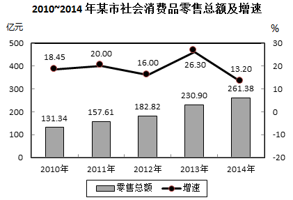

# 增长量比较（同比增长量趋势折线图判断）

考点：[[20-考点/资料分析/增长/增长量比较（同比增长量趋势折线图判断）|增长 / 增长量比较（同比增长量趋势折线图判断）]]
材料：[[15-材料/资料分析/187072 某市2014年社会消费品零售总额（含|187072 某市2014年社会消费品零售总额（含]]

**问法模型**：题干问'能准确反映2011-2014年同比增量的变化趋势的折线图' → 用相邻两年总额直接相减求各年增长量序列，再按'峰谷点+相对高低'与选项折线比对

## 推理链
1. 第1步：从柱线图提取各年零售总额（现期值）：2010年131.34、2011年157.61、2012年182.82、2013年230.90、2014年261.38亿元
2. 第2步：增长量=相邻两年总额之差（增长量=现期-基期，逐对相减，不涉及图中增速%）
3. 第3步：代入计算：2011年增量=157.61-131.34=26.27亿元；2012年=182.82-157.61=25.21亿元；2013年=230.90-182.82=48.08亿元；2014年=261.38-230.90=30.48亿元
4. 第4步：定峰值：2013年增量48.08亿元为四年最高（折线在第三点达峰），排除峰值不在2013的选项
5. 第5步：定次高关系：2014年30.48>2011年26.27且>2012年25.21，排除C、D
6. 第6步：定微差：2011年26.27略高于2012年25.21（前两点微降），B项不符，排除B，故选A

**最快解法**：⚡ 增长量比较+截位尾数相减：四组相邻相减得26.27、25.21、48.08、30.48，只需抓三个特征点即可秒选——①2013年（第三点）最高、②2014年高于2011和2012、③2011年略高于2012年，对应A

## 易错点
- ⚠ 增量≠增速：若按图中增速折线走势（20.00%→16.00%→26.30%→13.20%）选图必错，2014年增速最低但增量30.48亿元反而高于2011、2012年
- ⚠ 柱线双轴量纲混淆：柱形（左轴亿元）与折线（右轴%）刻度不同，不能凭图形直观高低判断，必须用柱形数值相减
- ⚠ 末两点微差陷阱：2011与2012增量仅差约1.06亿元，粗看近似持平，需精确相减才能确认2011>2012从而排除B；另勿误用2010年作基期算累计增量

## 母题抽象
> 🧩 当题干出现'同比增量的变化趋势/折线图'特征时，用相邻两期现期值直接相减得增量序列，再以'最高点位置、两端高低关系、相近点微差'三特征与选项比对验证

**同类特征**：同比增量、变化趋势、折线图、2011-2014年区间、相邻两年总额相减、图形选项需数值验证

## 相关题
- [[10-真题/资料分析/增长/5893795 同比增量计算与折线趋势比对（增长量比较）|5893795]]（国考 2024，相关度3）
- [[10-真题/资料分析/增长/10297072 同比增长量计算与折线趋势匹配|10297072]]（天津 2025，相关度3）
- [[10-真题/资料分析/增长/5445750 增长量比较（逐年同比增量序列与折线趋势判定）|5445750]]（国考 2023，相关度3）
- [[10-真题/资料分析/增长/5445763 增长量比较（同比增量折线趋势识别）|5445763]]（国考 2023，相关度3）
- [[10-真题/资料分析/增长/5894970 增长量比较（同比增量逐年差分与折线趋势匹配）|5894970]]（国考 2024，相关度3）

---

### 题干
能准确反映2011-2014年间该市社会消费品零售总额同比增量的变化趋势的折线图是：

### 选项
- A. 

　✅
- B. 

- C. 

- D. 

### 官方解析
由题干“同比增量的变化趋势”，可判定此题为增长量比较问题。定位图表，可得2010-2014年历年零售总额数据，根据增长量公式：，可得：
；
；
；
。
观察数据可知，2013年（第三年）增量最高，2014年比2011和2012年都高，排除C、D项；2011和2012年很接近，但2011年要比2012年高，所以排除B项。
故正确答案为A。

### 给定材料

        2014年，某市全年实现社会消费品零售总额261.38亿元，比上年增长。按经营地统计，城镇消费品零售总额为178.6亿元，比上年增长，乡村消费品零售总额82.78亿元，比上年增长。按消费形态统计，批发业增长，零售业增长。

        全年消费价格总水平比上年增长。其中家庭设备用品及维修服务类累计下降；食品类、烟酒类、衣着类、医疗保健及个人用品类、交通与通信类、娱乐教育文化用品及服务类、居住类累计分别上升、、、、、、。

