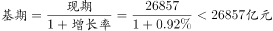

# 基期量计算（环比基期）

考点：[[20-考点/资料分析/增长/基期量计算（环比基期）|增长 / 基期量计算（环比基期）]]
材料：[[15-材料/资料分析/187090 2016年6月及2016年1~6月我|187090 2016年6月及2016年1~6月我]]

**问法模型**：题干所求时间（2016年5月）比材料现期（2016年6月）早一个月 → 环比基期模型：基期量 = 现期量 ÷ (1 + 环比增速)

## 推理链
1. 第1步：锁定口径——题干求2016年5月全国社会消费品零售总额，材料第一段现期为2016年6月（26857亿元），故6月是'现期'、5月是待求'基期'，两者相邻月份，对应增速是'环比'而非'同比'
2. 第2步：从材料第一段提取数据：现期量26857亿元，6月环比增速r（试卷完整版约0.9%，本材料文本中该数值空缺，实际代入须以原卷为准）
3. 第3步：套用基期公式：2016年5月总额 = 26857 ÷ (1 + r)
4. 第4步：定性排除——r是很小的正数，基期值应'只比26857小一点'：D.27104＞26857（环比正增长下不可能），A.24594、B.24283比26857小约9%~10%，相当于环比负增长近一成，均明显不符
5. 第5步：截位直除验证：26857 ÷ (1+0.92%) ≈ 26857 ÷ 1.0092 ≈ 26612亿元，与C完全吻合，故正确答案为C

**最快解法**：⚡ 选项差距定性法+截位直除：先判断环比增速是接近0的小正数，则5月基期值必然'略小于'6月的26857；四个选项中仅C.26612略小（D偏大、A/B小约一成），可直接秒选C；若需精算，26857÷1.0092≈26612亿元

## 易错点
- ⚠ 同比与环比混淆：本题必须用6月对5月的'环比'增速，若误用同比增速（约10%量级）会算出24200~24600量级，正中A、B选项设计
- ⚠ 基期现期方向颠倒：误把6月当基期做乘法26857×(1+0.92%)≈27104，恰好落入D选项陷阱
- ⚠ 当月值与累计值口径混淆：26857亿元是6月当月值，勿错取1~6月累计的156138亿元；且本材料文本所有增速数值空缺，代入的环比增速须以试卷完整版为准，不得凭空编造

## 母题抽象
> 🧩 当题干出现'求上一月/上一期数值'而材料给出现期值与环比增速时，用基期量=现期量÷(1+环比增速)；先用'正增速→基期略小于现期'做方向定性排除选项，再截位直除验证数值

**同类特征**：题干时间早于材料现期（5月 vs 6月）、相邻月份求基期、环比增速代入、约为（估算语气）、社会消费品零售总额（当月口径）、增速数值题干未直接给出

## 相关题
- [[10-真题/资料分析/增长/16070229 增长量计算（环比增量=现期量−基期量）|16070229]]（湖北 2026，相关度1）

---

### 题干
2016年5月份，全国社会消费品零售总额约为：

### 选项
- A. 24594亿元
- B. 24283亿元
- C. 26612亿元　✅
- D. 27104亿元

### 官方解析

材料中给出的时间为2016年6月，题干中的时间为2016年5月，可知，本题为基期计算问题。根据“2016年5月份，全国社会消费品零售总额”定位第一段材料，定位数据，“2016年6月份，我国社会消费品零售总额26857亿元，环比增长”，代入基期计算公式，，排除D选项，因为数值较小，影响较小，所以计算结果只比26857小一点。

故正确答案为C。

### 给定材料

        2016年6月份，我国社会消费品零售总额26857亿元，同比增长，环比增长。其中，限额以上单位消费品零售额13006亿元，同比增长。 

        2016年1~6月份，我国社会消费品零售总额156138亿元，同比增长。其中，限额以上单位消费品零售额71075亿元，同比增长。

        按经营单位所在地分，2016年6月份，城镇消费品零售额23082亿元，同比增长；乡村消费品零售额3775亿元，同比增长。1~6月份，城镇消费品零售额134249亿元，同比增长；乡村消费品零售额21889亿元，同比增长。

        按消费类型分，2016年6月份，餐饮收入2907亿元，同比增长；商品零售23951亿元，同比增长。1~6月份，餐饮收入16683亿元，同比增长；商品零售139455亿元，同比增长。

        2016年1~6月份，全国网上零售额22367亿元，同比增长。其中，实物商品网上零售额18143亿元，同比增长。

> [!warning] 疑点（官方解析可能有误，待人工复核）
> 材料文本中6月环比增速数值空缺，官方解析也未写明代入的具体增速值；由正确答案26612亿元反推环比增速约为0.92%。解析'结果只比26857小一点'的定性排除逻辑成立，但代入计算环节表述不完整，实际做题须以试卷完整版增速数值为准。

<!-- CODEX-ANSWER-REVIEW:BEGIN -->
### 本次独立复核

**复核状态：** `resolved`（答案与解析已核定）

**计分答案：** C（可计分）

**复核解析：**

2016年6月社零26857亿元，图中环比增长0.92%。5月=26857/1.0092≈26612亿元，选C。

**相关信息：**

环比基期回推使用单月环比率，不用同比率或累计值。

**题源依据：** [固定版本原题](https://github.com/Mentat-Uran/kaogongzhentizhengliu/blob/84ab93d4b64b61d897bece8a1c0a5bab06b4feb2/10-%E7%9C%9F%E9%A2%98/%E8%B5%84%E6%96%99%E5%88%86%E6%9E%90/%E5%A2%9E%E9%95%BF/2051374%20%E5%9F%BA%E6%9C%9F%E9%87%8F%E8%AE%A1%E7%AE%97%EF%BC%88%E7%8E%AF%E6%AF%94%E5%9F%BA%E6%9C%9F%EF%BC%89.md)；固定内容 commit `84ab93d4b64b61d897bece8a1c0a5bab06b4feb2`，Markdown blob `b8230dd5f33a15ad989208c2ffe758703b6f6cd9`。
<!-- CODEX-ANSWER-REVIEW:END -->
