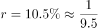
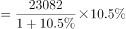
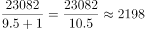

# 增长量计算（同比、当月口径）

考点：[[20-考点/资料分析/增长/增长量计算（同比、当月口径）|增长 / 增长量计算（同比、当月口径）]]
材料：[[15-材料/资料分析/187090 2016年6月及2016年1~6月我|187090 2016年6月及2016年1~6月我]]

**问法模型**：题干出现'比上年同期增加'+选项带单位'亿元' → 增长量计算模型：增长量=现期量×r/(1+r)（百化分后即现期/(n+1)）

## 推理链
1. 第1步：题干锁定口径为'2016年6月'当月值，取材料第三段'2016年6月份，城镇消费品零售额23082亿元，同比增长'（增速数值在所给文本中空缺，须以试卷完整版为准，由官方解析结果反推约为10.5%）
2. 第2步：选项均带单位'亿元'，判定为增长量计算，公式：增长量=现期量×r/(1+r)
3. 第3步：代入计算：23082×10.5%/1.105=2423.61/1.105≈2193亿元（百化分近似：10.5%≈1/9.5，增长量≈23082/(9.5+1)=23082/10.5≈2198亿元，略偏大）
4. 第4步：与选项对照：精确值≈2193亿元与D项2193亿元最接近（B项2169亿元为精度干扰项），故选D

**最快解法**：⚡ 百化分+截位直除：增速10.5%≈1/9.5，增长量=23082/(9.5+1)=23082/10.5≈2198，方向确认偏大后落点指向D（2193）；若需精算，用23082×0.105/1.105≈2193直接锁定D。注意B(2169)与D(2193)数值接近，近似值2198虽偏大但距离D更近，可安全排除B

## 易错点
- ⚠ 当月值与累计值混排陷阱：必须用6月当月值23082亿元，若误取1~6月累计城镇值134249亿元，数量级完全错误
- ⚠ '其中'包含关系陷阱：城镇23082只是6月总额26857的一部分，不能误用总额26857或乡村3775计算
- ⚠ 精度与口径双重陷阱：①B(2169)与D(2193)接近，百化分近似值约2198偏大，需确认其距D更近方可排除B；②所给材料文本增速数值缺失，须以完整试卷增速（约10.5%）代入，不得凭空编造

## 母题抽象
> 🧩 当题干出现'比上年同期增加'+选项带单位（亿元）特征时，先锁定现期值与对应口径（当月/累计）的同比增速，用百化分'增长量=现期/(n+1)'速算，再验证最接近的选项即可

**同类特征**：'比上年同期增加'、选项带单位'亿元'、当月口径（6月份）而非累计（1~6月）、现期值23082亿元、同比增速代入（约10.5%）、增长量计算

## 相关题
- [[10-真题/资料分析/增长/7159 增长量计算|7159]]（北京 2009，相关度1）
- [[10-真题/资料分析/增长/2571729 增长量计算——每增长1个百分点对应的增量（基期量×1%）|2571729]]（山东 2020，相关度1）
- [[10-真题/资料分析/增长/3018839 增长量计算（负增长情形：基期减少量）|3018839]]（广东 2021，相关度1）
- [[10-真题/资料分析/增长/10204654 增长量计算（已知现期与同比下降率求下降量）|10204654]]（安徽 2024，相关度1）
- [[10-真题/资料分析/增长/13319362 现期增长量计算（已知现期值与同比增速，用r-(1+r)公式）|13319362]]（江苏 2025，相关度1）

---

### 题干
2016年6月份，城镇消费品零售额比上年同期增加：

### 选项
- A. 380亿元
- B. 2169亿元
- C. 1193亿元
- D. 2193亿元　✅

### 官方解析

由题干求“2016年6月份，城镇消费品零售额比上年同期增加”，选项带单位“亿元”可知，本题为增长量计算。根据“2016年6月份，城镇消费品零售额”，定位材料第三段，“2016年6月份，城镇消费品零售额23082亿元，同比增长”，，代入增长量计算公式，亿元，与D项最接近。

故正确答案为D。

### 给定材料

        2016年6月份，我国社会消费品零售总额26857亿元，同比增长，环比增长。其中，限额以上单位消费品零售额13006亿元，同比增长。 

        2016年1~6月份，我国社会消费品零售总额156138亿元，同比增长。其中，限额以上单位消费品零售额71075亿元，同比增长。

        按经营单位所在地分，2016年6月份，城镇消费品零售额23082亿元，同比增长；乡村消费品零售额3775亿元，同比增长。1~6月份，城镇消费品零售额134249亿元，同比增长；乡村消费品零售额21889亿元，同比增长。

        按消费类型分，2016年6月份，餐饮收入2907亿元，同比增长；商品零售23951亿元，同比增长。1~6月份，餐饮收入16683亿元，同比增长；商品零售139455亿元，同比增长。

        2016年1~6月份，全国网上零售额22367亿元，同比增长。其中，实物商品网上零售额18143亿元，同比增长。

> [!warning] 疑点（官方解析可能有误，待人工复核）
> 所给材料文本及官方解析中该同比增速数值均空缺；由官方解析结果（≈2193亿元）反推，2016年6月城镇消费品零售额同比增速约为10.5%，代入23082×10.5%/1.105≈2193亿元恰与D项吻合；官方解析结论与答案一致无矛盾，仅提示做题须以完整试卷增速数值为准
